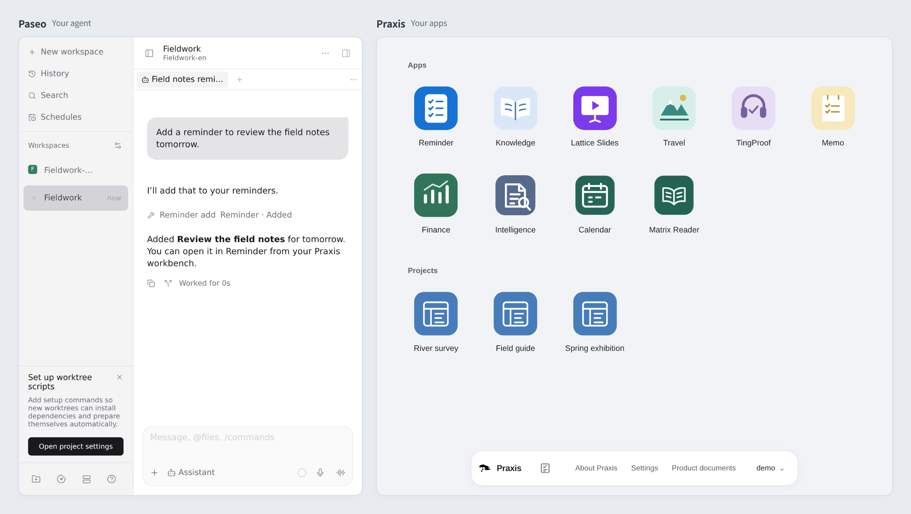

#  Praxis

[简体中文](README.zh-CN.md) · [Quickstart](#quickstart) · [Run local Praxis](#run-local-praxis) · [Connect to Praxis](#connect-to-praxis) · [Contribute](#contribute)

**Praxis is a self-hosted platform where the AI agent you choose is your interface to your apps.** With any MCP-compatible agent harness, you can ask your agent to find a passage in your notes or update a task. You decide which records it can access and what it can do. Whether you run Praxis for yourself, your family, a team, or an organization, you can use its 14 built-in apps for knowledge, projects, travel, finance, and more. You can also build your own apps and host them yourself.



## Quickstart

To try Praxis before setting up your own instance, paste this prompt into your agent to connect to our online service.

> Connect to Praxis at https://polaris.jianxiaoyitech.com/mcp using OAuth. Help me sign in and choose what you may access, then show my available apps and tools.

A Praxis account is required for the online service. Self-service account registration is planned.

### Run local Praxis

Install Git, Docker Engine and Docker Compose v2.

```sh
git clone --recurse-submodules https://github.com/55aaseclab/praxis.git
cd praxis
docker compose up --build -d --wait
```

Compose builds and starts all 14 built-in apps with the workbench, native app services, identity and authorized business endpoints. First startup generates the owner account, service keys and persistent application stores.

Retrieve the initial login details from this installation:

```sh
docker compose exec core node scripts/builtin-install.mjs credentials
```

Open [Praxis](http://127.0.0.1:4321/) and sign in. App and resource permissions apply to both browser access and agent operations. Keep the generated account details private. `docker compose down` stops the stack while preserving its data volumes. [Running Praxis](docs/RUNNING.md) · [Built-in apps](docs/BUILTINS.md) · [Managed deployment](docs/MANAGED-DEPLOYMENT.md)

### Connect to Praxis

1. **Connect your agent.** Copy this prompt into your agent.

   ```text
   Connect to my local Praxis at http://127.0.0.1:4321/mcp. Help me sign in and request permission to read and create reminders.
   ```

2. **Sign in and authorize access.** Open the sign-in link, use the account created when you started Praxis, and approve the requested Reminder access.

3. **Start your first task.** Ask your agent.

   ```text
   Remind me tomorrow to review the field notes.
   ```

   Open [the workbench](http://127.0.0.1:4321/), select **Reminder → All**, and check the saved reminder.

You can review or revoke your agent's access in **Settings → Agent delegations**.

## Contribute

Platform and app contributions are welcome. Submit app changes to the owning repository and update its pinned revision in Praxis. Run focused checks for small changes and `npm test` for integration changes.

[Contribution guide](CONTRIBUTING.md) · [App standard](docs/APP-STANDARD.md) · [Requirements](docs/PRD.en.md) · [Roadmap](docs/ROADMAP.en.md)

[Documentation index](docs/README.md) · [Product positioning](docs/COMPETITIVE-POSITIONING.md) · [How the logo grows](docs/LOGO.md) · [Apache 2.0 license](LICENSE)
