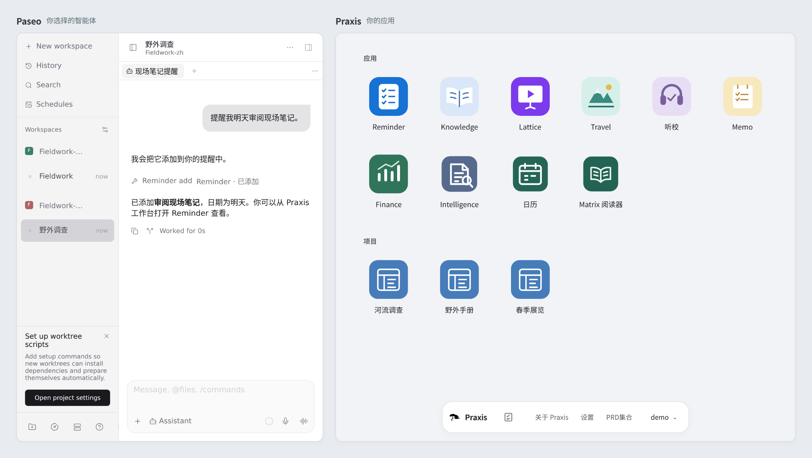

#  Praxis 工作台

[English](README.md) · [快速开始](#快速开始) · [连接 Praxis](#连接-praxis) · [参与贡献](#参与贡献)

**Praxis 是一个可自托管的平台，你可以通过自己选择的 AI 智能体使用各种应用。** 在任何兼容 MCP 的智能体运行环境中，你都可以让智能体从笔记里找出一段原文，或更新一项任务。它能访问哪些记录、执行哪些操作，都由你决定。无论是个人或家庭使用，还是为团队或组织部署，你都可以用 Praxis 的 14 款内置应用整理知识、管理项目、规划旅行、记录收支。你也可以开发自己的应用并自行托管。如果想在部署前先体验 Praxis，欢迎访问我们的[在线工作台](https://polaris.jianxiaoyitech.com/)。




## 快速开始

安装 Git、Docker Engine 和 Docker Compose v2。

```sh
git clone --recurse-submodules https://github.com/55aaseclab/praxis.git
cd praxis
docker compose up --build -d --wait
```

打开[工作台](http://127.0.0.1:4321/)。镜像包含日历与 Matrix 阅读器，可通过主页按钮返回工作台。需要账号和已授权业务操作的安装环境，还需配置身份与应用服务。[运行说明](docs/RUNNING.md) · [内置应用](docs/BUILTINS.md) · [受管部署](docs/MANAGED-DEPLOYMENT.md)

运行 `docker compose down` 停止这套本机工作台。

## 连接 Praxis

在支持 Streamable HTTP MCP 和 OAuth 的智能体客户端中，将 Praxis 添加为远程服务。

```text
https://polaris.jianxiaoyitech.com/mcp
```

在浏览器中登录，选择智能体可以访问的记录及执行的操作。可在**设置 → 智能体委托**中查看或撤销授权。自托管环境配置好身份与应用服务后，使用自己的 Praxis HTTPS 地址并在末尾加上 `/mcp`。

账号有 Knowledge 权限时，你可以问 **「现场笔记里说，哪些采样点还需要再去一次？」** 智能体可以检索获准文库、回读相关段落并引用出处。你可以在 Knowledge 中打开原文核对。[Knowledge 工具](skills/knowledge-mcp/SKILL.md)

<details>
<summary>在本机体验公共连接指南</summary>

在本机工作台之外，启动可选的指南服务。

```sh
docker compose --profile guide up -d --wait
```

将客户端连接到 `http://127.0.0.1:4181/mcp/guide`，也可以用 curl 查看两项公共工具。

```sh
curl -fsS http://127.0.0.1:4181/mcp/guide \
  -H 'Content-Type: application/json' \
  -H 'Accept: application/json, text/event-stream' \
  -d '{"jsonrpc":"2.0","id":1,"method":"tools/list"}'
```

`praxis_about` 和 `praxis_use_guide` 返回公共说明。业务操作需要上文所述的安装配置及用户授权。运行 `docker compose --profile guide down` 停止两个服务。

</details>

## 参与贡献

欢迎为平台及应用作贡献。应用改动提交到所属仓库，再更新 Praxis 中的固定版本。小改动运行定向检查，集成变更运行 `npm test`。

[贡献指南](CONTRIBUTING.md) · [应用标准](docs/APP-STANDARD.md) · [产品需求](docs/PRD.md) · [路线图](docs/ROADMAP.md)

[文档目录](docs/README.md) · [竞品分析](docs/COMPETITIVE-POSITIONING.md) · [标志生成方法](docs/LOGO.md#简体中文) · [Apache 2.0 许可证](LICENSE)
