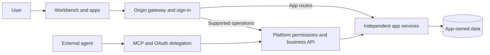

# Praxis platform manual

English · [简体中文](PLATFORM.md)

Praxis provides one workbench, permission system and set of business APIs. Each app owns its code and stores its own business records. External agents interpret requests, select tools and plan work. The platform keeps identity and grant metadata, events, redacted audit records and a queue for replicas. [Product requirements](PRD.en.md) · [Roadmap](ROADMAP.en.md) · [UI/UX guide](UI-UX.md)

## Workbench and apps

Open the [Praxis workbench](https://polaris.jianxiaoyitech.com/). HTTP on port 4321 redirects to canonical HTTPS on the deployed host. The legacy paths `/business`, `/business/` and `/business.html` also lead to the workbench. App-specific routes such as `/business/reminder/` serve the managed view of that app.

Each signed-in user gets a workbench. Administrators see default application entries. Project records require separate resource access. Other users see only granted entries, and a new account may see an empty workbench. Project access comes from Projects, which opens the corresponding overview. Project reference documents open from the corresponding Materials view. The destination service checks access again.

Use the bottom bar to switch between Apps and For you. Apps shows application and project launchers. For you shows permitted tasks and project work as cards with links to their sources. External agent clients connect through their own interfaces and authorized MCP connections. New local-only apps follow the development manifest contract. [External Paseo client](PASEO.md) · [App standard](APP-STANDARD.md)

Apps and projects open in the current tab. Browser Back returns to the previous view. The workbench account menu offers account information and sign-out. Open **Settings → General → Language** to choose English or Simplified Chinese for this browser. In a managed installation, signed-in users can also review their access and delegations in Settings. Administrators also manage accounts, grants, connections and system status. When an entry expires, the workbench withdraws the icon, associated PRD and access. The server checks direct URLs too. Managed private app pages have a Home button at bottom left that returns to the workbench in the same tab. Allow room for it on phones. Standalone apps and public shares retain their own navigation.

| App | Managed entry | Service port | Source |
| --- | --- | ---: | --- |
| Reminder | `/apps/reminder/` | 4322 | `third_party/reminder` |
| Travel | `/apps/travel/` | 4323 | `third_party/travel` |
| Knowledge | `/apps/knowledge/` | 14324 | `third_party/knowledge` |
| Memo | `/apps/memo/` | 4325 | `third_party/memo` |
| Lattice | `/apps/slides/` | 14666 | `third_party/lattice` |
| TingProof | `/apps/tingproof/` | 15173 | `third_party/tingproof` |
| Projects | `/apps/projects/` | 4327 | `third_party/projects` |
| Intelligence | `/apps/intelligence/` | 4330 | `third_party/intelligence` |
| Polaris | `/apps/polaris/` | 18787 | `third_party/polaris` |
| Matrix Reader | `/apps/matrix-reader/` | Web slot | `third_party/matrix-reader` |
| Calendar | `/apps/calendar/` | Web slot | `third_party/calendar` |
| Letters | `/apps/letters/` | Web slot | `third_party/letters` |
| Profiles | `/apps/profiles/` | Web slot | `third_party/profiles` |

The table gives the managed gateway targets. Standalone Knowledge, Lattice and TingProof use ports 4324, 4666 and 5173, respectively. The production gateway on 14321 forwards to fixed local targets. The managed core backend listens on loopback port 4326. App-specific publishing ports, mounts and probes appear in the Docker guide. Knowledge serves notes, books and project reference documents. Legacy Knowledge and Travel URLs use authorized redirects. The Letters and Profiles readers use separate read-only document mounts. Both require the configured owner’s administrator session. The Polaris entry is an administrator-only read-only observation viewer. [Deployment guide](DOCKER.en.md)



The installation index `config/installed-apps.json` contains only reviewed app source references; each app owns its presentation and release version in `praxis-app.json`. The PRD collection reads only documents listed by the app-owned `praxis-app.json` document declaration. Use `git submodule update --init third_party/<app>` for a required app. The thirteen pinned app commits are publicly fetchable; the retired Finance repository and documents are recorded in [REPOSITORIES.md](REPOSITORIES.md). [Source inventory](REPOSITORIES.md)

## Operations

For a local installation, start the workbench with `npm start` and use `npm run app:demo -- <app>` for an isolated service-backed demo. The earlier installation used a one-shot `run-stack` task. For an existing managed installation, use `node scripts/managed-compose.mjs status apps` for app services and `npm run deploy -- status` for blue/green slots. [Managed deployment](MANAGED-DEPLOYMENT.md) · [Docker guide](DOCKER.en.md)

| Topic | Details |
| --- | --- |
| User, entry, space and OAuth permissions | [Identity and authorization](BUSINESS-AUTH.en.md) |
| Services, mounts, immutable releases and rollback | [Docker](DOCKER.en.md) |
| Local data, snapshots, encrypted copies, replacement hosts and NAS | [Storage](STORAGE.en.md) |
| Business metadata and changing backup coverage | [Business storage](BUSINESS-STORAGE.en.md) |
| Single sign-on and the fixed external gateway | [Unified login](UNIFIED-LOGIN.en.md) |
| Read-only management status | [Platform status](PLATFORM-STATUS.en.md) |
| Redacted usage and performance observations | [Observability](OBSERVABILITY.en.md) |
| External agents, physical phones, Docker and cloud acceptance | [Verification ledger](VERIFICATION.en.md) |

The deployment operator owns the private forwarding configuration. Credentials and generated configuration stay on the deployment host. Travel sharing grants access to a specific trip and its allowed assets for a revocable period. A dedicated TingProof account sees TingProof in its workbench. Task assignment and access to individual segments are separate checks. [Gateway configuration](UNIFIED-LOGIN.en.md)

Each app has an active working data set, consistent snapshots and independent encrypted copies. Browser-only Memo records require an explicit export. Register original TingProof audio separately. For a new NAS or cloud target, copy the snapshot, check integrity and restore into an empty directory before switching.

## 1. Services and entry points

| Component | Source or entry | Responsibility |
| --- | --- | --- |
| Core backend | `src/business/server.mjs` | Managed app views, API, MCP and identity endpoints |
| Identity and delegation | `src/business/auth.mjs` | User, space and resource scope, authentication, OAuth, revocation and policy locking |
| Settings | `${issuer}/admin/`, `src/business/admin.mjs` | Account administration, website grants and revoking delegations |
| App bridge | `src/business/bridge.mjs` | Fixed signed app operations |
| Events and replica queue | `src/business/events.mjs` | Committed app events, scoped subscriptions and durable replication work |
| Maintenance CLI | `scripts/business-admin.mjs` | Initial configuration, memberships, grants and private credentials |
| Replication worker | `scripts/business-sync-worker.mjs` | Consume the queue using the storage coordinator |

For a controlled development instance:

```sh
npm run core -- --config /absolute/private/business.json --host 127.0.0.1 --port 4326
npm run core:admin -- status --config /absolute/private/business.json
```

Use an explicit HTTPS origin as the production OAuth issuer. Loopback HTTP is available for local development and isolated tests. A bind address such as `0.0.0.0` describes a listener. The workbench is at `${issuer}/`. The managed endpoints `/business/reminder/` and `/business/tingproof/` return app-specific HTML. Shared `app-transport.js` provides authentication, calls and events. The MCP endpoint is `${issuer}/mcp`. Verify public routing separately from local process startup.

Anyone with a valid website account can open Settings for their own access and agent delegations. Platform administrators can also administer users and global status. Browser actions use the person's existing permissions. External agents use explicit OAuth delegation within the current app and resource boundaries. [Identity guide](BUSINESS-AUTH.en.md)

The preferred platform backend commands are `core`, `core:admin` and `core:stack`. Older `business` command names remain compatibility aliases. Existing source paths, configuration filenames and `/api/business` routes remain supported.

## 2. Private configuration and credentials

Supply the private configuration path with `PRAXIS_BUSINESS_CONFIG` or `--config`. An installation can keep its existing `~/.config/praxis/business.json`. Use a regular, mode-600 file. Keep the identity database, event database and signing keys in a private directory outside Git.

This example uses placeholder paths and space IDs:

```json
{
  "issuer": "https://your-existing-domain.example",
  "database": "/absolute/private/state/auth.db",
  "eventsDatabase": "/absolute/private/state/events.db",
  "allowedHosts": ["127.0.0.1:4326", "localhost:4326"],
  "allowedOrigins": [],
  "apps": {
    "reminder": {
      "url": "http://127.0.0.1:4322/api/business",
      "keyFile": "/absolute/private/secrets/business-reminder.key",
      "spacesFile": "/absolute/private/reminder-business-spaces.json",
      "spaces": ["opaque-personal-space-id"]
    },
    "tingproof": {
      "url": "http://127.0.0.1:5173/api/business",
      "keyFile": "/absolute/private/secrets/business-tingproof.key",
      "spaces": ["opaque-company-space-id"]
    }
  }
}
```

Set `issuer` to an origin without a path, query, fragment or credentials. Explicitly configure allowed hosts and origins. Cookie-authenticated writes require an Origin matching the issuer and a valid CSRF token. Forwarded headers and `allowedOrigins` do not grant an exception.

The operator fixes each adapter's host and `/api/business` path. Use a separate HMAC key of at least 32 bytes for each app. Keep signing keys, app passwords, access and refresh tokens, and owner credentials out of logs, prompts, images and commits.

## 3. Website management and bootstrap

Sign in and open Settings or `${issuer}/admin/`. The Users view manages accounts, status, password resets and platform administrator status. Entry policies grant individual apps, PRDs and expiration. A newly created user can sign in to an empty workbench. Administrators get default website entries. App resource checks still control access to private records. Review and revoke agent delegations in **Settings → Agent delegations**.

Only administrator browser sessions can access `/api/business/admin/*`. The account endpoints at `/api/business/account/*` take their user identity from the current browser session. Both sets require same-origin CSRF checks for writes. Password resets invalidate old sessions and delegations. The last active administrator must retain administrative access.

The maintenance CLI bootstraps identity metadata and private configuration without importing Reminder tasks. Map the active data file explicitly:

```sh
npm run core:admin -- init \
  --config /absolute/private/business.json \
  --issuer https://your-existing-domain.example \
  --reminder-data /absolute/active/reminder/checklist.json \
  --state-root /absolute/private/state \
  --username owner
```

Initialization creates new files, prints their locations and preserves existing configuration. Its output includes identity and event database paths, a personal space, separate app signing keys, the Reminder space-to-file mapping and a private `business-owner.json` for browser login.

Other maintenance commands include `user-create`, `space-create`, `member-set`, `permission-grant`, `client-create`, `grant-create`, `grant-revoke`, `token-issue` and `status`. Provide mutations in a mode-600 regular file with `--spec /absolute/private/spec.json`. For `token-issue`, specify `--out` to write credentials into a new private file. Authorized business users and their agents operate app data via API or MCP. Space administrators use the scoped management API for membership and sharing.

## 4. Managed independent apps

### Reminder

Set `REMINDER_MANAGED=1`, `REMINDER_BUSINESS_KEY_FILE` and `REMINDER_BUSINESS_SPACES_FILE`. Example space file:

```json
{
  "spaces": {
    "opaque-personal-space-id": "/absolute/active/reminder/checklist.json",
    "opaque-family-space-id": "/absolute/active/reminder/family-checklist.json"
  }
}
```

Give each space its own canonical data path. The schema-v2 adapter uses the app's store with stable resource IDs, revisions, durable idempotency and commit events. Managed deployments reject raw routes including the old whole-database `/api/data` and disable direct-file CLI business operations. Internal `/api/business` requests require a valid signed context. Test the approved six-card views, data-driven weekly calendar and statistics against the app PRD.

### TingProof

Set `TINGPROOF_MANAGED=1` and `TINGPROOF_BUSINESS_KEY_FILE`; select the working directory with `TINGPROOF_DATA_DIR`. The adapter exposes assigned tasks, permitted segments and correction submissions. Owners supply authorized projects and segment IDs for creation or assignment. A task grant does not include the entire project inventory, separate tasks, original audio or exports. Verify project discovery, assignment, managed view behavior and submission independently.

### Internal signatures

The business bridge signs a short-lived assertion binding the app, user, client, grant, space, action, resource, request ID, HTTP method, fixed path, body digest and deadline. The app checks the signature on entry and checks the deadline again before committing. When enabling managed mode, verify development and production services, public replicas, direct listening ports and legacy routes. Each independently runnable app retains its own storage and behavior.

## 5. Business API and browser views

| Path | Purpose |
| --- | --- |
| `/health` | GET health and version metadata |
| `/` | User workbench |
| `/business/` | Workbench in gateway mode; independent development entry otherwise |
| `/business/reminder/`, `/business/tingproof/` | GET app-specific managed views |
| `/api/business/catalog` | GET spaces and actions allowed for the current identity |
| `/api/business/invoke` | POST a fixed app action; cookie requests require CSRF |
| `/api/business/events?spaceId=...&appId=...` | GET committed events and a reconnect cursor |
| `/api/business/management/spaces/:spaceId/...` | Scoped membership, sharing and delegation management |

The invocation shape is `{appId,operation,spaceId,resourceId?,sourceResourceId?,input?,expectedRevision?,idempotencyKey?}`. Routine logs use `sourceResourceId`. Ordinary resource operations use `resourceId`. Trust the authenticated credentials for identity and use the actual resource IDs and revisions returned by the service.

Use a stable idempotency key for a write. Reusing it with different input is rejected. Read the latest revision before merging a conflict. After a timeout, lost response or `OUTCOME_UNKNOWN`, retry with the original key and read back the outcome. If authorization changes after a commit, the error can include `committed` and request correlation information.

Events follow the app commit. The server checks current permissions at delivery. A client reconnects with its durable cursor or refreshes authorized state when the cursor expires. Offline views are read-only in this release.

## 6. MCP, OAuth and phones

For public onboarding, send requests to `POST ${issuer}/mcp/guide`. The read-only tools `praxis_about` and `praxis_use_guide` explain the platform, connection options and how to add a workbench shortcut. Recognized platform values include `ios_safari`, `android_chrome`, `desktop` and `other`. The user confirms installation in their browser. The public service exposes only its fixed guidance.

Public tool results default to English. Send the HTTP header `Accept-Language: zh-CN` for Simplified Chinese. The same schemas and fixed URLs apply. Skills advertised through MCP resources contain English first and the corresponding Chinese instructions in the same document.

The MCP section in Settings shows registered capabilities, adapter configuration and recent usage for administrators. A registration or past call is separate from a current health check.

The protected service at `POST ${issuer}/mcp` uses the official SDK's stateless Streamable HTTP JSON transport. Each call presents a Bearer credential bound to a user, client and scope. Tool discovery filters by current authority and execution checks authority again. Record the actual protocol version from `initialize`. Examples include permitted Reminder listing, creation, completion, execution records and statistics, and TingProof task reading, assignment or correction submission. Consult live discovery for names and arguments. Business clients get no shell, direct files, SQL, deployment access or arbitrary network commands.

| Endpoint | Purpose |
| --- | --- |
| `/.well-known/oauth-protected-resource/mcp` | Discover the protected resource and authorization service |
| `/.well-known/oauth-authorization-server` | Discover authorization, token, revocation and registration endpoints |
| `/oauth/authorize` | Sign in and select space, resources and permitted actions |
| `/oauth/token` | Exchange an authorization code with PKCE S256 and the exact resource audience, or rotate a refresh token |
| `/oauth/revoke` | Revoke a delegated credential |

Protected calls without credentials return 401 and resource-discovery information. Actual support from a third-party phone app, including Doubao or Qwen, must be verified on the device. A desktop MCP test, model API call or mobile browser page cannot establish that an independent phone client can connect, invoke a tool and honor revocation. [Identity guide](BUSINESS-AUTH.en.md)

## 7. Policy locking and revocation

The in-process FIFO `PolicyGate` serializes business execution with identity and management changes. A SQLite `BEGIN IMMEDIATE` transaction holds the cross-connection policy lease while the accepted operation can still commit. Authorization is rechecked before delivery.

An accepted action completes or its signed execution window expires before revocation commits. After a successful revocation response, the old grant must not commit new changes. Apps check the deadline immediately before a final commit. Canceling an HTTP client does not guarantee that downstream execution stopped.

A lock timeout returns HTTP 503 `POLICY_BUSY`. A business timeout leaves the outcome uncertain, so reuse the idempotency key and read it back. After permission withdrawal, subscriptions stop future deliveries. Previously delivered content may remain on the client's device.

## 8. Saves, subscriptions and replicas

App commit, visibility on another client and arrival in an encrypted cloud or NAS replica are independent states. Event collection coalesces nearby changes into persistent jobs. When synchronization fails, the worker records retry state while the app commit stays valid.

```sh
PRAXIS_BUSINESS_CONFIG=/absolute/private/business.json \
PRAXIS_STORAGE_CONFIG=/absolute/private/storage.json \
node scripts/business-sync-worker.mjs
```

Consult the worker's current help and source for arguments. The worker uses the storage coordinator for consistent snapshots and encrypted replicas. B01 specifies a real cloud round-trip check. A consumed queue item or synthetic replica test does not establish real cloud reachability or recovery. Docker application bindings and production cutovers follow the deployment guide. Real data changes require the designated business actor. [Storage contract](STORAGE.en.md) · [Docker guide](DOCKER.en.md)

## 9. Verification records

Current checkout checks include `node --test tests/workbench-http.test.mjs tests/app-launcher.test.mjs tests/private-document-access.test.mjs`. The browser scenarios below document the earlier implementation’s acceptance evidence.

| Check | Command or evidence | What it establishes |
| --- | --- | --- |
| Platform | `npm test` | Version and isolated behavior of the checked-out source |
| Development workbench | Historical development desktop browser suite | Development entry, PRD, responsive layout and legacy navigation |
| Authorization | `node --test tests/business-auth.test.mjs` | Identity, scopes, OAuth consent and token exchange, revocation and restart |
| Historical authorization suite | Pre-migration synthetic cases | Login rate limiting, space management and cross-process policy leases |
| Browser authorization | Historical isolated browser sign-in suite | Chromium sign-in, return path, scope selection, exchange and revocation on temporary services |
| App interface | Historical business browser scenarios | Scenarios in the isolated app fixture |
| Personalized workbench | Historical personalized workbench suite | Permission filtering, same-tab navigation, empty and expired states and status access |
| Reminder parity | Historical Reminder parity suite | Standalone and managed geometry, interaction and access on equal synthetic content |
| App adapter | `npm test` in the owning repository when provided | App transactions, schema, revisions, idempotency and managed route boundaries |
| Independent Paseo Codex | C01–X01 | Scoped MCP operations and cleanup under effective runtime isolation |
| Third-party phone app | M01–M03 | Independent physical-device connection and end-to-end business operation |
| Docker and cloud | D01/B01 | Actual service cutover and storage round trip |

[Verification ledger](VERIFICATION.en.md) · [UI/UX audit, 2026-11-19](UI-UX-AUDIT-2026-11-19.en.md)

The historical browser checks used `PLAYWRIGHT_MODULE` and `PLAYWRIGHT_CHROMIUM_EXECUTABLE`. For the development workbench, use `PRAXIS_URL` to select the target URL and hostname. A loopback-only check cannot cover the production Host allowlist. Use isolated fixtures for browser tests and keep real credentials and records out of screenshots, logs and version control.

For tests that require the user's own account or phone, provide the reachable URL, client settings, required scope, steps, expected result and the minimum redacted evidence. Record unexecuted cases separately from verified results.
