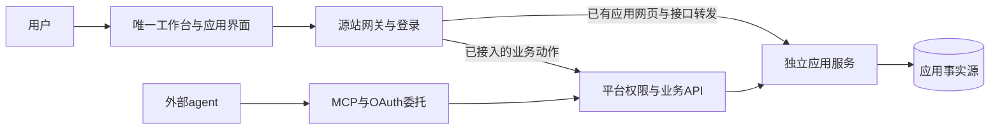

# Praxis 平台手册

[English](PLATFORM.en.md) · 简体中文

本手册统一工作台和原BUSINESS运行说明。**工作台是Praxis的用户界面，权限、API和MCP是支撑同一平台的后端能力，不是第二个产品或第二个用户工作台。** 前后端仍按职责分层运行，独立应用继续拥有各自代码和数据。

这是平台运行说明的统一入口；产品范围见[PRD](PRD.md)，排期见[路线图](ROADMAP.md)。实际部署、真实业务agent、手机App和云端验收以[验证台账](VERIFICATION.md)为准；文档存在或合成测试通过不代表未执行的验收完成。

Praxis 内部没有agent。外部客户端负责理解和编排，`core` 核心后端负责身份、权限、工具契约和所属应用调用。业务数据继续由独立应用保存，平台只保留身份/授权、事件、脱敏审计和副本队列等必要元数据。

设计和评审工作台及应用时，使用同一份 [Praxis UI/UX 设计指南](UI-UX.md)。

## 工作台与应用

统一用户入口是`https://polaris.jianxiaoyitech.com/`。本机HTTP4321入口在当前网关部署下跳转该地址，用户登录一次后进入工作台。旧`/business`、`/business/`和`/business.html`返回同一个工作台；`/business/reminder/`等路径是受管应用的技术路由，不代表另一套业务空间页面。

- 每个有效登录账号都有工作台；管理员有默认应用入口，项目记录另行验权，其他用户只看到获准入口，无应用时显示空态。
- 项目入口统一来自 Projects 的获授权项目列表，点击进入对应概览。项目引用的 Knowledge 资料位于相应的「资料」页，来源应用继续检查访问权限。
- 工作台采用启动台布局，以应用和项目图标为主体，使用系统字体、中性背景及紧凑导航，不强制侧栏。受管工作台按账号权限显示设置和 PRD 入口；应用和项目在当前标签页打开，可以后退。
- 在首页底部栏切换「应用」和「待关注」。「应用」展示应用与项目入口；「待关注」展示获准的任务和项目工作卡片，可从卡片回到来源。外部智能体通过各自的客户端和获授权的 MCP 连接使用应用，个人应用可用本地清单开发。[独立 Paseo 客户端](PASEO.md) · [应用标准](APP-STANDARD.md)
- 在独立或已登录的工作台打开**设置 → 通用 → 语言**，为当前浏览器选择 English 或简体中文。已登录的普通用户还可查看本人权限、管理本人的智能体委托。管理员可在**设置 → 状态概览**查看全局权限、连接、存储及体验线索。普通用户不请求全局概览信息。
- 应用入口到期会收回图标、PRD和相应访问，不把仍有效的登录伪装为退出。直接URL仍由服务端检查。
- 私有应用中的主页图标由Praxis系统层提供，同标签回到工作台；应用侧栏不承担平台账号操作。工作台点击用户名打开账户菜单，查看账号信息或退出；授权相关操作位于设置页。主页入口固定在左下角并留出安全区；遇到遮挡时调整对应业务控件。公开分享与独立运行沿用各自的导航。

| 应用 | 统一入口 | 应用服务端口 | 独立源码 |
|---|---|---:|---|
| Reminder | `/apps/reminder/` | 4322 | `third_party/reminder` |
| Travel | `/apps/travel/` | 4323 | `third_party/travel` |
| Knowledge | `/apps/knowledge/` | 14324 | `third_party/knowledge` |
| Memo | `/apps/memo/` | 4325 | `third_party/memo` |
| Slides | `/apps/slides/` | 14666 | `third_party/lattice` |
| 听校 | `/apps/tingproof/` | 15173 | `third_party/tingproof` |
| Projects | `/apps/projects/` | 4327 | `third_party/projects` |
| Intelligence | `/apps/intelligence/` | 4330 | `third_party/intelligence` |
| Polaris | `/apps/polaris/` | 18787 | `third_party/polaris` |
| 信件 | `/apps/letters/` | 网页槽 | `third_party/letters` |
| 个人资料 | `/apps/profiles/` | 网页槽 | `third_party/profiles` |

表内端口为受管网关的目标。独立运行的 Knowledge、Lattice、听校分别使用 4324、4666、5173。源站 14321 网关转发到固定本机服务，受管核心后端监听回环 4326；具体映射、公开资源副本及健康检查见 [Docker 手册](DOCKER.md)。Knowledge 承载笔记、藏书与项目引用，旧知识和旅行路径保留受权兼容跳转。信件和个人资料分别只读挂载文档，且要求固定所有者的有效管理员会话。Polaris 的管理员入口为只读观察查看器。



`config/installed-apps.json` 仅保存已审核应用的源码引用；各应用在自己的 `praxis-app.json` 维护展示与发行版本。PRD集合仅读取应用自有 `praxis-app.json` 文档声明明确列出的文档，不开放任意文件。代码、运行配置与私人记录分开；初始化所需子模块使用`git submodule update --init third_party/<app>`，应用归属不因进入工作台而改变。十一个固定应用提交可公开获取；已退役仓库与文档去向见 [REPOSITORIES.md](REPOSITORIES.md)。

## 运行与专题导航

本机通过 `npm start` 启动工作台，`npm run app:demo -- <app>` 启动合成数据演示。旧版安装通过一次性 `run-stack` 任务启动整组服务；本仓通过 `node scripts/managed-compose.mjs status apps` 核查受管应用，用 `npm run deploy -- status` 核查蓝绿槽。[受管部署](MANAGED-DEPLOYMENT.md) · [Docker 手册](DOCKER.md)

| 专题 | 唯一详细说明 |
|---|---|
| 用户、入口、空间与OAuth授权 | [身份与授权](BUSINESS-AUTH.md) |
| 统一部署、固定端口、挂载与回退 | [Docker手册](DOCKER.md) |
| 本地真源、一致快照、加密副本、换机/供应商/NAS | [全局存储](STORAGE.md) |
| 业务元数据与动态备份覆盖 | [业务存储覆盖](BUSINESS-STORAGE.md) |
| 单次登录与固定公网转发 | [统一登录](UNIFIED-LOGIN.md) |
| 设置页的只读状态 | [状态概览](PLATFORM-STATUS.md) |
| 脱敏需求线索与性能记录 | [观测手册](OBSERVABILITY.md) |
| 独立业务agent、手机、Docker及云的实际验收 | [验证台账](VERIFICATION.md) |

网络转发与部署配置只在部署方的私有配置中维护，凭据和生成配置留在部署主机。旅行的普通入口保持私有，限时/可撤销分享只放行指定旅行及其资源；来源网关负责验证分享，不能把整个应用长期公开。听校专用账号在工作台只看到听校，已有应用级访问不冒充任务隔离。

存储采用应用本地工作集、一致快照及多个独立加密副本。Memo浏览器记录需显式导出，听校原音频需单独登记，不能以容器卷声称全部备份；新增NAS或云商须复制、校验及空目录试恢复后再切换。具体规则由上述存储专题维护，不在工作台另建数据真源。

## 1. 服务组成与入口

| 组件 | 源码/入口 | 职责 |
|---|---|---|
| core 核心后端 | `src/business/server.mjs`，默认 `127.0.0.1:4326` | 受管应用界面、统一 API、MCP 和身份端点 |
| 身份与委托 | `src/business/auth.mjs` | 用户/空间/资源范围、登录、OAuth、撤销与策略锁 |
| 网页用户与授权管理 | `${issuer}/admin/`、`src/business/admin.mjs` | 显式平台管理员管理账号、应用入口与委托撤销；不读取业务正文或隐式扩展业务权限 |
| 应用桥接 | `src/business/bridge.mjs` | 固定业务动作及签名适配，不接受任意 URL、文件、SQL 或命令 |
| 事件及副本队列 | `src/business/events.mjs` | 应用提交 outbox 汇集、受控订阅、持久副本待办 |
| 维护配置 CLI | `scripts/business-admin.mjs` | 初始化身份配置、成员/授权配置、私密凭据签发 |
| 副本触发 worker | `scripts/business-sync-worker.mjs` | 消费业务事件形成的待同步队列，复用已有存储协调器 |

开发/受控运行命令：

```bash
npm run core -- --config /absolute/private/business.json --host 127.0.0.1 --port 4326
npm run core:admin -- status --config /absolute/private/business.json
```

生产对外采用明确 HTTPS issuer。回环 HTTP 只用于本机开发或隔离测试；不能把服务的监听地址 `0.0.0.0` 当作 OAuth issuer。统一工作台位于`${issuer}/`，旧通用`/business/`入口在网关模式返回工作台，独立开发模式转到明确的Reminder入口。`/business/reminder/`与`/business/tingproof/`分别直接返回应用专属HTML，禁用JavaScript也不经过通用界面；原通用HTML、控制器、样式与日历资源已删除。共享`app-transport.js`只处理认证、调用及事件，不提供通用应用界面。MCP资源位于`${issuer}/mcp`。应用启动器和核心后端是不同职责，不能因本地端口启动就宣称公网协议路由已配置。

账号菜单只保留账户信息与退出；所有有效用户均可打开「设置」。管理员保留全局及用户管理；普通用户只读查看本人应用/能力并管理本人智能体委托，不提供独立授权页面。正式网页按本人当前权限操作，无须自委托；外部agent经既有OAuth确认，只能取得当前应用与业务资源权限内、已接入的能力，详见[身份授权专题](BUSINESS-AUTH.md#5-工作台登录与智能体授权)。

平台后端命令统一使用 `core`、`core:admin` 和 `core:stack`，旧 `business` 命令名继续作为兼容别名。既有源码路径、配置文件名和 `/api/business` 路由继续支持。

## 2. Git 外配置与秘密

配置保存在 Git 外，例如 `~/.config/praxis/business.json`。通过 `PRAXIS_BUSINESS_CONFIG` 或 `--config` 显式指定。配置必须是权限600的普通文件，禁止符号链接；身份数据库、事件数据库和签名密钥同样放在 Git 外私有目录。

下面仅说明结构，所有路径和空间 ID 都是占位值：

```json
{
  "issuer": "https://your-existing-domain.example",
  "database": "/absolute/private/state/auth.db",
  "eventsDatabase": "/absolute/private/state/events.db",
  "allowedHosts": ["127.0.0.1:4326", "localhost:4326"],
  "allowedOrigins": [],
  "apps": {
    "reminder": {
      "url": "http://127.0.0.1:4322/api/business",
      "keyFile": "/absolute/private/secrets/business-reminder.key",
      "spacesFile": "/absolute/private/reminder-business-spaces.json",
      "spaces": ["opaque-personal-space-id"]
    },
    "tingproof": {
      "url": "http://127.0.0.1:5173/api/business",
      "keyFile": "/absolute/private/secrets/business-tingproof.key",
      "spaces": ["opaque-company-space-id"]
    }
  }
}
```

`issuer` 必须是 origin，不带路径、查询、片段或凭据。允许的 Host/Origin 必须明确列出；代理头不能自动扩大白名单。浏览器 cookie 写操作仍要求 issuer 的同源 Origin 和有效 CSRF，`allowedOrigins` 不会替代这项检查。

适配器 URL 由维护配置固定，只允许 `/api/business`，不接受客户端指定主机。HMAC 密钥最少32字节，两应用分别配置；密钥原值、应用密码、访问/刷新 token、owner 登录材料不得写日志、进入模型提示词、镜像或提交。

## 3. 网页管理与维护初始化

日常用户和授权管理在正式网页完成：登录后点击首页「设置」或打开 `${issuer}/admin/`。默认进入「通用」。管理员可选择「状态概览」；普通用户可查看本人入口权限和智能体委托。用户页创建账号、启停、重置密码和设置平台管理员；入口权限页选择应用、PRD及期限，不再单独授权工作台。新账号可登录空工作台，获准应用后显示入口；管理员有默认应用入口，信件与个人资料另核对所有者身份，业务数据另行验权。智能体委托页查看范围并撤销。用户管理、全局概览及其API仅限平台管理员；普通用户的设置页不请求这些数据，不保留独立查看者角色。密码重置使旧会话及委托失效，不能停用或降级最后一名启用管理员。`/api/business/admin/*`仅接受管理员浏览器身份；`/api/business/account/*`服务本人管理，用户从当前会话确定。写操作均强制同源/CSRF，不向业务Bearer客户端开放。

下列命令保留用于首次部署或故障维护，不是用户日常管理步骤。

初始化只建立身份/授权元数据和私有配置，不导入、读取或创建 Reminder 任务。必须明确指定现有数据文件的映射，不能猜测旧 checkout 是否仍为活动事实源。

```bash
npm run core:admin -- init \
  --config /absolute/private/business.json \
  --issuer https://your-existing-domain.example \
  --reminder-data /absolute/active/reminder/checklist.json \
  --state-root /absolute/private/state \
  --username owner
```

命令使用新文件创建方式，已有配置不覆盖；返回配置及凭据文件的位置，不把密码打印到终端。生成材料包括：

- 身份/事件数据库路径与一个个人空间。
- 两应用独立签名密钥。
- Reminder 空间至数据文件的明确映射及受管环境说明。
- 私有 `business-owner.json`，供用户通过正式登录页使用；不交给业务模型。

其他维护命令：`user-create`、`space-create`、`member-set`、`permission-grant`、`client-create`、`grant-create`、`grant-revoke`、`token-issue`、`status`。变更参数来自 `--spec /absolute/private/spec.json`，文件必须为600普通文件；`token-issue` 还需 `--out`，凭据原值只写新的私有输出文件。

这些 CLI 是平台维护/配置入口，不能作为普通 agent 的业务工具或授权旁路。业务操作和真实测试数据的创建、修改、清理由受限业务执行者经 API/MCP 完成。空间管理员日常成员/共享管理使用受控管理 API，详见 [身份与授权手册](BUSINESS-AUTH.md)。

## 4. 独立应用的受管模式

### Reminder

设置 `REMINDER_MANAGED=1`、`REMINDER_BUSINESS_KEY_FILE`、`REMINDER_BUSINESS_SPACES_FILE`。空间文件结构：

```json
{
  "spaces": {
    "opaque-personal-space-id": "/absolute/active/reminder/checklist.json",
    "opaque-family-space-id": "/absolute/active/reminder/family-checklist.json"
  }
}
```

不同空间必须对应不同规范数据路径，禁止把同一文件同时映射给个人和家庭。schema v2 保持兼容；受控业务适配提供稳定资源 ID、记录版本、持久幂等和提交事件，继续复用应用自己的 Store。

受管模式拒绝旧的全库 `/api/data` 等原始入口，并禁用直读数据文件的 CLI 业务操作；内部 `/api/business` 必须携带有效签名上下文。关闭旧接口以后，页面入口必须使用已经适配的受控业务 UI，不能继续让旧页面请求原始接口后声称 UI 正常。既定六卡、数据驱动周日历及统计行为仍需按对应 PRD 验证。

### TingProof

设置 `TINGPROOF_MANAGED=1`、`TINGPROOF_BUSINESS_KEY_FILE`，数据目录仍由 `TINGPROOF_DATA_DIR` 指定。新适配提供获分配任务、限定片段和校正提交；原 API 不能作为绕过任务授权的路径。

任务创建/分配需要拥有者提供获准的项目及片段标识；不能由维护代理读取私人数据库代填。任务授权不自动开放项目全量列表、其他任务、原始音频或导出。受管旧页面的入口适配、拥有者项目发现、任务分配及实际 UI 结果都需分别验收，不以接口存在代替完整可用性。

### 内部签名契约

业务桥接签发短期断言，绑定应用、实际用户/客户端/委托、空间、动作、资源、请求 ID、HTTP 方法、固定路径、请求正文摘要和截止时间。应用在入口验签，并在事务提交前再次检查执行期限；外部用户不能通过伪造身份请求头获得授权。

应用的独立运行能力保留。切换受管模式时需同步检查开发/生产服务、公共副本、直连端口及旧入口，不能只保护一个域名或一个 MCP 路径。

## 5. 统一业务 API 与界面

| 路径 | 方法/用途 |
|---|---|
| `/health` | GET，服务健康及版本，不含业务记录 |
| `/` | 唯一用户工作台，由源站前端提供 |
| `/business/` | 网关模式返回工作台；无网关的独立业务开发模式保留调试界面 |
| `/business/reminder/`、`/business/tingproof/` | GET，受管应用聚焦界面 |
| `/api/business/catalog` | GET，当前身份及业务授权可访问的空间和应用动作 |
| `/api/business/invoke` | POST，固定业务动作，cookie 请求需 CSRF |
| `/api/business/events?spaceId=...&appId=...` | GET，当前授权范围内的提交事件与重连游标 |
| `/api/business/management/spaces/:spaceId/...` | 成员、共享和委托管理，要求独立管理授权 |

调用结构为`{appId,operation,spaceId,resourceId?,sourceResourceId?,input?,expectedRevision?,idempotencyKey?}`。例行记录使用`sourceResourceId`，普通资源操作使用`resourceId`。身份只来自可信凭据，资源ID和版本以实际结果为准，不能用原条目ID或数组位置代替。

写请求必须使用稳定幂等键；相同键不同输入被拒绝。冲突后先读最新记录，再决定如何合并，不能用自动重试覆盖用户草稿。超时、响应丢失或 `OUTCOME_UNKNOWN` 表示结果尚不确定，不能当成“没有写入”；业务执行者以原幂等键重试并读回，不另建新键重复动作。已提交后授权变化的错误会明确携带 `committed` 和请求关联信息。

事件只在应用提交后产生，订阅交付继续校验当前权限。重连/重启通过持久游标补齐，游标失效时重新读取获准状态。离线首版只读，暂不承诺离线写入自动合并。

## 6. MCP、OAuth 与手机客户端

公共引导入口为`POST ${issuer}/mcp/guide`，由公共工作台前端直接提供，无需认证。固定两个只读工具：`praxis_about`介绍产品，`praxis_use_guide`提供连接及主屏幕／桌面快捷方式指南，platform为`ios_safari`、`android_chrome`、`desktop`或`other`。初始化也提示agent说明使用方法并引导用户保存工作台；安装动作由用户在浏览器中确认。该入口不接入业务适配器，附带账号凭据也不会增加能力。

公共工具默认返回英语。发送 HTTP 请求头 `Accept-Language: zh-CN` 可获取简体中文，工具参数和固定链接相同。通过 MCP 资源发现的技能在同一文档中先给出英文，再列出对应中文指引。

管理员可在设置页的 MCP 栏目查看实际注册能力及应用配置／近七天调用观测。注册或历史调用不代表连接健康；普通用户不能读取管理员清单。公共指南不改变下述业务MCP及OAuth保护，也不能证明具体手机App已经接通。

`POST ${issuer}/mcp` 使用官方 SDK 的无会话 Streamable HTTP JSON 传输，每次携带绑定具体用户、客户端及范围的 Bearer。工具发现按当前权限过滤，实际执行再次验权。协议版本以实际 `initialize` 握手结果登记。

工具契约包括Reminder列表、创建、修改、完成、删除、例行执行记录和统计，以及TingProof任务列表、读取、校正提交与分配。实际可用工具取决于已配置适配器与当前授权，名称/参数以实时发现为准；不把契约存在当作所有应用已在生产接通。不提供`exec`、原始文件、SQL、部署、任意网络请求或代码编辑工具。

远程授权发现：

- `/.well-known/oauth-protected-resource/mcp`：资源与授权服务。
- `/.well-known/oauth-authorization-server`：授权、换码、刷新、撤销及注册端点。
- `/oauth/authorize`：本人登录，明确选择空间、资源和动作。
- `/oauth/token`：授权码＋PKCE S256 和精确 resource audience，或刷新轮换。
- `/oauth/revoke`：撤销客户端委托。

公共元数据允许发现；受保护调用无凭据返回401及资源发现提示。完整scope、浏览器授权、精确重定向和撤销见[身份与授权](BUSINESS-AUTH.md)。正式网页直接使用本人当前应用与资源权限，普通用户无需自委托；外部agent仍需OAuth显式确认并受同一当前权限上限约束，平台角色不扩大他人私人数据范围。

豆包/千问等手机客户端的实际准入与接入方式需单独核实。模型 API 能调用工具、电脑 MCP 成功或浏览器能打开页面，都不能代替物理手机第三方 App 的连接/调用/撤销验收。

## 7. 策略锁与撤销顺序

进程内 FIFO `PolicyGate` 将业务执行与身份/管理请求串行；业务执行还通过身份 SQLite 的 `BEGIN IMMEDIATE` 持有跨连接策略 lease，避免另一个进程在已接受动作中途提交撤销。业务调用正常结束后，交付前再验当前授权。

撤销的线性化顺序是：已接受的动作先完成，或等待其签名执行窗口结束；随后撤销写入，撤销成功响应以后旧授权不得再提交。应用必须在最终提交前验证截止时间，不能把 HTTP 客户端取消当作远端已经停止。

锁超时返回503 `POLICY_BUSY`，不报告已经撤销。业务调用超时以结果不确定处理，保持幂等与读回要求；不得为了让撤销更快返回而提前放开仍可能执行的签名窗口。实时订阅在收权后停止后续交付，已合法下载到客户端的内容不能追回。

## 8. 业务保存、实时协作与云副本

应用提交、客户端可见及云/NAS 副本是三个独立状态。业务事件汇集会合并短时间变化并写持久待办；后台同步失败保存重试状态，不阻塞已经合法保存的业务。

```bash
PRAXIS_BUSINESS_CONFIG=/absolute/private/business.json \
PRAXIS_STORAGE_CONFIG=/absolute/private/storage.json \
node scripts/business-sync-worker.mjs
```

实际参数以 worker 的帮助和源码为准。worker 使用现有 [存储契约](STORAGE.md) 的一致快照/加密副本；云端恢复成功仍需 B01 实测。队列消费和临时合成副本测试不等于云端真实连通、备份或空目录恢复已完成。

Docker 统一运行、应用数据映射和正式切换按 [Docker 手册](DOCKER.md) 执行。不能通过增加一项本地启动命令宣称全部服务已切换，也不能在此维护身份下直接迁移或改写真实业务记录。

## 9. 验证与结果登记

工作台、登录、管理、阅读和各应用的交互问题、修复与验证范围见 [2026-11-19 UI/UX 审计](UI-UX-AUDIT-2026-11-19.md)。

当前检出可运行 `node --test tests/workbench-http.test.mjs tests/app-launcher.test.mjs tests/private-document-access.test.mjs`。下表保留历史版本浏览器验收场景及其证据范围。

| 验证 | 命令/方法 | 能证明什么 |
|---|---|---|
| 根自动检查 | `npm test` | 当前源码、版本及隔离合成行为 |
| 开发环境桌面 | 历史开发环境浏览器验收 | 指定开发/隔离服务的入口、PRD、手机布局及历史跳转；不代替受保护部署验收 |
| 授权安全 | `node --test tests/business-auth.test.mjs` | 身份、空间及资源范围求交，OAuth 同意与换码、收权及重启持久化 |
| 历史授权测试 | 迁移前的合成用例 | 登录限流、空间管理及跨进程策略锁 |
| 浏览器授权 | 历史浏览器身份专项检查 | 临时真实服务上的 Chromium 登录、回跳、范围选择、换码与撤销 |
| 业务界面 | 历史业务浏览器场景 | 隔离夹具上的业务界面；具体断言以脚本为准 |
| 个性化工作台 | 历史个性化工作台专项检查 | 受限内容、同标签导航、空态、到期及概览权限 |
| Reminder原版界面 | 历史 Reminder 界面对照检查 | 同一合成内容下的原版/受管界面几何、交互及权限对照 |
| 应用适配 | 各子仓 `npm test` | 应用自身事务、schema、版本、幂等与受管旧入口防护 |
| 独立 Paseo Codex | [C01–X01](VERIFICATION.md) | 生效隔离环境内的真实 MCP 操作与清理，需另有实际证据 |
| 手机第三方 App | [M01–M03](VERIFICATION.md) | 物理手机上的独立连接与业务闭环，需用户参与 |
| Docker/云 | D01/B01 | 实际服务切换和真实存储往返，独立记录 |

历史浏览器脚本使用`PLAYWRIGHT_MODULE`、`PLAYWRIGHT_CHROMIUM_EXECUTABLE`环境变量。开发环境桌面检查用`PRAXIS_URL`指定目标URL与主机名；仅测localhost不能覆盖真实Host允许列表。统一登录/个性化工作台优先使用上述隔离工作台脚本。测试不得读私人存储作为夹具，不把真实数据或秘密留在日志、截图及Git。

需要用户验证时，应提供实际可达 URL、客户端配置路径、授权范围、具体操作、预期结果和所需脱敏证据。未完成的用例继续明确标注，不能用历史通过数抵消未验证项。
