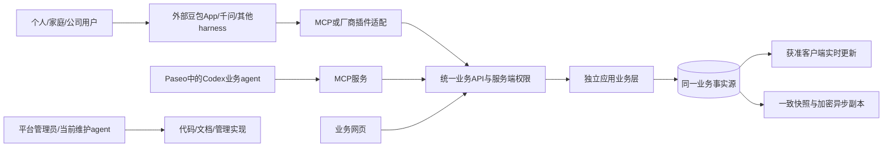
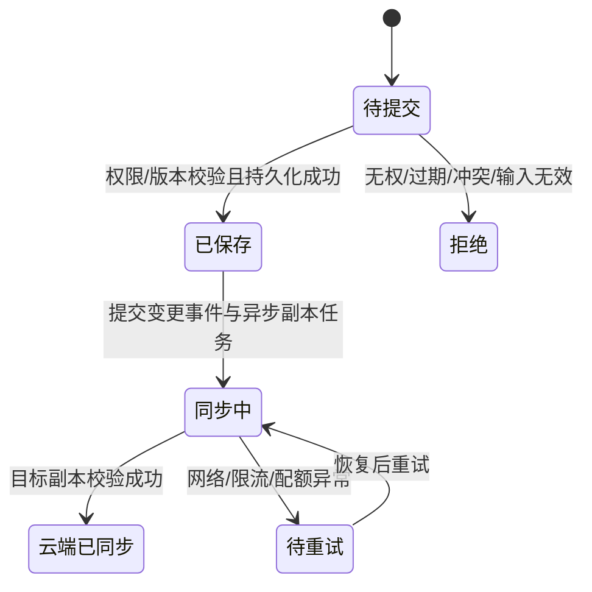

# Praxis 产品需求

版本：0.1.122 · [English](PRD.en.md)

Praxis 是一个可自托管的平台，为 agent 执行工作和人使用结果设计应用。用户表达想要的结果，授权 agent 完成日常操作。应用校验操作、保存结果，并以适合人阅读、观看或收听的方式呈现。每款应用负责自己的业务对象、可对这些对象执行的操作，以及让人理解结果的界面。

## 稳定的悬停与复制反馈

Settings → 数据中的位置内容及工作区别名使用一致的预览/复制控件。鼠标悬停在控件及内部文字时显示小手，随后在锚定浮层中显示完整内容；键盘聚焦和触屏也可查看，Escape 可关闭。长内容留在视口内，文字可选择。复制原始完整值，`$WORKSPACE` 对应真实完整路径。

复制中、成功、失败均在原有固定图标位置反馈，并使用不占布局空间的状态播报。不得在值下方插入“已复制”等行，也不得改变行、表格或页面几何位置；反馈期间完整内容持续可读，连续复制、失败/恢复及返回初始状态均不闪烁、不挤动内容。失败如实提示并保留手动选择，剪贴板回退保留焦点和滚动位置。相同清单刷新只更新时间，不替换控件、关闭预览或清除反馈；内容清除/变化和身份切换移除旧预览。用合成内容检查英中、桌面/手机宽度、鼠标、键盘及触屏。

## 备份配置与凭据保管

存储协调器按元数据加载业务配置，校验应用身份、路径、映射及声明格式，不读取签名密钥。登记备份来源必须继续使用原有数据/配置挂载，不得因此获得应用签名密钥。Core 运行配置仍须在接收业务流量前校验签名密钥。用明确未挂载密钥的隔离环境验证启动，继续拒绝非法配置，并保留队列代次、租约、工作区/写者身份及正常停止重启语义。

## 保护员工的注意力

**日常执行零次必需点击**旨在保护员工的注意力。意图、材料和授权就绪后，agent 应完成例行工作和可自动化的检查。人可以暂时离开界面，让工作继续推进，按自己的节奏回来查看结果，把注意力留给需要判断的验证、异常和重要取舍。

员工应能选择何时查看例行结果。只有符合团队约定的情况才值得立即打断，例如交付将到期且流程受阻。把结果、相关原始依据和待判断的问题一起交给有权处理的人。人也可以主动打开结果、查证或修正记录。团队通过业务记录同步进展，个人提醒的阅读和响应记录保留在个人视图。现有的原文定位和按权限展示的关注卡片提供了基础。跨应用送达和由员工自主安排查看时间仍是设计目标。

对团队而言，目标是在质量和时效相同的前提下，由同一支团队完成更多获验收的交付。衡量每次合格交付需要的人工分钟数，分别记录例行处理和需要专业判断的验证用时。有相应客户需求时，腾出的产能才能用于更多付费业务。

## 给反思和进化留出空间

每次交付都应留下可供团队回顾的业务记录。获授权的同事可以从最终交付版本沿着记录回溯原始材料、MCP 业务操作、Polaris 的运行和流程版本、人工决定，以及已记录的验收或返工情况。客户后续回来时，团队可以接着上次的交付做。团队也可以借此回看自己的工作方式。

**「一键业务优化」**是设计目标。团队成员发起一次复盘，系统基于历史运行给出有依据的流程改进建议，说明涉及哪些案例、可以改哪里、还有哪些不确定之处。团队可以补充上下文、暂缓建议，或在隔离环境中用获授权的历史案例验证流程草案。对照验证结果后，由获授权的流程负责人决定是否发布新版本。[业务留痕边界](OBSERVABILITY.md)

下表描述当前的平台能力。

| 用户需要 | 可观察的行为 |
| --- | --- |
| 委托有限操作 | 原生账号按资源和操作授权外部客户端。发现工具和调用工具时都需验权，撤权后再次访问会被拒绝。 |
| 理解结果 | 应用展示原生阅读器或视图，用户可以浏览引用证据，分辨加载、空内容和错误状态。 |
| 找到应用并回到首页 | 工作台显示可访问的应用和项目。受管应用在桌面与手机宽度下均有可访问的首页入口。 |
| 保护私人资料 | 阅读器在交付目录和正文前核对所有者会话。原件和生成数据存放于私有存储。 |
| 扩展本地应用 | 使用双语清单登记回环地址的独立服务，即可在本机工作台打开。 |
| 使用任一工作语言 | 从工作台进入**设置 → 通用 → 语言**，可选 English（默认）或简体中文。选择立即生效，在当前浏览器中保存，工作台与需求阅读器共用。独立工作台用户和已登录的普通成员均可修改。用户内容保留原语言。 |

公开仓库提供完整的内置应用 Docker Compose 栈。全新克隆会启动全部十四个应用的原生服务、需登录的工作台及限定范围的业务接口。首次初始化生成私有所有者账号、工作区、服务密钥和持久存储。重启或重试应保留既有身份、配置与记录。用隔离的干净安装逐项验证原生入口、受保护资源、写入回读及重启持久化。迁移时保留原有的栈管理与恢复流程。

上述行为用合成数据验收。受管运行使用的外部服务需独立配置。

## 应用卡片、动态数据清单与业务 Trace

按已设计的[卡片方案](design/workbench-cards.md)及原型实现，完整保留结果或问题预览、可展开的来源依据、一个原生主要入口、有限队列与列表、个人「稍后看／收起这一版／撤销」，以及 Home 返回原卡和位置。两个工作台视图始终顶部对齐，语言仍放在 Settings，沿用底栏单图标切换。浏览不表示签收、接单或完成；个人呈现状态不改变原事项日期，也不成为同事可见的已读回执。

十三个非 runtime 内置应用均提供所属应用负责、按权限过滤且带版本的卡片投影和当前数据清单。Polaris 是 runtime，不参与工作台卡片，但仍纳入数据清单。平台从已安装应用目录发现 provider，汇总其响应，应用或数据位置变化后更新 Settings。内容、来源版本、记录引用和原生入口由应用提供，不编造卡片、不静默遗漏应用接入。浏览器本地数据和派生来源按实际执行位置及归属报告。空、不可用、部分失败和无权限须明确区分。 Letters、Profiles 的卡片发现、原生读取和个人卡片偏好沿用同一已配置文档所有者边界，不能因它们不在通用应用入口策略中而对所有者隐藏来源。

在 Settings → Overview 新增 Trace 节展示业务操作全流程：已授权调用、应用结果或提交、来源与输出版本、已记录的工作流或人工决定关联，以及回读或失败。仅使用有界结构化元数据和获授权的引用，不纳入凭据、原始请求正文及个人浏览／暂缓历史。缺失的历史覆盖如实说明。Overview 的「使用和体验线索」始终展开，不再使用 details/summary 折叠控件。

### MCP 调用是 Trace 的主线

Overview → Trace 默认展示实际 MCP 工具调用：已注册工具、时间、脱敏调用者及客户端引用、结果与耗时，并在明确的观察窗口内汇总调用量、失败及延迟。业务调用可以继续查看已记录的授权、应用执行、提交及回读；即使未进入应用，被拒绝、参数校验失败、未知工具、控制调用和中断也应有真实结果。区分 MCP 传输、委托 HTTP 和原生网页操作；HTTP 成功不等于工具成功，也不等于业务数据已经提交。

工具排队或执行期间，Trace 元数据仍须可读。只读管理监控不应在无关业务路由门控后等待；业务执行仍保持授权租约和串行门控。

Polaris 已固化的工作流上下文作为补充来源，不能用运行历史、历史授权行或应用变更事件替代当前 MCP 调用证据。使用与体验线索保持展开。只记录允许的元数据，不记录原始参数、输出、凭据、任意工具名或个人浏览历史，保留现有管理权限与业务引用授权。

## 应用自有登记与发行身份

每款应用在所属仓库维护自己的 `praxis-app.json`、图标、本地化展示、默认入口、文档位置及登记示例，并在声明中提供应用发行版本。Praxis 负责发现和验证已安装声明，不再手工维护第二份应用总表或全应用示例副本。用仅包含源码引用的安装索引替代 `config/apps.json` 和 `config/apps.example.json`。部署来源、挂载、安装选择及授权仍由安装环境和平台负责；应用元数据不授予权限、不安装后端，也不扩展业务能力。

应用发行版本统一使用三段数字 `MAJOR.MINOR.PATCH`，各应用保持独立版本值与发布节奏。声明应与应用 package 及根 lockfile 的发行版本一致；静态应用在自身清单声明版本。运行时健康／版本响应以及工作台和 PRD 的应用发行标签使用同一身份，需求修订另行标注；PRD 阅读器识别中英文显式需求修订标题，不把应用发行标题误认为文档修订。将 `0.1` 等应用发行简称明确为 `0.1.0` 时保留原有历史含义；schema 数字、协议版本、算法修订和业务记录 revision 属于其他合同，不据此改号。

十四个已安装入口、十三个非 runtime 卡片来源、数据清单、双语 PRD、本机示例及原有受保护原生路由须继续基于应用自有元数据工作。全新匿名启动在应用清单尚未检出时，也能先从源码引用获取应用。重复身份、缺失或非法声明、不安全路径及版本冲突须明确拒绝，不退回过时内置表。保留私有部署覆盖项，先发布应用改动，再固定已审核的公开提交。

## 加载应用集成，不逐项枚举应用行为

平台从每个已安装且固定版本的应用源码加载经审核的 `praxis-integration.mjs`，与应用展示清单及 provider 配合。原生路由／资源、类型化业务操作、工具 schema、操作指南、请求／结果转换、支持动作／scope、部署配方及存储／导出语义由应用维护；发现、授权策略、网关、MCP、卡片、Settings、观测、安装与恢复共用已验证的 registry。一个新增合成应用只通过自己的声明／模块和显式安装配置接入，不应要求在 Praxis 新增该应用专属分支或名称／端口／工具总表。抽离时保留既有应用的完整原生行为，通用简化阅读器或仅成功 import 不算验收。[审计与加载合同](APP-LOADING-AUDIT.md)

平台继续负责账号和委托管理、即时授权、源码信任、令牌／密钥保管、签名断言、策略租约、串行门控、资源验权、安全 HTTP／文件原语、Trace 及一致性加密存储协调。应用声明不分配角色、不授予权限、不启动未配置后端，也不从调用者路径／URL 加载代码。可信 hook 仅接收有界、限定应用的回调及安全身份事实，不获得令牌、签名密钥或 AuthStore。激活前拒绝重复身份、slug、工具／scope／动作，不安全路径和不兼容 hook。停用后移除入口／工具，保留授权、数据与历史；停用授权不能继续放行，也不使无关的有效能力失效。

按 Projects 需求修订 2（保留提交 `54701f5`）及下一所属修订中明确的角色初始化，实现完整规划合同：项目主分支、四团队主分支、真实身份归属的个人草稿，结构化 PRD／Roadmap，面向目标的个人→团队→项目提案、比较、冲突、不可变决定／历史、恢复，以及完成 P0 闭环后的恢复为新草稿。读取不创建计划、成员或共同约定。具有项目范围角色管理权限的业务空间 owner／admin 可显式为合资格账号分配规划角色；接受另需指定目标角色及当前 update／accept 授权。平台管理员身份及自由文本 owner 不提供业务决定权。新增 Projects 操作由应用加载模块与所属服务提供，不在平台新增中央 schema 或 switch 分支。

## 应用发布

所有受维护应用在各自的公开仓库中，从 `main` 发布已验证的改动。Praxis 记录该分支和应用的具体提交，再验证组合发行版。匿名克隆应能从应用的公开 `main` 历史中获取所有固定提交。

## 平台核心服务命名

平台后端的 Compose 服务统一称为 **core**。本机启动、读取登录信息及管理命令使用该名称，服务负责身份、授权、外部智能体接入和应用协调。更名时兼容读取既有安装元数据、数据卷及旧命令入口。

## 视频引擎可用性

当前安装保留 Lattice 视频实现和依赖声明，只从运行环境卸载 Remotion、HyperFrames。视频操作先检查后端是否安装，缺失时跳过。保留既有视频记录与产物。创作、普通 PNG/PDF/HTML 导出及音频继续使用原生实现。

## 保存到桌面的应用标识 · v0.1.111

从工作台、登录页或设置将 Praxis 保存到桌面时，使用当前松树标志。登录页与设置引用和工作台一致的 manifest 和 Apple touch icon。安装元数据与 PNG 图标在登录前即可读取。图标 URL 携带图案版本，方便已有浏览器发现图标更新；更新图案时保留 manifest 的 ID、启动地址与作用范围。

## 外部智能体客户端 · v0.1.110

工作台提供应用与项目入口、设置及产品文档。移除 Paseo 网页门户、嵌入客户端、外部快捷链接和配对面板。用户在自己选择的外部智能体客户端中，通过已授权的 MCP 连接使用应用。

## 工作台视图 · v0.1.109

在现有底部导航栏内只放一个小图标，点击切换**应用 / 待关注**。按钮不显示文字标签，图标、悬停提示和无障碍名称说明将切换到的视图。支持键盘和触摸，主区域滚动时仍可操作。两个视图始终从主区域顶部按统一间距排列，内容很少或为空时也保持顶部对齐。「应用」只展示应用与项目入口，到期提示、提醒预览、事项数量与关注卡片都在「待关注」中展示。切换时焦点留在切换按钮上，返回「待关注」时保留选中的卡片。账号失去相关授权后清除关注内容并回到「应用」。中英文、桌面及手机宽度均需验收。

## 内置应用

Praxis 将维护中的应用作为独立版本的内置组件发布。目录包括提醒、知识库、Lattice 幻灯片、旅行、听校、备忘、财务、情报、Polaris、日历、Matrix 阅读器、项目、书信和个人资料。内置应用本身是可用的产品。它们的读、看、听体验展示产品方向，应用自有的数据、操作和界面也为开发新应用提供参考实现。各应用说明自己支持的操作及所需配置。访问取决于安装配置与用户授权。私有数据、账号和工作文件放在公开仓库之外。

个人、家庭和组织应能按自己的工作方式快速构建并部署应用。AI 辅助开发和可复用的部署流程，旨在让范围很小的需求也能用专门的应用解决。新应用可以直接围绕自己的业务对象和流程构建，按需使用外部来源和服务。目前，清单可将已运行的应用登记到本机工作台。受管入口和授权后的 agent 操作需要显式集成和部署。[应用标准](APP-STANDARD.md)

## 平台职责

应用所有者负责源码、持久化、校验规则和结果界面。公共平台提供身份、OAuth 委托、资源与操作授权、连接器、MCP 和工作台导航。用户选择外部 agent 客户端负责推理和编排。

平台面向持有私有记录的个人、共享选定资源的家庭和团队、接手特定任务的外部协作者，以及维护安装环境的运营者。开发与业务使用各有独立的会话、凭据、环境和审计记录。平台管理权与业务访问权分别授予。

## 用户流程

- **委托工作。** 用户把任务交给自己选定的 agent。外部客户端发现授权服务器、资源与支持的工具，经 OAuth 绑定用户，按资源、操作和有效期申请授权。每次调用同时受当前用户权限、客户端委托和部署及应用能力约束。用户可查看或撤销授权。网站使用原生浏览器身份。
- **保存并确认。** 使用有明确类型、在允许列表内的操作，以及资源标识、预期版本和幂等机制。结果留在所属应用中。写入结果不确定时，回读或用同一幂等键重试。提交后才能发出事件，后续送达时重新验权，并让冲突可见。写入成功和备份完成分别确认。
- **使用和核对结果。** 应用在原生界面中展示已保存的结果，例如对应原文、渲染后的演示稿或待复核的音频片段。人可以在上下文中查证。知识库区分笔记、书籍、论文和资料包。受控的导入、解析和索引工具提供可检索的段落与引用，界面如实显示内容覆盖和解析失败情况。
- **查看相关工作。** 项目信息以 Projects 为准。只展示用户有效权限内的工作，任务与动态均来自获授权的记录，并链接到所属应用。团队成员身份本身不授予全公司动态访问权。
- **打开应用并返回。** 登录后，工作台按当前权限展示应用和项目入口，并处理空状态。在同一标签页打开选定对象，受管应用通过左下角固定的首页入口返回，支持键盘、桌面与窄屏。登录后恢复经过校验的目标地址。为加载、数据过期、撤权、冲突和写入结果不确定提供恢复路径。
- **开发应用。** 界定接口和数据归属，提供语言支持、首次运行状态、入口和返回导航、权限、存储和验证。本地开发环境与生产发布及访问权限分开。[应用标准](APP-STANDARD.md)

## 历史需求、设计决策与验收记录

以下按作出决策时的版本记录 v0.1.0 至 v0.1.107 的需求与交付。历史测试数量、启动命令和部署结果均对应当时版本。现行公开发行版的启动方式、应用权限及 Polaris 只读查看器见[运行说明](RUNNING.md)、[内置应用指南](BUILTINS.md)和[查看器说明](POLARIS-VIEWER.md)。

| 版本 | 日期 | 修订人 | 说明 |
|---|---|---|---|
| v0.1.0 | 2026-11-11 | 作者与实现代理 | 明确 AI 手机愿景；交付主项目 PRD 与工作台“PRD集合”只读入口 |
| v0.1.0 | 2026-11-11 | 作者与实现代理 | 首页不重复显示工作台标题；增加 Slides 图标与现有服务入口 |
| v0.1.0 | 2026-11-11 | 作者与实现代理 | Adopt Praxis identity and add an operator skill; that skill requirement alone moves no content |
| v0.1.0 | 2026-11-11 | 作者与实现代理 | Approved current phases: existing Travel extraction, thin Node Praxis shell, independent Knowledge and project-reference routing; each requirement committed separately |
| v0.1.0 | 2026-11-11 | 作者与实现代理 | F11：为手机访问提供可恢复的受保护 HTTPS 入口，覆盖页面、接口、媒体与长连接。 |
| v0.1.1 | 2026-11-11 | 作者与实现代理 | 修复版本冻结，建立逐需求 PATCH 递增与版本一致性校验 |
| v0.1.2 | 2026-11-11 | 作者与实现代理 | 清理遗留目录，统一 VPN 维护来源，PRD 集合仅保留页眉入口 |
| v0.1.3 | 2026-11-11 | 作者与实现代理 | 修复 TingProof 与 Knowledge 主机名允许项并检查全部应用入口 |
| v0.1.4 | 2026-11-11 | 作者与实现代理 | 增加指定旅行计划的限时可撤销分享，普通入口继续私有 |
| v0.1.5 | 2026-11-11 | 作者与实现代理 | 新增多条行程多份行程及 Travel 目录 |
| v0.1.6 | 2026-11-11 | 作者与实现代理 | 增加 TingProof 专属协作账号及跨应用访问隔离 |
| v0.1.7 | 2026-11-12 | 作者与实现代理 | 加入通用原生应用 UI 规范并统一 Travel 两栏外观 |
| v0.1.8 | 2026-11-12 | 作者与实现代理 | Travel 路线分类、卡片与指定路线每日行程时间线 |
| v0.1.9 | 2026-11-12 | 作者与实现代理 | Travel 标题层级与预算管理，并按 pm-master 重整 PRD |
| v0.1.10 | 2026-11-12 | 作者与实现代理 | Travel 标准地点图标、连续紧凑时间线及开放和预算日期 |
| v0.1.11 | 2026-11-12 | 作者与实现代理 | 全局图片私有缓存、条件响应与更新校验 |
| v0.1.12 | 2026-11-12 | 作者与实现代理 | Travel 地点搜索、出行准备与 Memo 时刻卡入口 |
| v0.1.13 | 2026-11-12 | 作者与实现代理 | Docker 统一服务与可恢复多存储 |
| v0.1.14 | 2026-11-12 | 作者与实现代理 | 明确开发使用分离、外部业务API权限MCP及双客户端验证规范 |
| v0.1.15 | 2026-11-12 | 作者与实现代理 | 刷新连接、安全控制、数据沉淀与美观呈现定位并启动既有待办 |
| v0.1.16 | 2026-11-12 | 作者与实现代理 | 实现受控业务API、持久授权及外部MCP服务 |
| v0.1.17 | 2026-11-12 | 作者与实现代理 | 收口Docker实际运行与云端初始化恢复验证 |
| v0.1.18 | 2026-11-12 | 作者与实现代理 | 增加脱敏需求线索与体验观测日志 |
| v0.1.19 | 2026-11-12 | 作者与实现代理 | 工作台增加受保护的权限连接与业务存储概览 |
| v0.1.20 | 2026-11-13 | 作者与实现代理 | 统一Praxis登录并将公网中继收敛为转发 |
| v0.1.21 | 2026-11-13 | 作者与实现代理 | 三实体架构与网页用户授权管理 |
| v0.1.22 | 2026-11-13 | 作者与实现代理 | 管理员默认授权并恢复登录授权后的桌面工作台 |
| v0.1.23 | 2026-11-13 | 作者与实现代理 | 恢复受管Reminder原版右侧布局与既有交互 |
| v0.1.24 | 2026-11-13 | 作者与实现代理 | 统一按用户展示的工作台并改为当前标签页导航 |
| v0.1.25 | 2026-11-13 | 作者与实现代理 | 合并工作台与业务服务文档为统一平台手册 |
| v0.1.26 | 2026-11-13 | 作者与实现代理 | 将状态概览与体验线索移入管理界面，仅管理员可见 |
| v0.1.27 | 2026-11-13 | 作者与实现代理 | 扩展按用途选择的UI模板并更新工作台启动台样式 |
| v0.1.28 | 2026-11-13 | 作者与实现代理 | 统一工作台应用与项目的并列二级标题样式 |
| v0.1.29 | 2026-11-13 | 作者与实现代理 | 使用本地Chart.js将管理状态概览与体验线索改为图表 |
| v0.1.30 | 2026-11-13 | 作者与实现代理 | 将主页导航与账号功能收归Praxis系统层，保持应用独立 |
| v0.1.31 | 2026-11-13 | 作者与实现代理 | 删除通用业务空间界面，直接提供应用专属首屏 |
| v0.1.32 | 2026-11-13 | 作者与实现代理 | 将学习资料归入Knowledge并将项目参考资料归入项目 |
| v0.1.33 | 2026-11-13 | 作者与实现代理 | 将Paseo入口统一为Docker栈管理并清理过时启动脚本 |
| v0.1.34 | 2026-11-14 | 作者与实现代理 | 统一按角色展示的管理页并清理重复授权入口 |
| v0.1.35 | 2026-11-14 | 作者与实现代理 | Travel行程地图、日期联动及高德私有运行配置 |
| v0.1.36 | 2026-11-14 | 作者与实现代理 | Travel高德Web服务Key、地点搜索与驾车步行查询 |
| v0.1.37 | 2026-11-14 | 作者与实现代理 | Travel地图悬浮卡片、访问编号和列表路线联动 |
| v0.1.38 | 2026-11-14 | 作者与实现代理 | Travel受限MCP、私有攻略事实源与独立业务执行 |
| v0.1.39 | 2026-11-14 | 作者与实现代理 | 原有行程复用相同的行程界面；全局明确结构化数据与服务适配原则 |
| v0.1.40 | 2026-11-14 | 作者与实现代理 | 管理界面增加管理员专属MCP状态与能力清单 |
| v0.1.41 | 2026-11-14 | 作者与实现代理 | 提供无需认证的公共MCP使用与主屏幕引导 |
| v0.1.42 | 2026-11-14 | 作者与实现代理 | 以受限对象操作更新各份旅行计划并复用统一界面 |
| v0.1.43 | 2026-11-14 | 作者与实现代理 | 工作台采用桌面平板手机共用的主屏幕与底部系统栏 |
| v0.1.44 | 2026-11-15 | 作者与实现代理 | 共享Projects应用与跨小组项目协作第一版 |
| v0.1.45 | 2026-11-15 | 作者与实现代理 | 验证既有与备用公网传输之间的显式切换 |
| v0.1.46 | 2026-11-15 | 作者与实现代理 | 桌面逐项目入口与隔离的项目上下文 |
| v0.1.47 | 2026-11-15 | 作者与实现代理 | 项目资料栏目名称简化 |
| v0.1.48 | 2026-11-15 | 作者与实现代理 | Knowledge可追溯业务知识库与受控项目引用 |
| v0.1.49 | 2026-11-15 | 作者与实现代理 | 统一Knowledge书库与知识库阅读风格 |
| v0.1.50 | 2026-11-15 | 作者与实现代理 | 修复Knowledge内部链接并统一旧HTML参考页 |
| v0.1.51 | 2026-11-15 | 作者与实现代理 | 将根项目源资料归入Projects应用并移除目录 |
| v0.1.52 | 2026-11-15 | 作者与实现代理 | 精简Paseo为单一Docker启动入口并删除卸载脚本 |
| v0.1.53 | 2026-11-15 | 作者与实现代理 | Knowledge首页平铺内容并提供书籍和条目直达阅读 |
| v0.1.54 | 2026-11-15 | 作者与实现代理 | 补充AI Agent Handbook设计参考及既有需求关联 |
| v0.1.55 | 2026-11-15 | 作者与实现代理 | 统一PRD集合的导航与阅读界面 |
| v0.1.56 | 2026-11-15 | 作者与实现代理 | 统一Slides文稿列表与播放和视频工作区界面 |
| v0.1.57 | 2026-11-15 | 作者与实现代理 | 为PRD集合和正文补齐统一系统导航 |
| v0.1.58 | 2026-11-15 | 作者与实现代理 | 落实按影响范围验证并分离重型集成测试 |
| v0.1.59 | 2026-11-15 | 作者与实现代理 | 通过MCP握手声明授权能力及不可执行边界 |
| v0.1.60 | 2026-11-15 | 作者与实现代理 | 增加MCP只读能力刷新入口 |
| v0.1.61 | 2026-11-15 | 作者与实现代理 | 设计受控Slides制作MCP完整闭环 |
| v0.1.62 | 2026-11-15 | 作者与实现代理 | 实现Slides受控制作MCP与文稿交付 |
| v0.1.63 | 2026-11-15 | 作者与实现代理 | 合并Lattice并重做原生模板制作MCP |
| v0.1.64 | 2026-11-15 | 作者与实现代理 | 修复旧业务稿按原生模板重做：受控独占编辑保留历史并恢复原生查看 |
| v0.1.65 | 2026-11-16 | 作者与实现代理 | 新增Finance财务应用：mock收支、月预算与储蓄目标预测，数据和控制分离 |
| v0.1.66 | 2026-11-16 | 作者与实现代理 | Knowledge单篇阅读隔离，目录仅包含当前文档 |
| v0.1.67 | 2026-11-16 | 作者与实现代理 | Knowledge文档MCP与受控版本编辑 |
| v0.1.68 | 2026-11-16 | 作者与实现代理 | Knowledge精简阅读目录并显示真实文档版本 |
| v0.1.69 | 2026-11-16 | 作者与实现代理 | MCP工具配套skill与Knowledge正文增删改查 |
| v0.1.70 | 2026-11-16 | 作者与实现代理 | Knowledge采用section章编层级并显示完整章目录 |
| v0.1.71 | 2026-11-16 | 作者与实现代理 | Praxis核心蓝绿发布、健康门禁与回滚 |
| v0.1.72 | 2026-11-16 | 作者与实现代理 | 外部内容助手的有界新增授权 |
| v0.1.73 | 2026-11-16 | 作者与实现代理 | Knowledge关系图纵向分组与可读性修复 |
| v0.1.74 | 2026-11-16 | 作者与实现代理 | 固定系统主页入口，消除滚动与渲染闪烁 |
| v0.1.75 | 2026-11-16 | 作者与实现代理 | Knowledge参考页展示标题统一 |
| v0.1.76 | 2026-11-16 | 作者与实现代理 | Knowledge静态参考页接入受控内容MCP |
| v0.1.77 | 2026-11-17 | 作者与实现代理 | Praxis桌面安装入口，移除Memo独立安装引导 |
| v0.1.78 | 2026-11-17 | 作者与实现代理 | Knowledge当前section目录自动展开与更新 |
| v0.1.79 | 2026-11-17 | 作者与实现代理 | Knowledge章内新增section与受控目录归属 |
| v0.1.80 | 2026-11-17 | 作者与实现代理 | Memo新增维权与租房指南及受权MCP，内容与本机凭证分离 |
| v0.1.81 | 2026-11-17 | 作者与实现代理 | Reminder独立与托管界面移除编辑，保留完成和旗标 |
| v0.1.82 | 2026-11-17 | 作者与实现代理 | Reminder移除完成圆圈避免误触，状态由授权agent维护 |
| v0.1.83 | 2026-11-18 | 作者与实现代理 | Polaris现有仓库迁入third_party并登记独立数据位置 |
| v0.1.84 | 2026-11-18 | 作者与实现代理 | 管理页增加全部应用数据位置清单，仅管理员可读 |
| v0.1.85 | 2026-11-18 | 作者与实现代理 | 统一应用工作数据目录并支持每应用路径配置 |
| v0.1.86 | 2026-11-18 | 作者与实现代理 | 数据管理使用工作区简称显示长路径 |
| v0.1.87 | 2026-11-18 | 作者与实现代理 | 路径复制控件使用标准手型指针 |
| v0.1.88 | 2026-11-18 | 作者与实现代理 | 新增Intelligence情报展示应用与四类材料阅读 |
| v0.1.89 | 2026-11-18 | 作者与实现代理 | 多类学术会议论文收录及文库统计概览 |
| v0.1.90 | 2026-11-18 | 作者与实现代理 | 学术资料客户端按需采集会议论文，通过受限 MCP 发布统计 |
| v0.1.91 | 2026-11-18 | 作者与实现代理 | 工作台新增管理员专用的 Polaris 原生门户入口 |
| v0.1.92 | 2026-11-18 | 作者与实现代理 | Knowledge 接收按年采集的会议统计并保全其他年份 |
| v0.1.93 | 2026-11-18 | 作者与实现代理 | Polaris 的用户管理统一归入 Praxis，工作流沿用既有运行空间 |
| v0.1.94 | 2026-11-18 | 作者与实现代理 | Polaris 数据归属统一到 Praxis 工作区 |
| v0.1.95 | 2026-11-18 | 作者与实现代理 | Knowledge 分类统计、原件入库与证据检索 |
| v0.1.96 | 2026-11-18 | 作者与实现代理 | Knowledge 入库目录自动更新与跨页阅读定位 |
| v0.1.97 | 2026-11-19 | 作者与实现代理 | 统一工作台项目入口并一次呈现授权项目列表 |
| v0.1.98 | 2026-11-19 | 作者与实现代理 | 将平台 UI 规范扩展为统一 UI/UX 设计指南 |
| v0.1.99 | 2026-11-19 | 作者与实现代理 | 审计平台与应用 UI/UX 并修复导航、反馈和恢复问题 |
| v0.1.100 | 2026-11-19 | 作者与实现代理 | 新增应用先登记空白首发状态，Matrix Reader 随 Docker 蓝绿网页槽发布 |
| v0.1.101 | 2026-11-19 | 作者与实现代理 | Matrix Reader 纳入工作台应用目录并补充首发点击验收 |
| v0.1.102 | 2026-11-19 | 作者与实现代理 | 修复 Matrix Reader 入口的 TLS 握手错误并接入工作台标准 HTTPS 路径 |
| v0.1.103 | 2026-11-19 | 作者与实现代理 | Matrix Reader 房间选择支持全选和取消全选 |
| v0.1.104 | 2026-11-19 | 作者与实现代理 | International workbench, Calendar, attention cards, local apps and public project documentation / 双语工作台、日历、关注卡片、本地应用与公开项目文档 |
| v0.1.105 | 2026-11-19 | 作者与实现代理 | 公开 MCP 引导与操作技能支持双语，应用目录复用双语清单 |
| v0.1.106 | 2026-11-19 | 作者与实现代理 | 补充 agent-native 应用与 harness、已有应用连接器的竞品分析 |
| v0.1.107 | 2026-11-19 | 作者与实现代理 | 新增 Letters 和 Profiles 所有者阅读器，公开应用代码与私有资料分离 |
| v0.1.113 | 2026-11-19 | 作者与实现代理 | 平台后端服务及命令更名为 core，并兼容既有安装 |
| v0.1.114 | 2026-11-19 | 作者与实现代理 | 实现应用自有卡片、动态数据清单、个人卡片偏好及概览业务 Trace，使用和体验线索始终展开 |
| v0.1.115 | 2026-11-19 | 作者与实现代理 | 卡片发现与个人偏好遵守私有阅读器所有者授权 |
| v0.1.116 | 2026-11-19 | 作者与实现代理 | 概览 Trace 优先展示真实 MCP 调用、结果与耗时 |
| v0.1.117 | 2026-11-20 | 作者与实现代理 | 业务调用进行中仍可及时读取 MCP Trace 状态 |
| v0.1.118 | 2026-11-20 | 作者与实现代理 | 应用清单归属所属仓库，统一三段发行版本 |
| v0.1.119 | 2026-11-20 | 作者与实现代理 | 显式读取应用自有需求修订，与发行版分开显示 |
| v0.1.120 | 2026-11-20 | 作者与实现代理 | 加载应用自有集成合同并实现 Projects 规划 |

## 零、需求体检与澄清

本轮按 pm-master → pm-prd-writer → pm-roadmap-planner 执行，先刷新产品定位与现有待办，再进入实现、合成验证及逐需求提交。v0.1.14 是上一轮文档基线，不能据此宣称业务 API、权限、多成员同步或 MCP 已实现。本轮已授权继续实施 F24–F31；维护侧不增删改真实业务记录，实际业务验收与手机操作继续按独立执行者约定进行，需要用户参与时给出具体步骤。

| 信号 | 用户证据与现状 | 结论 |
|---|---|---|
| 需求来源 | 作者明确要求从豆包 App、千问等第三方 agent/harness 操作 Praxis；普通用户只改业务数据，代码只由平台管理员维护 | 外部 agent 是客户端，Praxis 提供业务能力与强制权限边界 |
| 用户价值 | 现有应用和数据可用，但控制入口分散、应用级账号不能限制具体项目，尚无统一业务 MCP | 统一业务 API 与授权契约，降低多客户端接入成本，并支持家庭共享和任务外包 |
| 成功定义 | 真实 Paseo Codex agent 经 MCP 修改指定验收数据；另有一个真实手机第三方 agent App 完成连接、授权、写入与读回；越权和撤销被服务端拒绝 | 两条独立端到端验收缺一不可，不能以单元测试、模型 API 调用或口头报告代替 |

已确认：Praxis 内部没有 agent、模型推理、聊天助理或任务规划器；个人、家庭、公司是数据空间；家庭/公司空间管理员不拥有平台代码权限；外包用户按任务/资源授权。当前维护 agent 只做代码、产品文档及必要配置，不再直接或通过 CLI/SQL/脚本增删改真实业务数据。真实数据操作交给独立业务执行者通过受控 API/MCP；临时合成夹具的自动测试不属于线上业务操作。该调整的产品含义是**开发与使用分离**，不是只对当前会话增加一条例外。

无阻塞文档编写的问题。实施依赖单独记录：豆包等 App 的具体准入资格、真机版本和工具入口需联调核实；厂商限制不降低手机端验收标准，也不凭空承诺所有 App 都能添加任意 MCP 地址。

## 一、概述（为什么做）

### 1.1 愿景、产品概述与目标用户

**战略假设**：未来智能体将成为大多数流量的入口，跨设备承接需求理解、服务发现、选择和调用。该判断指导产品方向，不代表目前已达到多数流量占比。Praxis 面向这一变化，连接用户已有的服务，让不同外部智能体安全地办事，持续沉淀个人、家庭与团队的数据，并以美观、清晰的界面呈现。

产品按三个实体建模：**外部 agent、数据、界面**。作者使用的 coding agent/harness 在 Praxis 之外；Praxis 不内置 agent。控制、鉴权、连接和体验设计是实体之间的关系与能力，不是五个并列的产品模块。

Agent → 数据：MCP 暴露可执行操作，OAuth 2.0 提供用户授权委托，服务端逐次判断身份、空间、资源、动作与期限；连接器将这些操作落实到已有应用和外部服务。OAuth 登录或工具发现本身不等于已获全部数据权限。数据 → 界面：通过信息层级、布局、反馈和交互让数据的价值被用户看见，并让用户能够核对结果、纠错和收回授权。

外部 agent 的开发身份与业务身份仍分离：维护代码使用受信任开发通路，业务操作使用受限 MCP/API；不能因为客户端名为 coding agent 就自动授予源码或平台管理权。原有四类要求保留为关系与数据能力的验收维度：

| 部分 | 产品要求 | 既有需求与验收方向 |
|---|---|---|
| 连接 | 长期连接一切已有服务；从真实事务出发逐项扩展，复用已有接口，积累连接的深度、可靠性与维护能力 | F26/F28/F31；先 Reminder、TingProof 与外部客户端，再按实际需求覆盖其他服务；按端到端任务成功和故障恢复检验，不能以注册一个图标或工具名代替接通 |
| 控制 | 用户能对个人、家庭、团队及外部任务安全委托；授权范围内自动执行，权限由服务端强制判断 | F27/F30；身份、资源、动作、期限、撤销和审计；普通业务客户端无代码、主机或部署能力 |
| 数据 | 操作保留可信状态、来源与历史，在获准范围内关联复用；更换 agent 后仍能继续同一事务 | F25/F26/F29；独立应用保持权威事实源，避免双份冲突记录；保存、协作推送和恢复副本分别确认 |
| 呈现 | 美观是明确产品要求；以一致的字体、留白、层级和交互展示状态、变化及待决定事项 | F18–F23及通用 UI 规范；Reminder 是黄金参照；工作台与按需结果界面可共用同一业务状态，不展示用户无须知道的调试信息 |

连接覆盖、业务理解和持续维护有机会积累成工程与生态壁垒；安全控制建立委托信任，数据复用与呈现形成持续使用价值。这些是待验证的竞争力，不能将尚未建设的覆盖、外部贡献或付费留存写成既成护城河。用户通过 agent 使用平台同样计入价值，工作台打开次数不作为唯一指标；观察真实事务完成、历史复用、跨客户端连续性和用户纠错能力，不额外引入遥测 SDK。

保留“AI手机”的控制平台愿景：让用户从自己选择的外部 agent 客户端操作独立应用，逐步实现个人、家庭和公司的业务数据化。Praxis 提供工作台、统一业务 API、身份权限、MCP 工具和客户端适配；对话、推理、工具选择与任务编排由外部客户端负责。后台通知、同步、备份和确定性业务任务不是内部 agent。

已有工具优先复用业务 API、CLI 的共享数据层和适配器；能力不足时补齐 owning app 的接口。数据规则只有一个事实源；MCP 和各厂商适配不得另造业务存储或改变独立应用的归属。业务用户不能借工具调用或修改 Skill 获得源码、主机或运维权限。

| 用户/执行者 | 目标及权限 | 典型场景 |
|---|---|---|
| 平台管理员及维护 agent | 维护代码、文档、部署和权限实现；本维护 agent 不操作真实业务记录 | 为各应用补业务接口、隔离与审计，交付合成测试 |
| 个人用户 | 管理个人业务资源；默认不共享 | 用外部 agent 管理自己的提醒或笔记 |
| 家庭/公司空间管理员 | 管理本空间成员和共享规则；无平台代码权限 | 邀请家庭成员、分配公司项目 |
| 空间成员 | 在获准的共享资源和动作范围内操作业务数据 | 家庭购物、旅行准备、公司项目协作 |
| 外部协作者 | 仅获指定任务/项目的必要资料与操作，不自动成为组织成员 | 在 TingProof 完成被分配的听校任务 |
| 外部业务 agent | 代表已认证用户执行获准业务动作，不是独立高权限角色 | Paseo 中的 Codex、豆包 App、千问或其他 harness |

### 1.2 产品目标与成功指标

| 目标 | 本轮规范及后续实施的通过条件 |
|---|---|
| 明确平台边界 | 产品、接口和验收均无 Praxis 内部 agent；外部业务客户端无代码操作能力 |
| 统一操作业务数据 | 至少 Reminder 完成统一 API/MCP 的列表、创建、修改、完成及限定删除链路；TingProof 支持被授权任务的读取和提交；逐应用记录覆盖状态 |
| 形成可执行权限 | 每次调用校验用户、客户端、空间关系、资源、动作及期限；个人/家庭/公司/外部任务的正反例均可验收 |
| 实证外部 agent 操作 | 启动一个真实 Paseo Codex agent，证明通过真实 MCP 完成变更；审计和服务端读回一致，拒绝请求没有副作用 |
| 手机可用 | 至少一个真实手机第三方 agent App 连接同一业务能力，完成账号绑定、操作、同步可见与撤销测试；豆包为首选候选 |
| 家庭实时协作 | 同一服务端事实源支持多人操作、已提交变更推送、冲突保护、幂等和重连补齐；跨空间数据不广播 |
| 可管理运行与存储 | Compose 统一管理应用及基础服务；家庭实时协作与云/NAS 恢复副本分开验收，保存与云端同步状态准确 |

### 1.3 名词、角色边界与阅读对象

| 名词 | 定义与约束 |
|---|---|
| 业务空间 `spaceId` | 个人/家庭/公司的业务归属与授权边界；同一人可属于多个空间，关系互不继承 |
| 存储工作区 `workspaceId` | 既有快照/恢复的稳定身份；不能当成已经实现的人员或业务空间权限 |
| 外部协作者 | 相对于某空间的任务关系，不是一个账号的永久类别；可有期限，不默认读取空间全部数据 |
| 平台管理员 | 显式授予的平台用户/授权管理身份，与家庭或公司空间管理员分开；源码及发布仍走受信任维护流程，不由业务 MCP 开放 |
| MCP 服务 | 对外提供结构化业务工具、校验调用并返回结果的服务，不运行内部 agent |
| 维护执行者与业务执行者 | 前者交付代码/文档，后者在指定用户权限内操作业务数据；验收也保持分离 |

本文面向作者、维护实现者、应用维护者、验收执行者与接入方。v0.1.0 的 n=1、无团队角色及 F11/F17 的应用级登录墙是历史已交付范围；当前目标由 F26–F31 更新，原能力与 URL 不因本轮文档变更失效。

### 1.4 开发与使用分离（平台原则）

开发侧负责构建、维护和发布系统，使用侧负责在系统提供的业务能力中操作数据。权限按照执行身份与通路区分，不按照模型品牌区分；同一种 Codex 或其他模型可以分别承担两类角色，但必须使用独立的会话、身份、凭据、工作环境和审计，不能沿用一份全能凭据自动切换。

| 边界 | 开发侧 | 使用侧 |
|---|---|---|
| 主体 | 平台管理员、维护 agent | 个人/家庭/公司用户、外部任务协作者及其受托 agent |
| 入口 | 受信任的代码仓库、维护工具与发布流程 | 业务网页、统一业务 API、MCP/厂商适配 |
| 可修改对象 | 源码、文档、测试、必要配置和实现规则 | 获准空间/资源内的业务记录 |
| 不随角色开放的能力 | 不通过维护会话代写真实用户业务数据 | 无源码、任意命令、主机、部署、服务端权限判定实现/平台安全策略或备份解密能力 |
| 验证责任 | 交付代码和隔离合成测试，核验脱敏证据 | 从正常业务入口完成真实操作、回读及指定测试数据清理 |

平台管理员需要使用产品时，也应以独立业务身份进入正常业务通路。空间管理员可以通过获准的正常业务管理接口管理本空间成员、共享资源和委托授权，但不能改变服务端权限判定实现、平台安全策略或扩大自身管理边界；修改这些实现规则须由平台管理员通过受信任维护流程发布。两侧分别记录代码发布与业务操作，不把“同一模型可以做两件事”当作可以共享权限的理由。

## 二、产品描述（做什么）

### 2.1 范围、架构与版本规划

Praxis 继续使用轻量工作台和原文件 PRD 阅读，独立应用继续负责各自业务逻辑与存储，不依赖 books。当前增加统一业务能力契约、权限与 MCP 的产品要求；多个接入协议共享同一业务校验和事实源。业务账号/授权元数据可以由平台管理，不复制各应用整套业务数据。

| 范围 | 当前事实 | 后续承诺 |
|---|---|---|
| v0.1.0–v0.1.12 | 工作台、独立应用、PRD 集合、受保护入口及应用级协作等已有能力 | 保留既有入口、样式和隐私约束 |
| v0.1.13 | Docker/存储代码与隔离验收已交付；本机数据切换和真实云端验收未完成 | 按 F24/F25 和实际验收结果继续；不重复宣称已部署 |
| v0.1.14 历史基线 | 本 PRD、路线图、角色分工和验证方案 | 当时仅文档交付，不代表新 API、权限或 MCP 已上线 |
| 当前实施轮 | 按外部 agent、数据、界面三个实体整理架构；F35 补齐网页用户与授权管理 | 复用现有 OAuth/MCP/连接器及事实源；后续外部验证仍按实际结果记录 |
| 后续个人/家庭切片 | 待实现 | 统一 API/权限/MCP、Paseo Codex 实证、手机 App 实证、共享资源同步 |
| 后续公司与外包切片 | 待实现 | 公司成员、任务级外部协作及逐应用覆盖；复用同一身份与资源权限 |

v0.1.14 部署状态勘误（2026-11-12历史记录）：Docker 已安装，`sg docker` 已验证可访问引擎；旧 Paseo Supervisor 尚未继承新增组，完整刷新需从新组环境启动 Supervisor，普通 worker restart 不等于刷新。当时原生应用仍运行，未切换 Docker；坚果云凭据只有 Git 外私有副本，没有客户端连通或云端同步验收。当轮不执行上述部署/数据操作；当前已获授权继续实施，凭据内容始终不进入文档。

v0.1.16 代码交付记录（历史，当前结果见验证台账）：独立业务服务、持久权限/OAuth、受信应用适配、官方 MCP、授权事件与持久副本队列已实现，并增加业务查看、受限校正及显式草稿合并界面。Reminder 保留 schema2、六视图、周日历、统计及例行执行记录；TingProof 提供任务范围接口、事务幂等和提交期限复核。源码通过隔离 HTTP/MCP、真实 Chromium、SQLite WAL 与临时 Docker 验证；实际发布、真实 Paseo 业务执行者和手机验收另行记录，不能以合成结果替代。运行与配置见[平台手册](PLATFORM.md)。坚果云账号与应用密码已写入 Git 外私有配置，最小认证返回207；新路径初始化遇到兼容问题，实际云端同步、完整性及恢复尚未通过。

当前运行收口切片：将已有 canonical 数据目录精确挂载到 Docker，能够保持同一事实源时不复制或改写业务记录；声明当前实际挂载、活动写入者、健康检查与回退，逐服务避免端口或重复写入实例冲突。受管 Reminder 使用已实现的业务界面与授权通路；TingProof 的既有完整工作流和任务受管部署分别说明，不因应用容器启动就宣称任务级权限已在原入口生效。云端新目标仅在已配置的 `praxis/<workspaceId>` 前缀按层初始化必要 collection，明确的祖先不存在与认证/冲突/限流分开处理；不得把任意409当作空仓成功。维护侧仅配置基础设施、部署代码和检查完整性，真实业务 CRUD 与验收清理由独立业务执行者执行。

既有公网转发链路的运行修复属于本切片：使用规范仓库的当前镜像和有界认证，避免反复提交启动时生成的旧验证码；密码和 TOTP 密钥不进入命令参数、日志或提交，原证书、existing relay 与无关服务保持原运行配置。

### 2.2 整体流程与数据流

用户绑定账号和客户端 → 选择获准空间 → 外部 agent 提交结构化业务动作 → 服务端验权及版本/幂等校验 → owning app 持久化 → 返回真实结果并写审计 → 向获准订阅端推送 → 后台同步副本。用户/客户端提供的 `userId`、`spaceId`、任务 ID 或 Skill 文字都不是授权证明。

拒绝请求不得改变业务数据。网络重试不得重复执行已成功动作；本地已保存与云端已同步分别记录。既有 PRD 阅读维持只读白名单，业务 MCP 不自动获得源文档/代码目录的文件访问权限。

### 2.3 功能清单与为什么现在做

| 编号 | 功能 | 优先级 | 为什么现在做 |
|---|---|---|---|
| F70 | 受控Slides制作MCP | P0／已实施，客户端视觉验收另验 | 让外部content agent通过受控文稿合同完成制作、检查与导出，避免用源码编辑绕过业务边界 |
| F71 | 合并Lattice仓库并重做原生MCP | P0／已实现，原生对照通过 | 上版自定义版式绕过既有模板和稳定库，交付不合格；统一源码、直接复用全部原生制作能力，模板保持不变 |
| F01 | 主项目 PRD 与路线图 | P0 | 主项目愿景与版本边界尚未统一，后续实现需要可读的依据 |
| F02 | 页眉“PRD集合”入口及分组阅读页 | P0 | 已有多个独立项目，作者需要一个可发现的阅读入口 |
| F03 | 原文件读取、版本识别与安全边界 | P0 | 复制文档会分叉，任意文件读取又会暴露私有内容，必须同时保证一致性和范围 |
| F06 | 首页标题去重与 Slides 启动入口 | P0 | 顶部品牌已标明工作台，正文重复标题占空间；已有 Slides 服务需要可直接点击的统一入口 |
| F07 | Praxis 操作技能与角色分工 | 已交付并修订 | 当前维护 agent 仅改代码/文档；业务操作由独立外部执行者通过业务入口完成 |
| F08 | Existing Travel app becomes independent | P0/current, separate requirement | Travel already runs today; standalone ownership removes platform coupling without inventing another app |
| F09 | Thin Node Praxis desktop-style shell and registry | P0/current, separate requirement | The platform needs independent ownership of launchers and agent integration instead of depending on the documentation app runtime |
| F10 | Independent Knowledge app and project-reference compatibility | P0/current, separate requirement | Existing content must remain accessible while platform and documentation ownership are separated |
| F15 | 指定旅行计划的限时分享 | P0/current，独立交付 | 作者需要免密码发给朋友，但不接受 Travel 长期公开；分享必须可到期、可关闭且不泄露其他计划 |
| F16 | 多份行程的比较与独立分享 | P0/current，独立交付 | 使用相同的行程结构比较不同计划，并按单份计划授权。 |
| F24 | Docker 统一运行 | P0/统一13项已健康运行；完整原生回退未执行 | 原生服务占用多个 Paseo 标签，重启、日志和状态分散；必须统一管理且保留应用独立性 |
| F25 | 全局存储、同步与迁移 | P0/真实云合成往返通过；首轮生产副本运行中 | 作者已有本地与坚果云需求，并将换机器、换供应商和使用 NAS；必须先确定数据归属与可恢复性 |
| F23 | Travel 搜索与出行准备 | P0/current | 作者需要地点搜索快捷入口、准备标签与 Memo 时刻卡联动，并移除概览参考块 |
| F22 | 全局图片缓存 | P0/current | 作者指出重复图片传输影响性能，需要统一现有图片入口和未来应用的缓存约定 |
| F21 | Travel 地点与时间信息 | P0/current | 作者明确指出图标难辨、虚线断开、开放时间缺失、间距过疏，以及预算项目缺少日期 |
| F20 | Travel 标题层级与预算管理 | P0/current | 作者需要在行程中直接比较按景点、交通、住宿归类的费用与预订状态，同时纠正 PRD 结构和版本同步 |
| F19 | Travel 路线分类与指定行程交互 | P0/current | 作者需要先确认路线卡片、总览和每日时间线，之后接入 API；本次使用演示数据，不新增外部数据依赖 |
| F18 | 通用原生应用 UI 规范与 Travel 外观统一 | P0/current | 作者明确要求统一 UI 设计语言，当前 Travel 的宣传式首屏、顶栏和页尾与日常应用使用不符 |
| F17 | TingProof 专属协作账号 | P0/current，独立交付 | 实际协作者需要编辑听校项目，但该账号不能获得其他应用或工作台的访问权 |
| F14 | 已配置主机名访问修复与跨应用检查 | P0/current | TingProof 可监听端口却被 Vite 拒绝实际主机名，导致工作台入口打不开；仅测 localhost 未覆盖该故障 |
| F13 | 清理遗留目录、统一 VPN 实现与精简入口 | P0/current | 已独立应用仍残留根目录与重复基础设施，容易操作错源；PRD 阅读入口无需重复占用应用位 |
| F12 | PATCH 正常递增与版本一致性校验 | P0/current | 多次交付冻结在 v0.1.0，作者无法从版本区分变更，必须阻止再次漏增 |
| F11 | Protected public HTTPS relay for cellular access | P0/current, separate requirement | The owner needs to open Praxis and its independent apps from a phone without first joining the backend network |
| F04 | 更多工具控制适配 | P1/逐应用增量 | 统一契约见 F26/F28，新增适配仍按真实业务需求验收 |
| F05 | 家庭/公司及外部协作 | 由 F27/F29 承接 | 用户已明确共享空间和外包场景，采用统一权限模型分切片实现 |
| F26 | 统一业务 API | P0/已实现并通过隔离验证；Reminder 已受管运行 | 网页及各外部客户端需要一致的业务规则和事实源 |
| F27 | 身份、空间及资源权限 | P0/已实现并通过隔离验证；实际外部验收另记 | 家庭、公司和外包关系不同，应用级登录墙不足以限定项目 |
| F28 | 对外 MCP 服务与薄适配 | P0/本机服务已运行；公网认证链路待恢复 | 豆包/千问/harness 是外部客户端，平台不内置 agent |
| F29 | 家庭实时协作与异步副本 | P0/事件、冲突及持久队列已实现；离线编辑 P2 | 多人需即时看到已提交业务变化，云盘同步不能承担多人数据库合并 |
| F30 | 开发与使用分离及 Codex 实证 | P0/实际 Reminder 闭环、清理及撤销通过 | 用户指定当前 agent 仅改代码，另起真实 Paseo Codex 经 MCP 改业务数据 |
| F31 | 真机第三方 agent App 接入 | P0/协议已实现；厂商准入及物理手机验收待完成 | 用户必须在自己的手机 App 发起操作，桌面或模型 API 不能代替 |
| F32 | 需求与体验观测日志 | P0/本轮实施，独立提交 | 目前主要靠用户报 bug，缺少能力缺口、失败和访问时延的持续证据 |
| F33 | 工作台权限、连接与存储概览 | P0/紧接 F32，独立提交 | 作者需要在主界面确认授权覆盖、实际接入与业务数据副本状态，不能只看到应用图标 |
| F34 | 统一登录与源站访问网关 | P0/已交付v0.1.20 | 中继Basic与业务登录重复，统一身份同时保护尚未接入业务API的应用 |
| F35 | 网页用户与授权管理及三实体架构 | P0/已交付v0.1.21 | 用户不能依赖维护 CLI 才能管理账号和授权；网页必须提供真实管理员能力，避免把全应用查看者误称管理员 |
| F36 | 管理员默认授权与工作台返回修复 | P0/已交付v0.1.22 | 管理员被要求重复授权，登录和授权完成又误入业务页，破坏桌面工作台入口 |
| F37 | 恢复受管Reminder原版右侧界面 | P0/已交付v0.1.23 | 受管入口以通用业务面板替代应用界面，破坏用户认可的任务/统计、条目、日历和交互 |
| F38 | 单一工作台与按用户展示入口 | P0/已交付v0.1.24 | 业务空间页面与工作台重复；用户需要在同一桌面看到自己的应用/项目，点击后留在当前标签页 |
| F39 | 合并工作台与业务服务运行说明 | P0/已交付v0.1.25（文档） | BUSINESS手册与工作台说明让同一平台看起来像两个产品，需要统一入口和现行规则 |

## 三、功能需求（怎么做）

### 3.1 F01：主项目产品文档

作为作者，我希望主仓有一份可评审的 PRD，以便人和 agent 依据相同范围推进产品。前置为本次用户指令；后置是 `docs/PRD.md` 与随后保存的 `docs/ROADMAP.md`，当前版本必须与根 package.json 一致。

文档记录愿景、现状、用户价值、P0、非功能边界与验收。需求变更先更新 PRD，再同步路线图，最后修改实现；本次不把个人 v1 或团队 v2 写成已交付事实。文件不是文件夹，不为集合另建主 PRD 副本。

**每个需求完成后立即提交：** 执行顺序固定为“更新 PRD → 更新 ROADMAP → 修改实现 → 验证 → commit”。每完成一个需求并验证通过，就单独提交该需求相关文件，不累计多个需求一起提交；验证失败先修复，不提交未通过的实现。涉及子模块时，先提交对应子仓，再提交主仓的版本引用及该需求关联改动。commit 不包含私有运行数据、凭据或他人无关改动，默认只做本地提交，不自动 push。交付摘要报告提交号与验证结果。

**按影响范围验证与及时交付**：小范围导航、样式和文案改动默认只运行直接相关测试，并对变化的交互做一次必要检查；不默认启动全量回归、Docker冷启动、真实备份或完整屏幕／角色矩阵。仅在失败、明确跨层风险或集成／发布要求下扩大范围。独立检查不得阻塞已满足验收的改动，源码和浏览器验收稳定后才构建一次受影响镜像，不为验证记录反复构建或追加无关润色。提供PRD／导航快速测试入口与显式重型集成入口，并将规则写入AGENTS与维护技能；开发维护和独立内容agent的角色保持分离。

### 3.1.1 版本递增纪律（F12）

Praxis 使用 `MAJOR.MINOR.PATCH`。`v0.1.0` 是初始历史基线，不能作为后续交付的固定版本。每完成一个 Praxis 产品需求或代码修复，PATCH 递增一次：`0.1.0 → 0.1.1`，`0.1.9 → 0.1.10`；同一需求的实现、测试、修复和部署共享这一次递增，不按测试次数、重启次数或提交次数重复加号。MAJOR / MINOR 仅随明确的版本规划调整。

当前发布版本以根 `package.json` 为准；`package-lock.json` 的两处根版本、PRD 和 ROADMAP 的文首当前版本声明必须一致。先更新 PRD，再更新 ROADMAP；当时的发布脚本一次同步这几处版本，并为需求与路线图各追加一条发布记录。现行维护流程见 [Praxis 运维技能](../skills/praxis-operator/SKILL.zh-CN.md)。历史版本与历史日期原样保留，不追溯编造过去的发布号。

`npm test` 必须先校验版本一致性；Praxis 文件相对上次提交有改动时，还须检查本次版本已递增，防止再次遗漏。递增命令不提交、不打 Git 标签、不推送，验证通过后仍按既有规则单独提交该需求。例行业务数据操作不递增产品版本；第三方应用按自己的版本规则独立递增，不随 Praxis 联动。

验收：本次修复为 `v0.1.1`；数值边界 `0.1.9 → 0.1.10` 正确；输入或版本不一致时在写入前失败；历史、依赖版本和第三方文件不变；公网 PRD 阅读页展示更新后的当前版本。

### 3.2 F02：集合入口、目录与阅读

作为作者，我希望从工作台直接进入 PRD 集合，按主项目/第三方项目选择阅读。前置为本地工作台启动；后置为显示所选文件当前正文，不改文件。

| 元素 | 交互与默认值 | 反馈 |
|---|---|---|
| 页眉 PRD集合链接 | 保留中文名称，可鼠标和键盘打开本地页面；不列为应用图标 | 页面显示两组目录，不跳转到代码托管网站 |
| 主项目分组 | 默认包含“Praxis” | 打开主仓 PRD |
| 第三方项目分组 | 包含下表六个独立应用，保留项目名称 | 选择后读取对应原文 |
| 阅读区域 | 展示标题、正文、可识别的现行版本；允许滚动 | 加载/空/缺失/失败有明确中文提示 |
| 返回入口 | 可返回集合或工作台 | 不丢失原知识库导航能力 |

初始读取清单如下；这是一份路径白名单，不是全文备份。

| 分组 | 项目 | 唯一原文件 |
|---|---|---|
| 主项目 | Praxis | `docs/PRD.md` |
| 第三方项目 | Reminder | `third_party/reminder/docs/PRD.md` |
| 第三方项目 | Memo | `third_party/memo/docs/Memo_PRD.md` |
| 第三方项目 | 听校 | `third_party/tingproof/docs/听校_PRD_V1.0.0.md` |
| 第三方项目 | Lattice Slides | `third_party/lattice/docs/Slides-Platform_PRD.md` |
| 第三方项目 | Travel | `third_party/travel/docs/PRD.md` |
| 第三方项目 | Knowledge | `third_party/knowledge/docs/PRD.md` |

第三方缺失或子模块未初始化时，该项显示“文档暂不可用”，其余目录和主 PRD 照常工作。分组没有项目时显示空清单，不伪造条目，也不自动联网初始化子模块。

### 3.3 F03：共用真源、版本与只读安全

作为作者，我希望阅读页与 agent 看到同一份原文，以便避免执行过期需求。读取接口仅接受固定文档 ID，在服务端映射到上述允许路径；不接受任意文件路径、目录遍历或用户指定磁盘位置。

| 字段 | 类型 | 必填 | 说明 | 示例 |
|---|---|---|---|---|
| id | string | 是 | 固定文档标识，不是任意路径 | `main` |
| group | enum | 是 | 主项目/第三方项目 | `主项目` |
| name | string | 是 | 项目展示名称 | `Reminder` |
| source | string | 是 | 主仓相对路径，仅服务端允许清单内 | `docs/PRD.md` |
| content | string | 读取成功是 | 从原文件读取的 UTF-8 Markdown | 原始正文 |
| version | string/null | 否 | 按正文明确声明识别；不确定时提示“见原文” | `v0.1.0` |
| status | enum | 是 | 可读/缺失/读取失败 | `可读` |

版本不得由文件名猜测：听校当前正文版本可能高于文件名版本；Memo 以正文版本表为准。保留原文中的版本和历史，识别不确定时不编造现行版本。agent 可直接读取允许源文件，查看原文与版本；本次只提供只读阅读能力，不新增文档写 API。

刷新时读取当前源内容，源文件变更在下次刷新体现。若读取中原文件变化，后续刷新重试即可，不自动合并或回写。验收通过修改临时合成源并刷新证明更新可见，不修改真实第三方文件。

### 3.4 F06：首页精简与 Slides 入口

作为作者，我希望首页直接呈现常用应用，点击 Slides 图标即可打开演示文稿工具。左上角保留“工作台”品牌，根首页正文不再显示同名标题，也不保留空标题区域；其他文档和 PRD 的标题保持正常。

首页新增与现有入口一致的大号 Slides 图标，键盘和触屏均可打开配置的演示服务。保留已有应用入口和产品文档入口。

验收：桌面和手机首页均无重复的正文标题或空白标题区；Slides 图标可见、键盘可用且新标签目标正确；服务监听 `127.0.0.1:4666`，页面能够正常打开。

### 3.5 全局异常与边界

| 场景 | 行为 |
|---|---|
| 源文件缺失/未初始化子模块 | 显示该项不可用，不阻断其他文档；不自动 clone、pull 或安装 |
| 空目录/空文档 | 分别显示“暂无文档”或“文档内容为空”，不冒充读取错误 |
| 读取失败/无权限 | 显示可重试的中文提示；日志仅保留必要错误类型，不泄露凭据和绝对路径 |
| 非允许 ID、遍历、编码绕过或符号链接逃逸 | 拒绝读取，不能返回任意仓库/主机文件 |
| Markdown 含 HTML/脚本/危险链接 | 作为文本或安全内容处理，不执行原始 HTML、脚本或事件属性 |
| 外链、相对链接与图片 | 只允许安全协议；文档内锚点与允许 PRD 链接可导航；其他本地路径不变成文件服务器；不自动拉取远程资源 |
| 本地服务不可达 | 页面明确失败并可重试；不显示旧副本冒充现行源文件 |

### 3.6 F07：Praxis 操作技能与执行者分工

操作技能仍由主仓 `skills/praxis-operator/SKILL.md` 和根 `AGENTS.md` 发现；应用保留独立所有权。当前维护 agent 可修改源码、产品文档、测试与必要配置，按 PRD → 路线图 → 实现 → 验证 → 本地提交执行；临时合成夹具可以用于自动测试。

**最新角色约束覆盖旧的“同一 agent 同时改代码和数据”约定：本维护 agent 不增删改真实业务数据，不通过 owning app CLI、SQL、文件写入、curl 或强权子 agent 代做业务写入。** 业务执行者是独立的外部用户/agent，只通过获准的业务 API/MCP 操作数据，无平台源码和运维能力。文档评审子 agent 不是 F30 的业务验收 agent。

技能中的数据流程必须注明执行者和授权，不能将通用操作说明变成当前维护角色的写入许可。合成测试成功不代表真实业务或外部客户端已验收；维护 agent 仅检查脱敏证据，不用自己的管理员入口补写记录来掩盖失败。

已授权的常规维护不反复请求确认。代码只提交本次验证的源变更，子仓先于主仓 gitlink；私人数据、凭据和无关改动不提交，不自动 push。验收见 F30 及 [验证方案](VERIFICATION.md)。

### 3.7 F08: Extract the existing Travel app now

Travel already had a native page and assets. Extract its renderer, preserve stable relative paths and keep the original sources in private storage. The independent Node service must serve its own index and link back to Praxis when opened through the workbench.

Travel becomes an independent child Git repository registered at `https://github.com/55aaseclab/travel.git`; the parent records its gitlink. This requirement follows the already committed skill and gets a separate local commit: child first, then parent integration/gitlink. No push or remote-repository creation is included; private runtime data stays outside Git.

Acceptance: compare private source material and asset hashes before and after extraction. Start Travel independently and verify the itinerary, images, compatibility redirect and workbench entry. Reject out-of-scope paths. Confirm the parent pin matches the child revision.

### 3.8 F09: Thin Praxis shell and registry — current delivery

Replace the original site runtime with a thin Node server and registry. Keep independent applications distinct from project workspaces. An app launches its owning interface and a project opens its authorized reference view. Use the app’s verified launch contract; retain stable links through the transition.

The shell is a thin, desktop-like icon/launcher surface, not an operating system, AI chat UI, general autonomous runtime, or new business application. Keep existing UI language and useful navigation; show no debugging implementation detail. Add `run-praxis` on 4321; retain `run-books` as a compatibility alias that launches Praxis rather than a second Astro platform process. Preserve existing launcher behavior, local app independence, and authorized CLI/API control.

Acceptance: root `npm start` and `run-praxis` serve the shell without an Astro runtime or child-app dependencies; `run-books` targets that same platform. Registry entries have correct app/project types and verified launch targets. PRD reader consistency/security tests still pass. Existing apps remain independently runnable, and no fake research-system functionality is introduced.

### 3.9 F10: Independent Knowledge app and project references — current delivery

Extract the document reader into the independent Knowledge repository. Preserve Notes and Library navigation, stable document paths, assets, anchors and relative links. Separate project references from shared library materials. Verify representative chapters, source attachments and missing targets using synthetic content.

Knowledge maintains its own PRD, roadmap, package and server scripts. Register its Git revision in Praxis. Keep personal inputs, old checklists and reader data outside public assets; the app renderer must start independently of the platform.

Acceptance: Knowledge starts and serves representative Notes, Library, and both project-reference sections without the parent checkout; original canonical routes/assets/content remain available, and old platform paths reach the preserved destinations. Test redirects, links/anchors, assets, private-data exclusion, and app/project separation. No existing Reminder, Slides, TingProof, or Memo runtime is made dependent on Praxis/Knowledge. Verify both child and parent references and commit this requirement separately from skill, Travel, and shell.

### 3.10 F11: Protected cellular-access deployment — current delivery

The public HTTPS entry must protect every route to an app. App data stays at the owning service. An operator configures the origin and secrets outside Git, checks route ownership and retains a working rollback before moving traffic. Preserve the original URL and the relevant path prefix when opening a protected page.
| Surface | Required behavior |
|---|---|
| Praxis root, PRD pages, app pages and launchers | Authentication required; authorized navigation stays on the approved public HTTPS entry. |
| App APIs, assets, media and required connection upgrades | Protected by the same wall; no unauthenticated alternative path or upgrade handshake. |
| Backend ports, alternate relay listeners and origin routes | No public bypass around the wall; only the approved internal/VPN path reaches origins. |
| Development tooling, inspectors and source-file/debug endpoints | Not publicly exposed; authentication is not a reason to publish development tools. |
| Relay configuration and credentials | Private to the installation; inaccessible through public routes. |

**Access boundary.** Only the owner and explicitly authorized users/tokens may pass the wall. The exact login/token mechanism remains inspection-dependent; do not introduce unrelated identity infrastructure. Authentication covers HTTP and upgrade requests before proxying them. A missing, invalid, or unauthorized credential must not return private app content. Existing app records remain shared; this requirement does not add per-user record separation, new application business features, or a data migration.

**Deployment and rollback.** Capture the baseline health of the existing edge and origin. Stage the replacement and verify certificate, redirects, authentication and full app navigation before switching. Restore the previous routing if any acceptance check fails.

**Acceptance.**

1. The public origin serves a valid HTTPS certificate and continues to serve unrelated authorized traffic.
2. Unauthenticated requests to the root, every app, APIs, assets, media, and upgrade routes are blocked; alternate listeners and backend routes do not bypass authentication. Use synthetic credentials and synthetic app records in tests, with no secrets or private runtime data in Git.
3. Verify a real edge-to-origin request over the configured private transport.
4. The owner and an explicitly authorized user can open the public root and complete representative app flows from the public HTTPS routes, including assets and API writes where those apps support them, without private-host redirects or HTTPS-origin failures. A real phone on cellular data verifies the owner flow; server-side or desktop tests alone do not prove cellular acceptance.
5. No extra DNS, public development tooling, open proxy, or application-level per-user record model is introduced. The old nginx configuration remains recoverable; switching and rollback procedures preserve existing SSL and existing relay.
6. Report deployed URLs, relevant checks, the local requirement commit, and any still-pending credential or phone verification precisely; do not mark those pending checks as passed.

### 3.11 F13：仓库清理与单一维护来源

本次小版本清理移除不再使用的根 `books/`（Astro 生成缓存）、`travels/`（已被独立 Travel 与 `run-travel` 取代的启动壳），以及 `packages/` 等确认无内容、无依赖的遗留空目录。先核对文件与引用，仅删除已迁移内容或生成缓存；第三方独立应用、原有浏览器 URL 的跳转、私人运行数据、`profiles/`、`letters/` 与无关工作区改动保持原样。

网络接入组件由其所有者单独维护。安装专用的接入配置、凭据和运维历史保存在工作台公开仓库之外。

PRD 集合是 Praxis 内置阅读能力，只保留页眉“PRD集合”入口；从应用注册表与桌面图标区删除重复入口及无引用图标。`/prds/`、七份原文、版本展示和只读安全边界不变；六个独立应用与两个项目入口继续可用。

验收：已停用根目录和重复基础设施源码不存在；文档与启动引用指向拥有者仓库；根测试、PRD 页眉导航、应用入口和部署健康检查通过；本需求版本递增为 `v0.1.2`，先提交 VPN 子仓，再提交主仓，不推送。

### 3.12 F14：实际主机名访问修复

应用须接受安装明确配置的工作台主机名，并拒绝任意 Host。监听地址和允许的主机名分别配置，页面、脚本与只读 API 使用同一策略。

验收以实际完整/短主机名请求应用页面、开发资源与现有只读接口，不把 `127.0.0.1` 检查成功当作主机名兼容证据。受本次配置修改的 Vite 服务还须拒绝无关主机名；原有端口、业务数据、API 来源边界和 HTTPS 认证入口保持原样。使用合成数据测试，重载受影响开发服务；复用 `PRAXIS_URL` 运行实际主机名的工作台浏览器验收，记录各应用结果。子仓先提交，主仓版本递增为 `v0.1.3` 后单独提交，不推送。

### 3.13 F15：限时、可撤销的旅行分享

Travel 的普通入口继续仅作者可访问，不设长期匿名公开。作者经 agent/CLI 选定一份计划，生成无需密码的随机分享链接，默认有效 7 天，可指定时长并随时撤销。链接只允许该计划目录内的 GET/HEAD 页面和必要资源；其他旅行、目录、API、工作台与应用不因持有链接而开放。持链接者在有效期内可读所选计划，分享链接不等于账号。

每次请求检查实际 UTC 到期时间与撤销状态，不能仅依赖配置重载完成到期。未知、过期、撤销或越界链接均不返回内容；授权服务或私有清单不可用时拒绝。分享记录、令牌与生成的链接保存在主机私有文件，源代码及日志不保存链接秘密；响应禁止引用来源外传与缓存，不改变原业务数据。使用固定格式的计划目录与相对资源路径，避免分享后跳出授权范围。

验收覆盖匿名普通入口拒绝、有效链接可读且无需密码、资源路径可用、过期/撤销即时失效、跨计划/跨应用/编码路径/伪造路由头/写请求拒绝，以及作者原有登录与证书、VPN、existing relay 保持正常。此需求为 Praxis `v0.1.4`，独立提交。

### 3.14 F16：多份旅行计划的比较与分享

Travel 目录可容纳多份独立的计划，每份计划有独立页面，支持手机阅读和按计划分享。同一模板呈现每日路线、住宿基地、交通时间、预算、预订顺序、天气或停运时的备选方案。预算与报价区分，未核实的航班、营业时间或季节安排显示待核实；保留信息来源和核实日期。注册表中的分享目标仅指向已选行程，不能经相对链接读取其他计划。验收应同时覆盖目录、每份计划的正文与图片、过期分享以及相邻资源拒绝。

### 3.15 F17：TingProof 受限协作账号

保留作者现有账号和全部访问权限，另建默认名 `scoped-collaborator` 的独立强密码账号，只可访问 TingProof 的网页、资源、音频和既有工作 API。该账号可执行现有听校编辑/保存/导出流程，但不能凭此账号访问 Praxis、PRD、Reminder、Knowledge、Slides、Memo 或普通 Travel。旅行链接是另行授予的限时权限，不随账号自动获得。

F17 是 v0.1.6 的历史应用级授权基线，TingProof 内仍为原有共享项目数据，未实现项目级隔离。当前 F27 要求新增外部任务/资源范围，不能把现有 `scoped-collaborator` 当作已经满足该目标。凭据与密码哈希留在 VM 私有文件，源代码不含真实账号秘密；作者凭据不轮换、不覆盖。应用 API 原有来源校验和数据层行为保留。

验收按匿名、作者、听校协作者、旅行链接四类能力测试页面、API、静态资源、音频、升级请求与伪造头/路径；用合成项目证明听校写操作可用及其他应用写操作不可达，线上只读检查不修改真实听校项目。此需求为 Praxis `v0.1.6`，先子仓后主仓独立提交。

### 3.16 F18：通用 UI 设计规范与 Travel 应用

这是可复用的 UI 设计与风格规范，按作者最新确认，以 Reminder 的空间、留白与侧栏条目为黄金示例，不复制其任务业务结构，也不跨应用导入样式代码。桌面 shell 采用居中、最大宽 1350px、外边距留白 32px、两列间距 20px，侧栏固定 160px，主内容自适应；侧栏顶部显示应用英文名和较小的中文名，其后条目采用图标、名称、右对齐真实数量，选中项使用轻量底色。条目字号、内边距与留白跟随黄金示例；侧栏品牌、中文副标题和条目显式采用 1.4 行高及相同系统字体顺序，中文副标题上边距为 0.15rem，品牌下留白为 1rem，避免正文或旧页面的 1.6/1.65 行高把首条目向下推。验收需比较品牌块高度、英文/中文名位置和首条目起点，不能只检查侧栏宽度或声明的 margin；没有合理数量的条目不伪造数字。

通用设计语言仍以 Apple 原生应用的清晰层级、克制配色、系统字体和内容优先为参考；不设置全局顶栏或页尾，标题和必要操作置于主内容内，即使参考应用存在工具栏或状态区也不照搬。适中字号、4/8 间距、语义色、细分隔线、轻量圆角及清晰选中/焦点状态形成通用语言，避免宣传首屏、装饰插图、堆叠卡片、渐变和冗余说明。小屏跟随黄金示例收为紧凑导航与正文，保持触控、键盘和可读对比，不横向挤压内容。

规范保存于 Praxis operator skill 的独立参考文档，由技能在 UI 任务时显式引用；说明哪些是本地默认、哪些来源于 Apple HIG。它指导授权范围内的后续界面工作，不要求本次重做其他应用，不增加共享运行时或跨应用 CSS 依赖。

Travel 本次落实该规范：目录和各旅行页面跟随黄金示例的 160px 侧栏、英文名/中文名与图标/名称/数量条目，采用侧栏/内容结构，无全局 header/footer；保留路线、预算、来源、地图、照片、清单、原 URL 与有效分享链接。多份计划的内容数据不改动，分享页侧栏只含当前计划可访问的章节；不因此加入其他计划或目录入口。原原有行程页面以保全的历史 HTML 源生成新外观，保留原内容/脚本与 55 张照片；历史源哈希保全，公开 HTML 可因已授权的样式改造变化，不再要求公开字节等同旧外观。

验收：技能引用可发现；Travel 桌面两列、160px 侧栏及黄金示例留白、侧栏品牌/中文名与条目、无全局头尾与装饰首屏；手机/键盘/缩放可用；所有路线信息、原有行程地图和清单能力保留；原有分享前缀、源链接、访问范围及 URL 不变。先 PRD、路线图、技能规范，再修改界面；先子仓后主仓提交，本需求为 Praxis `v0.1.7`。

### 3.17 F19：路线卡片与指定行程详情

Travel 左栏改为“全部路线 / 待出行 / 已出行”，保留既定 160px 侧栏、品牌间距与无全局页眉页脚。右栏列路线卡片：左侧方形照片，右侧依次为标题、起止日期及地点/城市数量、最后编辑日期。分类数量与卡片数据一致，空分类有空态。

先交付指定路线交互：打开卡片显示“行程详情”，下设“总览、第一天……第七天”胶囊标签。总览按日展示路线卡片，以箭头连接地点，住宿/餐饮/购物前加语义图标。每日首行显示当天路线，其下为时间线；地点卡片包含图片、地点、建议游玩时间与价格；卡片之间有交通耗时、距离与导航快捷入口。支持键盘与手机使用，刷新及前进后退能恢复标签。其他已有行程继续可读。

作者已确认本次数据无需真实，后续再接 API；本次仅用本仓独立的数据结构和本地图片完成可运行交互，不抓取实时价格、不预订、不接新 API。界面不增加演示标识或技术说明。原有原有行程来源/照片保全，普通入口及单路线限时分享权限不变；分享页不带其他路线目录或私人数据。验收为三类筛选、路线元数据、指定路线逐日切换、时间线与导航入口、窄屏/键盘、分享范围及自动检查通过。

### 3.18 F20：Travel 标题层级、预算与文档规范

根据作者明确反馈，Travel PRD 由 pm-master 路由至 pm-prd-writer，使用完整模板重整当前需求，保留历史版本，不再以追加片段代替现行规范；再由 pm-roadmap-planner 同步目标、交付依赖、风险缓冲和验收。Travel 本次版本为 v0.1.4，Praxis 本次集成为 v0.1.9，代码、文档与集合显示一致。

指定路线主栏顺序为：无返回箭头的标题 → 出行日期、天数、人数 → “行程详情 / 预算管理”并列标签。行程详情保留总览及逐日胶囊；预算管理顶部为左侧“行程总费用”、右侧金额，其后按景点、交通、住宿分组，以左项目、右价格的列表显示。未预订项使用灰色及“待预订”文字；已预订项使用正常文字及预订金额。

[假设] 未预订项显示计划金额，行程总费用取各项已预订金额或未预订计划金额之和，均为整趟两人合计人民币，不重复累计；这是本轮可调整的界面口径，不阻塞实施。金额和状态由 Travel 本仓数据结构拥有；本轮不接 API、不真实预订、不增加界面调试标签。分享仍只含所选路线，历史、键盘、手机、原行程与黄金侧栏几何保持可用。验收覆盖标题/元数据/标签次序、预算分类和求和、已订/未订与零值金额、非法数据拒绝、可恢复标签状态和分享范围。

### 3.19 F21：Travel 地点识别与时间信息

指定路线采用 Google 官方酒店、景点、餐饮和购物 SVG 图标，保留中文可访问名称及本地使用方式；每日详情的虚线在首末节点间连续，收紧卡片间交通行，导航仍可触达。建议停留时长后增加开放时间，预算每项增加适用日期（支持单日或多个非连续日期）。时间与图标由 Travel 独立数据和表现层拥有，不增加实时 API 或平台运行依赖。

验收覆盖四类图标与本地许可、逐日虚线连通、开放时间/日期展示与校验、手机紧凑间距、原预算金额及分享范围。先更新 Travel 现行 PRD 和路线图，再实施；本次 Travel v0.1.5，Praxis v0.1.10。

### 3.20 F22：全局图片缓存与更新校验

来源为作者明确提出“图片需要缓存，这是全局优化需求”。当前工作台图标、Travel 照片、Knowledge 静态图片及 Slides 图片存在禁止存储或缺少条件响应的路径；重复打开会传输完整图片。目标是在现有架构中复用浏览器已下载的图片，规则覆盖当前应用和未来接入，不增加 CDN、图片数据库或新的 Service Worker。

**用户故事与流程：** 作为作者或获授权的访问者，我希望再次打开相同图片时复用缓存，并在图片更新后得到新版本。首次 GET/HEAD → 检查文件、类型和权限 → 图片响应带私有缓存策略、ETag、Last-Modified；有效期内直接复用，过期或刷新时带条件请求；内容未变返回无正文 304，变化返回新图片与新校验标识。HEAD 保留对应响应头，无正文。

| 资源范围 | 策略与边界 |
|---|---|
| 普通应用静态图片 | 开发热更新入口可沿用工具的重验证缓存，需确认验证器及 304 有效；生产及自有静态服务使用浏览器私有缓存 `private, max-age=3600, must-revalidate`，带 ETag / Last-Modified；保留授权隔离所需的 Vary，不放进共享代理缓存。 |
| 可变生成图片与单路线分享图片 | `private, no-cache, must-revalidate`：允许保存图片字节，每次复用先校验；分享仍先检查有效期/撤销和范围，之后才可能返回 304。 |
| HTML、业务 JSON、登录/权限错误、缺失图片与非图片资源 | 不因本需求获得图片缓存策略；保留原业务语义，失败响应不缓存。不能按 URL 后缀把 HTML 回退页缓存成图片。 |
| Reminder / Memo | 前者暂无独立 HTTP 图片，后者照片已在本地存储；不发明上传接口或改动私有照片。 |
| 未来图片入口 | 遵循同一约定；第三方应用实现归其自身，不能导入 Praxis 代码作为独立运行依赖。 |

**异常和数据边界：** 条件请求不能越过路径/授权检查；If-None-Match 优先于 If-Modified-Since，支持 GET/HEAD 的弱比较。替换图片后刷新或到期校验须返回新内容。禁止对分享 URL 添加原边界拒绝的查询参数；不变更分享时限、账户或业务数据。已有音视频范围请求不回退。规则写入 Praxis 操作技能并由各拥有者实现，不把开发工具默认缓存误当成生产已优化。

**验收：** 合成图片首次 200、匹配条件请求 304 且无图片正文、更新后新 200、新鲜缓存重复浏览不再传图；普通与共享入口分别验证。过期/撤销分享的条件图片请求仍拒绝；API、错误、非图片和路径隔离保持，六应用实际图片入口有覆盖或明确已有本地/内联状态。运行结果与根/子仓测试通过后按同一需求提交，Praxis PATCH 仅增加一次。

F22 实施验收：Praxis 85 项、Travel 37 项、TingProof 421 项自动测试通过（6 项既有外部夹具检查跳过）；Lattice 11 项相关 HTTP/工作台/portal 检查通过；真实双跳 Caddy 14 项检查通过。浏览器合成图片首次正文 合成费用 字节，重复导航不再请求图片，未变刷新为 304/零正文，替换后返回新 200；实际分享照片也观测到浏览器 304/零正文，HTML 仍不存储。六应用路径回归通过，受影响服务及双跳代理已更新；原有 VPN、容器启动时间、existing relay、证书与账号边界保持。

| 图片拥有者 | 当前覆盖结果 |
|---|---|
| Praxis | 本地及公开工作台图标私有一小时缓存，带验证器。 |
| Travel | 独立图片服务器；普通图片一小时缓存，分享图经网关逐次授权与重验证。 |
| Knowledge | 生产静态适配器使用统一策略；开发服务已有 ETag/304 重验证，已实测。 |
| Slides / Lattice | 本地素材和生产静态图片可复用；生成图片采用私有重验证，范围请求保留。 |
| TingProof | 独立生产静态图片处理器覆盖格式与条件请求；API、SPA 回退及图片路径边界保持。 |
| Reminder / Memo | Reminder 无独立 HTTP 图片；Memo 照片已保存在本地，不新增 HTTP 端点或重复存储。 |

### 3.21 F23：Travel 地点搜索及 Memo 准备入口

每日地点新增小红书/百度图片搜索快捷入口；预算后增加出行准备标签，复用 Memo 已有登机、落地、入住、退房和上车检查卡。Travel 只拥有准备提示、适用日期与入口，Memo 继续独立拥有执行、照片和凭证，不做双份清单或跨应用存储读取。普通入口支持同主机 4325 与公开 `/apps/memo/` 深链；单路线分享不开放跨应用导航。概览完整移除出行参考块，图片署名移至准备页，旧资料保留在本仓数据中。

验收为两种搜索词正确编码并新页打开、准备标签/历史/键盘、Memo 现有深链及数据不自动写入、分享范围、手机/图片缓存和原预算/时间线回归通过。按 PRD → 路线图 → 实施验证 → 子仓/主仓提交，Travel v0.1.7、Praxis v0.1.12；不改 Memo 实现或增加同步 API。

### 3.22 F24：Docker 统一运行

**需求体检与用户故事**：来源为作者当前管理多个服务的实际负担。作为作者，我希望一次启动、查看、重启全部应用，不依赖逐个 Paseo 服务标签。成功定义为 Compose 管理现有十一项服务，重建容器后数据保留，当前本地端口、公开前缀及授权行为不变。

**前置与后置条件**：目标主机有可用 Docker Engine 与 Compose v2；构建时安装依赖，运行时不临时 npm install。容器非 root 运行，日志限额、健康检查和自动重启；应用只挂载自己的可写数据目录，密钥不进镜像。提供统一 CLI 的 up/down/status/logs/应用命令和一项 Paseo 启动任务。原生启动保留为开发/回退路径，实际切换后停止旧的托管服务。

**流程与边界**：PRD → 路线图 → 镜像/Compose → 合成数据验证 → 当前数据一致性导出和校验 → 停旧服务 → 启新服务 → 固定入口与数据验收。无引擎时完成构建配置和独立 Docker 环境验证，保留现有服务，不能写成已完成本机切换。不将本地私人数据搬到公网中继机，不改既有网关、认证、证书或 existing relay。

Reminder 挂载整个数据目录，CLI 通过同一容器执行，保持原子替换和 PID 锁；TingProof 挂载 SQLite 所在目录，保留 WAL 的一致性语义。Slides 持久化 decks 和完整业务状态 .lattice；Knowledge/Travel 的源文档与照片属于源内容，随精确源码版本保全。Memo 浏览器记录不属于容器卷，按 F25 单独迁移。健康检查还需区分页面可访问与 Slides 渲染可用。

### 3.23 F25：全局存储、同步与迁移

**需求体检**：目前 JSON、SQLite、文稿及浏览器记录各自保存，Git 和普通文件拷贝无法覆盖全部私人状态。作者已明确本地、坚果云、换机与未来 NAS，不是新增团队协作需求。作为作者，我希望数据不绑定某台机器或某个云商，断网可用、故障可恢复，换存储时保留旧副本。

**产品决定**：本地工作集是唯一活动写入源；快照经加密后保存到本地仓库，并复制到多个独立存储。稳定 workspace UUID 不依赖主机、供应商或目录。工作目录为 `<dataRoot>/workspaces/<workspaceId>/apps/<appId>/`；云/NAS 为 `praxis/<workspaceId>/` 下的备份仓库。应用不感知坚果云，只有存储协调器持有凭据。初版使用成熟 restic + rclone，不自研加密，不将活动数据库置于 WebDAV/NAS 挂载上。

**核心流程与交互**：agent 通过 CLI 初始化、快照、同步、状态、校验、恢复、增加目标和迁移；不为本次增加桌面云盘图标。定时协调器先提交本地一致快照，再独立重试各副本；一处失败不阻塞本地应用及其他目标。状态记录最后成功快照、失败、待同步状态，不报告虚假“已同步”。空凭据明确未配置，禁止覆盖远端或在日志输出密码。

**快照范围与恢复**：JSON 校验后完整读；SQLite 使用 Online Backup，不复制一组持续变化的 DB/WAL/SHM；Slides 保存 decks、资产和 .lattice 业务状态；源内容与精确主仓/子仓提交一起保全，本地未推送提交需可导出恢复。锁、tmp、依赖及构建缓存不作为业务数据。Memo 提供带照片、偏好和流程的版本化完整导入/导出；恢复不自动开始计时。Travel 历史清单和 TingProof 原音频/浏览器文件句柄单独列为客户端迁移边界；数据库不包含原音频，允许登记媒体目录并在新浏览器重新关联。任何未包含项必须写入清单，不宣称全部已备份。

**并发、删除与失败**：初版一台活动 writer，不承诺多机离线同时编辑后自动合并数据库。恢复默认进入新的空目录，校验文件 SHA-256、schema、SQLite 完整性与版本后才能切换；禁止直接覆盖正在使用的数据。writer 不符或快照父链冲突时保留分支并拒绝自动覆盖。旧机停止后再交接；无法联系旧机时不自动抢占。删除由新快照体现，历史保留；初版不自动 prune、不执行双向删除传播。上传中断可重试，鉴权/限流/额度/磁盘不足必须可诊断且不破坏源。

**换机与换存储**：换机依次停止旧 writer、最终快照、复制并校验、在新空目录恢复、校验应用及源码版本、转移独立保存的解密密钥、交接 writer、启动验证；旧源保留回滚。换云或接 NAS 先添加独立目标、复制历史、完整性与试恢复通过后再切默认，不先删除旧目标。文件系统 NAS、SFTP/WebDAV 等由传输配置适配，NAS 初版作为副本，也可日后运行新的单活服务。

| 字段 | 类型/必填 | 说明/示例 |
|---|---|---|
| workspaceId | UUID/是 | 跨主机和供应商保持，例如初始化生成的稳定 UUID |
| deviceId / activeWriterDeviceId | UUID/是 | 本机身份和当前允许写入设备；不得由主机名推断 |
| snapshotId / parentSnapshotId | 字符串/是（首版父为空） | 不可变快照及父链；冲突不覆盖 |
| appId / kind / source | 字符串/是 | 应用身份、json/sqlite/directory 和本地事实源 |
| files | 数组/是 | 相对路径、大小、SHA-256；拒绝路径穿越和符号链接逃逸 |
| repositories | 数组/是 | 本地/云/NAS 目标，位置与身份分离；只保存密钥文件引用 |
| sourceVersion / coverage | 对象/是 | 提交、schema、实际包含与未包含项；不能以 GitHub 已有源码代替本地未推送提交 |

**坚果云集成限制**：使用账号和第三方应用密码（非登录密码），私有文件权限 600。默认 500M 单文件、免费每半小时 600 次请求、单次列表 750 项，采用小包、低速单并发；目录列举达到上限时失败关闭，不假定列举完整，不自动清理。真实账号与大目录恢复验证前，只报告适配已实现，不能报告云端验收通过。[官方说明](https://help.jianguoyun.com/?p=2064)

**成功指标与验收**：合成 JSON、带 WAL 的 SQLite、文稿/图片、含中文路径的快照在本地和第二仓库恢复后哈希完全一致；中断重试不损坏快照；错误密钥、损坏、路径逃逸、重复运行和 writer 冲突可拒绝；迁移前后源保留。云端验收需实际坚果云往返与校验，浏览器数据需真实导出后才能纳入覆盖率；每个目标状态能区分未配置、待同步、成功、失败。默认每小时尝试一次（可配置），恢复点以最后成功快照时间为准，不承诺跨断网的零数据丢失。

**F24/F25 历史验收记录（2026-11-12，v0.1.13；后续状态以 2.1 为准）**：根 `npm test` 137/137 通过，无跳过；Memo v0.5.3 的34项 Node 和6项浏览器检查通过。隔离 Docker 环境验证十一应用及存储工作器、共享 JSON/SQLite、图片200/304、Slides 实际3秒视频导出，以及只读冷 WAL 备份和同步器取消/锁清理。本机实际本地加密快照720文件已全量校验并试恢复，覆盖当前四个服务器来源和九个代码仓；浏览器数据/原音频仍按清单单独登记。实际部署前提未齐：本机没有可用 Docker 引擎，原生服务未停；坚果云凭据未填写，状态为未配置，未宣称真实云同步完成。恢复材料已在私有目录生成，异机独立保存仍需完成。详细操作见 `docs/DOCKER.md`、`docs/STORAGE.md`。

### 3.24 F26：统一业务 API

**描述与用户故事**：作为业务用户，我希望网页和任一外部 agent 对同一事项执行相同操作，结果回到同一应用事实源。前置是业务身份、空间/资源授权及应用适配；后置为成功动作真实保存、失败无副作用，并返回可审计的真实结果。

统一的是业务语义、鉴权、参数/版本/幂等契约，不是将任意 CLI、SQL、文件路径或命令包装成通用执行接口。协议层、网页及厂商插件复用业务层；独立应用不反向依赖 Praxis。应用尚无写接口时需先实现拥有者接口，不能声称静态 HTML 或浏览器 localStorage 已成为共享存储。

| 应用/能力 | 顺序与目标 | 边界 |
|---|---|---|
| Reminder | P0，列表/创建/更新/完成/限定删除，作为首个 MCP 端到端闭环 | schema v2 兼容；空间/授权可通过存储映射或外部元数据实现，不强制污染原条目结构 |
| TingProof | P0，读取获分配任务资料及提交校正结果 | 普通项目列表、音频、导出、附件均需任务/资源校验，不能仅过滤一个入口 |
| Travel | P1，指定行程、预算及准备事项的读取/更新 | 目前部分内容由 Git/静态文件维护，需 owning app 的受控写入适配 |
| Memo | P1，个人/共享笔记按明确需求迁移到应用服务端持久化 | 现状仍为浏览器存储；完整导出只解决迁移，不等于已支持家庭共享 |
| Knowledge / Slides | P1，按实际资料与内容场景逐步暴露 | 笔记/结构化内容属于业务；可执行 JS/TS、组件、模板和构建脚本仍是代码，不向业务用户开放任意源码编辑 |

业务请求接受明确的资源 ID、动作参数、期望版本与幂等标识；身份从可信凭证取得。返回实际保存版本、操作结果和审计关联号。空列表仅表示当前授权范围内无数据；未知/无权资源使用一致错误，避免枚举。输入无效、冲突、权限不足、服务异常不得伪装成功，不返回内部路径或私人正文到通用日志。

首批实现采用独立业务服务（固定端口4326），承载统一 HTTP API、OAuth 和 MCP；受管应用接收绑定请求内容、动作、资源和短期限的服务端签名断言。签名密钥只属于服务配置，不交给用户或模型。应用复用自身数据层完成原子版本/幂等提交，保留独立运行能力；受管模式封闭旧匿名 API。浏览器业务身份与 MCP 客户端委托分别授权，网页结果与外部操作读取同一业务状态。配置、身份数据库与密钥保存在 Git 外；具体接口和运行方法随代码写入业务服务手册。

验收：同一动作经网页/API/MCP 得到一致结果；额外参数不能注入代码/SQL/路径；同一幂等键不重复执行；不同空间用户不能通过换 ID 或绕过 MCP 直调 API 越权。

### 3.25 F27：身份、空间与资源权限

**用户故事与流程**：同一个人可拥有个人空间、属于家庭和公司，并作为另一空间的外部任务协作者。用户登录 → 为客户端建立受限授权 → 每次业务请求校验当前身份、关系、资源、动作和期限 → 执行/拒绝 → 记录结果。拥有任何一个空间的权限，不自动取得其他空间或平台代码权限。

| 主体 | 允许范围 | 不自动获得的能力 |
|---|---|---|
| 平台管理员/代码维护者 | 平台源码、配置和发布管理入口 | 业务 MCP 中不会因此出现 shell、Git、部署或原始文件工具；当前维护 agent 仍不写真实业务记录 |
| 个人用户 | 本人资源及被明确共享的内容 | 家庭/公司资料及他人个人数据 |
| 家庭/公司空间管理员 | 本空间成员、资源共享和业务管理 | 平台代码、主机、其他成员个人空间 |
| 普通成员 | 允许的空间资源与业务动作 | 空间管理、跨空间访问、代码/运维 |
| 外部协作者 | 指定任务/项目、资料、动作与有效期 | 全空间成员目录、其他项目、默认导出/下载或其他应用 |
| 外部 agent 客户端 | 代表当前用户持有的委托范围 | 独立于人的超级权限、任意转授或修改自身权限 |

服务端授权取“用户当前权限 ∩ 客户端委托 ∩ 空间/资源/动作约束”，缺省拒绝。按用户/客户端区分短期凭证，支持到期、刷新与撤销；不共用 owner 密钥，不信任模型填入的身份。授权覆盖列表、搜索、读取、修改、导出、附件/音频、缓存、事件订阅和后台业务任务；绕过 MCP 的 HTTP 路径也需同样保护。

家庭共享资料和个人资料分开；加入家庭/公司不自动共享个人数据。AI 生成的结果归目标业务空间，记录发起人、实际客户端及操作来源；跨空间检索/记忆/内容传输须有明确授权，不能因为同一人能访问两个空间就自动混合上下文。

**异常**：撤销/退组后阻止后续请求、重连、缓存读取和待执行业务任务，关闭相关授权订阅；不能承诺追回已被用户下载到设备的内容。外部协作者验收结束或到期后失去继续访问权，任务结果归原空间保留。测试记录只限自己验收运行创建的资源，不可全库清理。

验收：至少两个人、个人/家庭/公司资源与外部任务的正反例通过；旧账号墙不计作资源级权限；角色、客户端或资源 ID 伪造无效，拒绝动作前后业务版本/摘要不变。

### 3.26 F28：对外 MCP 服务与客户端适配

**描述与用户故事**：作为使用豆包 App、千问或其他 agent harness 的用户，我希望从原客户端调用获准业务能力。MCP 服务只做协议、工具发现、身份校验与业务调用，不内置模型、聊天代理或任务规划器；普通业务用户及其 AI 均不能修改代码。

优先提供经认证的远程 MCP/HTTPS 服务，统一业务 API 是协议无关底座。支持 MCP 的 harness 直接连接；厂商插件通过薄适配调用同一业务能力。只支持 Header 凭据的客户端也必须绑定具体用户、客户端、范围和期限，不能使用全员共享密钥。标准授权之外，仍由 F27 做实际业务权限检查。

候选业务工具包括 `reminder_list`、`reminder_add`、`reminder_update`、`reminder_complete`、`reminder_delete`、`tingproof_get_assignment`、`tingproof_submit_corrections`；名称/参数为待实施契约，不能据此假设当前服务已存在。工具发现只提供当前身份应获得的能力，实际调用再次校验；不提供 `exec`、SQL、通用文件读写、代码提交、部署、备份解密或任意 URL 请求工具。

Skill 说明业务工具如何组合，不作为安全边界；当前维护用的 operator skill 不直接分发给业务用户。敏感凭据保存在模型上下文以外；工具只返回完成业务所需内容，错误/审计不输出凭据。厂商证书、账号映射与特殊返回形式留在适配层，不复制业务逻辑。

验收：真实外部 MCP 客户端完成 discovery → 调用 → 真源结果；未知/越权工具被拒绝；同一业务契约可由另一 harness 复用；没有私有文件、owner 会话或直连后台作为备用写入路径。采用的 MCP 版本和客户端能力必须在证据中记录，不用“支持 MCP”概括未验证的 OAuth 或传输兼容。

### 3.27 F29：家庭实时协作与异步云副本

**用户故事**：家庭成员在一台常在线服务上共享购物清单、旅行准备等业务数据；一位成员或其外部 agent 保存成功，其他获准设备收到变化。单一活动存储服务器支持多用户并发请求，不等于只允许一个人操作，也不让手机互相覆盖 JSON/SQLite。

提交前检查权限、记录版本和幂等；业务保存后再发布带游标的变更事件。相同记录发生并发修改时保留后提交者草稿并提示冲突，不默默覆盖；不同记录可分别保存。重试同一次已提交操作只执行一次。重连按游标补拉；事件已过期则重读当前授权数据。撤销成员/任务授权后旧连接及队列重新校验；推送与缓存按用户、空间和资源隔离。

首版共享写入要求在线；离线只展示已缓存内容与离线状态。离线写入队列及多设备自动合并为 P2，不提前承诺。网页、外部 agent 与受控业务接口复用同一写入/事件流程；直接绕过接口修改文件不算同步能力。

云/NAS 是恢复副本，由服务端在业务提交后触发一致快照、合并短时连续变化，再排队增量传输；上传失败不影响已成功的本地业务与家庭设备同步。当前代码仍是默认每小时备份，事件触发、持久待同步队列及推送属于待实现目标。界面只展示有意义的“待提交/已保存/同步中/已同步/需重试”，不暴露内部装箱、目录、日志或算法调试信息。云端耗时受网络/配额/限流影响，不承诺每次保存瞬时已落云。

验收：两位成员/两个客户端互见已提交变化；冲突/幂等/断线补齐/权限撤销正确；云端断开时业务仍可用且副本状态诚实，恢复后补传并验证。业务 `spaceId` 与存储 `workspaceId` 的映射和快照覆盖需明确，不将包含私人数据的整份备份作为家庭共享接口。

### 3.28 F30：开发与使用分离及真实 Paseo Codex 验证

按 1.4 的平台原则，开发 agent 与使用产品的业务 agent 是两个执行角色；模型相同也必须分开身份、会话、凭据和环境。本维护 agent 属开发侧，只修改代码、文档、测试和必要配置，不再修改真实业务数据。不得用 CLI、SQL、文件、curl、直接后台调用或管理员 token 代替业务验收，也不得为演示先写一条线上业务记录。临时合成夹具可用于单元/集成测试，禁止接入私人存储当测试库。

后续实施完成后，通过 Paseo 的真实 agent 管理能力启动独立 **Codex 业务 agent**，记录实际 provider、会话、授权身份与环境隔离。它从 MCP 创建带运行标识的合成业务记录，读取、修改、完成及清理，并证明越权动作被拒绝。仅创建普通 full-access 子 agent、换一个 worktree 或让文档评审 helper 发消息，不能算受限业务执行者。

业务 agent 不能接触主仓/子仓、`.git`、宿主 shell/文件系统、owner 凭据、原始数据目录或直连业务后台；其可用业务通道限定为指定 MCP，运行隔离和出口限制由平台管理员交付，不能只靠 prompt。无法提供该隔离时不得把结果记为权限验收通过。

维护 agent 通过脱敏 MCP 跟踪、服务端审计、真源计算的版本/摘要和独立只读验收结果检查成功/拒绝，不读取私人正文或补写数据。业务 agent 的最终自然语言报告不能替代实际 MCP 请求和已持久化结果。准备、证据、断言、清理、失败分类见 [验证方案](VERIFICATION.md)。v0.1.14 仅交付方案；当前实施轮按实际执行结果逐项登记，不能提前宣称真实验收成功。

### 3.29 F31：真实手机第三方 agent 连接

至少一个真实手机第三方 agent App（优先豆包）需完成远程连接、本人账号绑定、指定空间/任务授权、发现业务工具、创建/修改/读回以及撤销后的拒绝。手机端必须实际调用服务端业务能力并与工作台看到同一结果；打开网页、对话中手工复制结果、Paseo 手机界面转发同一桌面 Codex、桌面客户端、模拟器或只调用模型 API，均不能代替这条独立验收。

| 候选客户端 | 已核实事实（2026-11-12） | 待验证条件 |
|---|---|---|
| 豆包 App | 官方应用插件经 MCP 接业务，配套 Skill/登录；存在邀请及审核流程 | 实际账号准入、目标手机版本、私有服务连接、身份/Scope/工具调用和完整撤销 |
| 千问 App | 官方开放平台列出智能体、Skill 和 MCP 接入方向 | 普通手机用户自定义 MCP、具体发布/分发与授权支持尚未证实；不能以 Qwen Code/桌面办公代替 |
| Claude 手机 App | 官方确认远程自定义连接器可在 iOS/Android 使用；连接由厂商云端发起 | 公网 HTTPS 恢复后，使用实际账号完成连接、授权、业务操作与撤销；不把官方支持当作本项目真机通过 |
| 其他手机 agent App | 可作为满足同一标准的候选 | 先核实真机外部工具能力、身份与协议，再记录实际全链路 |

平台依赖受阻时记录候选、原因、证据和可替代客户端；继续完成自有 API/MCP，不降低“至少一个真实手机 App”的交付标准。MCP/权限服务自身可用不等于厂商 App 已接通。远程工具入口需可达 HTTPS，不能直接复用或外发管理员/网关 owner 口令；新认证入口不得造成既有应用的匿名绕过。

官方依据：[豆包应用插件](https://open.doubao.com/apps-plugin/docs/overview/introduction)、[豆包登录接入](https://open.doubao.com/apps-plugin/docs/backend-development/login)、[千问开放平台](https://open.qianwen.com/)、[Claude 远程连接器](https://support.claude.com/en/articles/11175166-get-started-with-custom-connectors-using-remote-mcp)、[MCP 授权规范](https://modelcontextprotocol.io/specification/2026-07-28/basic/authorization)。规范/API 能力与当前账号准入分别核实，实施前重新检查。

### 3.30 F32：用日志发现需求与改善体验

**需求体检**：来源为作者明确提出的两个场景——用户尝试平台尚无的能力、用户访问很慢。当前靠报 bug 和人工查日志；本轮补持续可查的证据。作为维护者，我希望按应用/能力看到失败与耗时分布，以便复核需求和定位体验问题。日志是候选线索，不自动证明需求成立、不自动改 PRD 或授权，也不在 Praxis 内引入 agent。

**范围与流程**：Praxis 页面/文档与注册表请求、统一业务 HTTP/MCP、业务适配时延及工作台浏览器加载/应用启动点击 → 固定分类事件 → 本地私有观测库 → 最近一天/七天聚合报告 → 维护者复核。独立第三方应用尚未接入的页面不能宣称已采集；点击启动图标不代表目标应用已加载成功。未发送到 Praxis 的对话意图不可观察。

| 事件类别 | 固定字段与口径 | 用途 |
|---|---|---|
| 服务请求 | route_id、method、source、result、reason_code、duration_ms | 区分成功、无效输入、权限拒绝、冲突、不可用及未提供能力；HTTP 与 MCP 业务结果分开 |
| MCP 动作 | 已知 app_id/capability、result、duration_ms | HTTP200但isError=true仍为失败；已存在但无权的工具不计作缺失能力 |
| 能力缺口 | 固定应用/能力分类及unsupported原因 | 仅白名单可识别的尝试保留分类；未知原名称归other，不记录自由文本或推断具体需求 |
| 浏览器体验 | workbench页面加载、注册表获取耗时、应用图标点击、固定异常分类 | 浏览器来源标记为客户端上报，不作为服务器成功/真实授权用户数的证明 |
| 内部检查 | health、catalog、事件采集、状态轮询 | 单独排除，不进入用户失败、需求缺口及业务慢请求榜 |

**数据字典**：服务生成event_id、occurred_at；其余字符串均采用代码白名单枚举，duration_ms为有限非负整数。应用限当前注册的六应用及other；能力限read/create/update/complete/delete/search/share/import/export/stats/schedule及other。严禁保存任务/笔记/对话正文、业务参数、资源ID、原URL/path/query、未知操作/工具原名、IP/UA、认证头、cookie、token、error.message/stack。首版不追踪设备或跨站用户画像。

**非功能与默认值**：[本轮默认] 本地独立SQLite观测库，Git外目录700/文件600；保留30天、最多50000条，自动清理；不注册为业务备份来源。写入失败/锁竞争不得阻断业务结果；无远程遥测SDK、网络上报或外部分析依赖。浏览器入口同源、固定字段、体积和速率受限，不能借上报写任意数据。页面3秒、业务请求1秒作为首版慢阈值，报告同时给样本数、失败类别及p50/p95；SSE只计建立时延，不把连接寿命记为慢请求。

**交付与验收**：中文操作说明及CLI聚合报告，列出能力缺口候选和慢请求/失败分布。隔离夹具覆盖一次成功、缺失能力、权限拒绝、冲突及慢请求；私密sentinel注入正文/参数/URL/未知工具后不能出现在库、stdout或报告。空库显示无记录，损坏/停用明确提示，不填模拟结果。

### 3.31 F33：工作台主界面的三类状态

**需求体检与用户故事**：作为平台使用者/维护者，我希望首页就能看到权限控制、服务连接及业务数据存储情况，以便知道哪些能力可用、哪些授权或副本需要处理。保留现有Praxis品牌、业务空间/PRD页眉、六应用与两个项目入口；在应用区上方增加紧凑三列概览，手机纵排，无大数字、内部路径或原始日志。

| 分组 | 展示事实 | 不可混淆的边界 |
|---|---|---|
| 权限控制 | 已受管应用/未覆盖范围、未到期与已撤销委托概况、当前平台只读查看身份 | 家庭/公司管理员不自动成为平台查看者；委托未到期不代表当前所有动作仍有权 |
| 连接情况 | 各应用最近服务探针、已接入业务适配、MCP服务与最近成功调用 | 图标/配置不等于可达；进程可达不等于完整工作流通过；stateless MCP不显示虚构“在线用户” |
| 业务数据存储 | 本地真源方式及单活writer、最近本地快照、各副本最后结果/成功时间、处理中/重试、覆盖遗漏 | 容器健康不等于已同步；与最后快照一致不等于最新业务全上云；登记来源不冒充成功覆盖，浏览器数据/原音频仍单列 |

**权限与数据流**：沿用现有业务身份登录；私有配置显式授予平台只读查看用户，缺省拒绝。概览与聚合接口仅接受有效浏览器身份session并核对查看名单，普通成员/外包/任意空间owner以及业务Bearer凭据均不能自动读平台全局状态。此权限不提供业务正文、源码或运维写操作。首页通过固定目标的同源代理读取业务服务只读汇总；未登录展示登录入口，无权/会话失效立即清空详情，应用入口仍可用。本地HTTP页面不降级Secure cookie；登录入口使用配置的规范HTTPS地址，现有公网认证故障仍单独报告。

存储由独立只读元数据发布器写入专用脱敏目录，业务服务只读该目录，不给网页进程挂原始业务文件、备份凭据、Docker socket或完整备份目录。发布器不触发备份/同步/云探测；使用现有状态记录。源不存在、格式错误、过期、尚未验证分别展示，不伪装正常；成功覆盖收据缺失时明确未记录，不能从登记表推算“已备份全部”。

**交互与鲜度**：[本轮默认] 每30秒及手动刷新；每组独立state/observedAt，局部失败不清空其他组。探针/元数据90秒后标为过期；云端lastSuccessAt/lastVerifiedAt另行呈现，不因本地重新读取就冒充新远端验证。加载、无记录、无权、不可用及过期均有中文状态。首版只读，不新增权限编辑、连接设置或数据迁移按钮。

**验收**：匿名和普通业务用户读不到详情，显式平台查看者可读且停用session后拒绝；合成UI覆盖混合状态、失效清空、局部错误和手机布局；六应用/两项目/PRD入口不回退。实际部署读数必须来自配置、探针与状态文件；当前未接入、未验证或未同步必须如实显示。

### 3.32 F34：统一登录与源站访问网关

**来源与价值**：作者确认取消边缘中继独立密码，浏览器登录Praxis一次，外部agent通过OAuth委托。本轮迁移真实运行入口，保留已有URL和应用权限，不把删除Basic等同于公开应用。

**身份与边界**：复用现有用户、浏览器session和OAuth授权码+PKCE/Bearer；源站持久化显式应用入口授权、工作台/PRD权限及期限，默认拒绝。应用入口授权不产生业务资源授权或平台状态查看权，空间管理员不自动获得整站权限。原听校专用账号迁移到同一身份体系，保留原应用级访问范围；该历史范围仍不是任务/项目隔离，新任务外包走受管业务通路。

**目标流程**：HTTPS客户端→边缘TLS及固定转发→VPN中继→源站Praxis网关→固定应用后端。边缘不再校验用户密码、分享或业务权限；源站统一判断。浏览器未登录跳转规范HTTPS登录页，登录后同域会话复用；API返回401/403，不弹Basic框。MCP仍只接受业务Bearer，登录session不自动委托agent。保留显式授权范围确认，刷新/撤销规则不变。

**覆盖**：页面、注册表、PRD、应用内容/资源/API/音频、范围请求、SSE和WebSocket均有入口检查；注册表只展示获准应用/项目，PRD单独授权。未知/含混路径不路由到私有后端。当前平台状态查看名单继续独立。原分享URL与有效期/撤销保持，由源站验证指定旅行能力，不能进入目录、其他行程或写接口；既有分享授权清单迁移的是控制元数据，不改旅行记录。

**部署**：原始应用端口和业务适配端口限制为本机访问，仅受保护源站入口供中继访问；原生4321入口跳转规范HTTPS地址，避免另建不安全cookie身份。网关只挂必要脱敏/分享配置，不挂身份数据库、业务数据或密钥；身份校验通过固定本机业务服务完成。源站不可用时拒绝/503，不回退匿名应用。

**实施与验收**：先部署源站保护及原端口封闭，在旧中继认证仍生效时验证；随后校验并切换两级转发、移除Basic与账号挂载，不重启健康VPN，不改证书/existing relay。合成真实浏览器验证一次登录跨获准应用、登出/停用/过期拒绝、听校账号跨应用拒绝、分享实时撤销、API/SSE/WS及编码路径绕过拒绝；保留OAuth/MCP隔离回归。线上只读核验身份、入口和元数据，不由维护agent操作业务记录；真机豆包和VPN自动恢复仍属原独立待办。

F34交付记录：源站与公网已按上述顺序切换。326项根测试及网络组件定向检查通过，匿名、所有者、听校范围、OAuth/Bearer与撤销实际只读验证通过；真实浏览器只需一个登录表单。旧浏览器数据无需迁移（作者确认）；没有执行业务数据写入。

### 3.33 F35：网页用户与授权管理

**需求体检与用户故事**：作者明确要求“不要用 CLI，这是 Praxis 的核心功能”。当前账号、入口策略及委托维护依赖维护命令，已有只读概览不能完成管理。作为平台管理员，我要在网页创建用户、调整入口和撤销智能体授权；成功标准是正常管理流程在网页完成，普通用户及其 MCP 凭据不能调用管理接口。

**范围与交互**：首页对显式平台管理员提供“管理”入口；独立两栏管理页仅含用户、入口权限、智能体委托。用户列表显示账号、启停和平台管理员状态；可创建账号、停用/启用、重置密码、授予/取消管理员。入口权限按选定用户编辑六应用、工作台、PRD 与可选到期时间，默认不授权。委托显示用户、客户端、具体范围、期限与撤销状态，可撤销；新委托仍由用户走现有 OAuth 确认，不允许管理员替用户静默生成全权令牌。保留现有首页概览，不将存储/连接/控制再堆成五个并列设置页。

**角色与数据边界**：平台管理员是持久且显式授予的控制身份，不由空间 owner、业务权限、全应用入口或只读查看名单推断。首次部署仅为已确认的 owner 设置该控制角色，凭据不变；后续通过网页管理。平台管理员不自动获得其他人的业务正文、资源动作或 MCP 范围，管理端不提供任意命令、代码执行、主机、备份密钥或真实业务写接口。家庭/公司成员和共享资源继续由获准空间管理员走原业务空间管理通路。

**安全与异常**：管理 API 仅接受有效的本人浏览器 session，拒绝业务 Bearer；写操作同时检查同源与 CSRF，并在实际执行时复核角色。最后一名启用管理员不能被停用或降权，并覆盖多请求竞争。重置密码使原 session 与受托令牌失效；停用立即拒绝现有身份；授权或角色收回后拒绝后续操作并清空页面敏感状态。账号重复、弱密码、无权、过期、网络失败和最后管理员保护均给出简洁中文反馈。密码由管理员输入，服务端只存哈希，不返回已有密码；不把口令、令牌或业务正文写入审计、观测、截图或提交。

**数据与验收**：只增加平台角色与现有用户/入口/委托元数据的受控管理，不复制业务数据。合成 HTTP/真实浏览器验证建号→入口授权→登录、停用、密码重置、管理员收回、委托撤销；覆盖普通用户/空间 owner/Bearer 越权、CSRF/跨源、最后管理员竞争、失效清空、桌面和390px手机。实际部署只为原 owner 赋控制角色，并只读核验 owner 可进入、受限听校账号被拒绝；维护角色不操作真实业务记录。界面沿用 Reminder 留白与160px侧栏，不展示调试细节。

F35交付记录：完整根测试343/343通过、无跳过，含实际隔离Docker及跨进程最后管理员竞争；真实合成浏览器完成账号、入口、密码重置、委托撤销、过期/旧响应清空及390px布局。实际公网owner的“管理”入口和三页可用，受限听校账号403，Bearer、跨源、缺CSRF拒绝；退出后管理接口401。14项服务健康，owner原密码、源存储配置及事实源映射不变，存储工作器未重启；维护侧未改真实业务记录。

### 3.34 F36：管理员默认授权与工作台返回

**来源、价值与成功定义**：作者反馈管理员无需逐项授权，授权后应回到原有工作台。问题为原生浏览器身份仍强制显式委托、管理员入口仍依赖单独策略，以及默认登录/授权完成硬编码到`/business/`。桌面工作台本身未删除。成功是管理员登录即可打开桌面工作台、六应用/两项目及管理/PRD；从默认登录或授权完成回到`/`，从明确应用入口发起时回到该应用，不丢失上下文。

**规则与交互**：启用的平台管理员默认拥有全部网页入口，无需单独配置六应用、工作台和PRD，也不受旧入口空策略/到期记录阻断；入口权限页明确显示“管理员默认拥有全部入口”，不再呈现可误导的逐项勾选。第一方管理员浏览器直接使用本人当前已获准的业务空间/资源/动作，不再显示“授权工作台”；不因平台角色读取其他人的私人业务数据。角色收回后自动默认权限失效，普通用户继续按显式入口和业务委托校验。外部agent OAuth客户端仍需用户确认具体范围，管理员浏览器便利不生成可复用的外部全权令牌。

**跳转与边界**：统一网关模式的默认登录与工作台授权完成返回`/`，保留原桌面图标布局；显式安全同源`return_to`贯穿未登录→登录→授权→完成，应用内发起保留当前页面。拒绝跨源、协议相对、反斜杠与认证自循环目标。独立业务服务无工作台网关时保留自身业务页默认入口；外部OAuth授权码/PKCE回调仍严格按已注册客户端地址，不改成工作台。

**验收**：合成管理员无入口策略、空/过期策略均能看到桌面与默认应用，原生本人业务访问无需二次授权；降权/停用/退出立即收回默认权限。普通听校范围不扩大，外部OAuth仍弹范围确认且无隐式授权。真实浏览器验证直接登录→桌面、普通用户授权→桌面、明确应用授权→原页面、管理员无授权提示，以及桌面/390px布局。管理页初次加载期间阻止尚未就绪的导航切换，避免丢失初始用户列表。实际仅核验页面、入口和身份元数据，不由维护角色读取或修改真实业务记录。

F36验收记录：根测试357/357通过、无跳过；合成真实浏览器覆盖八图标桌面、管理员无单独入口策略/工作台委托、Reminder六视图和周日历、普通用户默认/明确目标返回、外部OAuth确认，以及管理页初次加载、失效与旧响应隔离。公网已验证直接登录返回桌面、默认六应用入口、管理员免二次授权、入口权限只读说明、390px无溢出和退出后401；受限账号、Bearer/跨源/缺CSRF拒绝保持。14项服务健康，仅更新受影响服务；Reminder、存储发布器及存储工作器未重启，源存储配置与事实源映射不变，无真实业务记录操作。

### 3.35 F37：受管Reminder原版界面恢复

**来源、原因与成功定义**：作者明确指出Reminder右侧面板被改坏。Reminder独立应用原界面仍在，但受管入口转到平台通用业务视图，造成外观及功能回归。以独立应用现有`public/index.html`、`app.js`、`styles.css`、`views.js`为基准，恢复受管Reminder右侧原有布局与展示契约；接入权限/API不能成为重新设计应用的理由。

**恢复范围**：恢复“任务／统计”工具栏、适中的视图标题、原版紧凑条目、正文/备注与安全富文本、已完成时间及日期/位置/预期和实际耗时/tags徽标。恢复日1至日6周日历的高度、间距、分类配色、标题与文件顺序装箱；不展示装箱参数等调试说明。任务默认例行，六视图过滤/计数/源顺序、计划按日分组及已完成倒序跟随原应用；保留当前视图偏好。统计保留周/月、日期、总览和原表格字段。恢复既有编辑、完成/恢复、旗标操作，控件按当前资源权限显示，写入继续携带资源不透明ID、版本和幂等键；冲突保留草稿并要求核对。保持已删除的新增、删除和记录执行按钮不出现。

**实现边界**：仅在受管Reminder焦点页面恢复应用专用呈现，TingProof及通用业务页不变。复用现有受控list/stats/update/complete和授权事件，禁止重新开放原始`/api/data`、直读文件或绕过当前用户/空间/资源权限。独立Reminder不增加Praxis/books运行依赖，不改私人数据或数据schema。若需要呈现逐条可操作状态，服务端只补充当前资源可用动作的元数据，最终写入仍逐次验权。

**验收与防回归**：使用同一隔离合成内容分别打开独立原版与受管版，比较桌面右侧工具栏、标题、条目三行/徽标、留白、日历尺寸配色和统计页面；同时覆盖390px、长文本和富文本安全。验证编辑/旗标/完成及恢复走受控API，单条读写范围、版本冲突、权限撤销、退出清空和无新增/记录执行；保留原六视图及统计计算检查。线上仅核验版本、静态资源与受控入口，真实任务正文和业务写入不由维护角色用于验收。

F37验收记录：根测试366/366通过、无跳过；同一合成数据下原版与受管版实际Chromium对照通过，右侧工具栏、标题、条目、徽标、日历尺寸/配色及桌面1350/160/20/32几何一致，390px及深色原生控件通过。六视图、统计周期/日期/汇总/历史趋势、安全富文本、编辑/旗标/完成/恢复、冲突草稿及撤销清空均通过；只读和混合逐条权限验证通过，不以按钮隐藏代替服务端验权。原业务浏览器和管理员工作台回归通过。独立Reminder文件和私人任务数据未修改；平台操作技能已加入认证/API/MCP接入保持原界面的对照要求。

### 3.36 F38：单一工作台与当前标签页导航

**来源与成功定义**：作者要求移除重复的“业务空间”页面，只保留工作台，并按用户展示可访问内容；应用及项目均在当前标签页打开。成功是管理员看到六应用和两个现有项目，受限用户只看到获准入口，零应用账号看到清晰空态；所有桌面入口点击均不创建新标签页。

**单一入口**：移除工作台页眉“业务空间”。统一网关模式下旧`/business`、`/business/`、`/business.html`以及业务核心自身根页返回规范工作台`/`，不保留第二个通用页面；不影响`/business/reminder/`、`/business/tingproof/`等独立应用界面、授权流程或业务API。业务空间仍是后台个人/家庭/团队的数据与权限归属，不因去掉页面而删除其模型、成员、授权或数据。无工作台网关的独立业务开发服务保持原默认入口。

**按用户呈现**：每个有效原生浏览器账号都有工作台外壳，不再单独授权“工作台”，旧workbench开关兼容读取但不再阻断桌面；管理页移除该勾选。应用列表由服务端按实际入口权限过滤，项目继续跟随所属Knowledge应用权限，不另造本轮未要求的项目权限系统。普通账号无策略或入口期限届满时仍可登录桌面，但应用/PRD默认拒绝并显示空态；未登录、停用、会话过期、身份服务不可用及损坏策略继续拒绝。管理员默认全部入口规则保持。无条目的应用/项目分组隐藏，不展示其他用户的名称或空分组。

平台全局概览仅对显式平台管理员或既有只读查看者呈现，由服务端能力标记控制；普通用户不请求或显示全局存储、连接与授权概览。管理入口仅管理员可见，PRD入口仍单独按权限显示。权限调整及到期后，图标和页眉及时按当前权限刷新，旧异步响应不能回填已收回入口；入口到期不伪装成账号退出。身份有效期与入口有效期分别表达，应用HTTP/SSE/WebSocket仍在授权到期时停止，不能因开放工作台外壳扩大应用或数据访问。

**导航与边界**：所有工作台应用/项目锚点使用当前标签页导航，去掉新标签页target及相关可访问文案；保留标准浏览器后退。仅调整启动器链接，不更改任务正文、文档外链、旅行搜索等已约定的外部链接行为；保留Reminder原版界面和其他应用自身设计。只开放确定的桌面外壳、资源及过滤注册表，其他应用/PRD/历史内容和直接URL仍各自验权。

**验收**：合成真实浏览器覆盖管理员/受限用户/零授权用户、同标签应用及项目点击和后退、无重复页面入口、空态/隐藏分组、普通用户零全局概览请求、已有只读查看者可见、授权减少/增加/到期与旧响应隔离、会话失效、390px和键盘导航。HTTP检查旧通用入口跳转、聚焦应用保留、未授权直接URL/PRD与业务范围拒绝，原Reminder视觉基准回归；实际仅检查身份/入口元数据和静态页面，不读取或修改真实业务记录。

F38验收记录：完整根测试379/379通过、无跳过；真实隔离浏览器验证管理员八入口、历史workbench=false听校账号一入口、空/到期策略保持登录空态、动态收权与延迟注册表不回填、同标签应用/项目点击及后退、普通用户零全局概览请求和只读查看者保留。应用权限期限可在身份会话仍有效时关闭流连接；旧通用页面跳转、未授权应用/PRD/历史内容拒绝通过。管理员浏览器回归及Reminder原版同数据视觉、手机和深色基准再次通过；独立应用与私人业务数据不变。

### 3.37 F39：统一平台手册

工作台是Praxis的用户界面，现有`BUSINESS.md`是同一平台的后端权限、API、MCP及运行说明，不是另一个产品。将其与README分散的工作台运行说明合并为`docs/PLATFORM.md`，README只保留快速开始和统一手册导航，移除旧`BUSINESS.md`并更新引用。统一说明唯一工作台入口、按用户显示内容、当前标签页导航、管理员网页管理与后台服务关系；保留私有配置、应用受管接口、授权/幂等/事件/恢复及独立验收边界。

身份、存储、Docker、转发及验证等专题文档继续按职责引用，修正其中与当前入口/权限矛盾的旧说法。合并文档不把后端并入前端进程，不改变API路径、数据所有权、角色、应用界面或运行配置。验收为一个平台总手册、所有原技术主题保留、无旧文件引用/断链、现行说明一致及原自动检查通过；不操作业务记录。

F39验收记录：统一手册保留原九个技术主题，补齐唯一工作台及前后端关系；README收敛为快速入口，旧BUSINESS文件与引用已移除。30个本地链接及锚点、版本与空白检查通过，原根测试379/379通过且无跳过。统一登录和状态专题已对齐现行权限规则。本次仅整理文档及版本元数据，未修改运行代码、服务配置、应用界面或业务记录。

### 3.38 F40：状态概览归入管理界面

**来源与目标**：作者要求将“状态概览”放到管理界面。工作台首页仅呈现获准的应用与项目入口，不再展示状态概览、“使用与体验线索”，也不发起概览或观测报告请求；从页眉“管理”进入`/admin/`，默认显示“状态概览”。

**范围与权限**：管理界面新增状态概览导航，保留权限控制、连接情况、业务数据存储、刷新及一天/七天体验线索。管理入口和概览仅限显式平台管理员，不保留单独的只读查看者名单或兼容入口；用户、入口权限和智能体委托仍由管理员管理。其他用户不显示管理入口，直接访问页面、资源和接口仍拒绝。

**验收与边界**：首页无概览节点和相关请求；管理员默认概览且可切换原三项管理功能；非管理员即使曾在旧查看名单中也不能进入管理页或读取概览。保留新鲜度、未知/错误状态、聚合周期、到期/撤权/退出清空、迟到响应隔离及窄屏可用性。沿用原有脱敏只读数据，不增加业务读写，不改变应用界面或存储任务。

F40验收：根383/383、无跳过；合成浏览器验证管理员四项导航、概览新鲜度/聚合/失效/窄屏、非管理员拒绝及首页零概览请求，原管理与Reminder基准回归通过。实际14项服务健康，管理员首页八入口、管理默认概览及原用户管理可用，受限用户一入口且管理页面/接口拒绝。未操作业务记录，Reminder与存储服务未重启。

### 3.39 F41：统一视觉语言与按用途选择布局

**来源与目标**：作者要求工作台更新旧样式，并明确统一风格不意味着所有页面都使用两栏。Praxis技能的UI指南拆分为共同视觉规范与布局模板：共同规范覆盖系统字体、克制配色、留白、控件、响应式及可访问性；布局按使用目的选择，不把Reminder侧栏当作全局硬约束。

**布局模板**：启动台用于发现和打开应用，以图标网格和紧凑身份/导航行为主；集合型应用用于频繁切换列表，以侧栏和内容面板为主；阅读型用于文档，以阅读宽度和按需目录为主；编辑型用于创作，以工作区和就近工具为主。Reminder仍是集合型应用的留白与侧栏黄金样例。模板是选型依据，不新增运行依赖或要求重做未涉及应用。

**工作台更新**：首页采用启动台模板，使用中性背景、系统字体、清晰的应用/项目分组、轻量身份与导航行及响应式图标网格，不增加侧栏、重复工作台正文标题、宣传区域或页脚。保留现有应用和项目入口、同标签打开与后退、按权限显示管理/PRD、账号退出和零授权空态；状态概览仅在管理页且仅管理员可见。

**验收与边界**：指南能为启动台、集合、阅读和编辑选择不同布局，同时保持共同视觉语言。核验首页桌面与390px排版、触控目标、键盘焦点和无横向溢出；管理员八入口、受限账号一入口、空态、及时收权/到期、迟到响应及同标签导航继续通过。首页CSS与PRD阅读页隔离，不重做管理页或独立应用，不改变身份、业务数据和服务边界。

F41验收：四类布局模板已写入Praxis技能，集合侧栏规则不再用于限制所有页面，技能校验通过。首页采用启动台，桌面/390px、中性配色/系统字体、键盘导航、PRD阅读页隔离及原权限/到期/后退浏览器检查通过；根383/383无跳过。实际14项服务健康，管理员八入口和受限账号一入口、首页零概览请求与管理权限核验通过，无真实业务读写。

### 3.40 F42：工作台并列分组标题一致

“应用”和“项目”是并列分组，统一使用`h2`及同一字号18px、字重600和主文字颜色，不把应用分组当作页面标题，也不重复显示工作台标题。验收为桌面与窄屏两标题语义和计算样式一致，PRD阅读页样式及入口权限、导航行为保持。

### 3.41 F43：状态概览图表化

**来源与交付**：作者要求状态概览全部改为图或表，并选用可视化库。采用Chart.js（锁定依赖版本、本地提供资源，无前端框架），将权限数量/覆盖与响应耗时绘成图；连接、业务存储、副本及体验观测明细使用语义化表格。所有业务读数、覆盖范围和口径说明均放入图表或表格；标题、刷新/周期控件和加载/错误提示保留正常界面文案。

**范围**：权限表保留本人空间、资源授权、委托和应用接入覆盖；连接表逐应用区分服务可达、业务接口配置和实际MCP调用；存储表区分本地工作数据、快照、各副本成功/核验时间、后台/队列状态及覆盖缺口。一天/七天体验线索以图表覆盖现有HTTP、协议、业务、适配器、浏览器和能力缺口聚合，不新增采集或推断时间趋势。保持未知、未记录、零、无样本与过期含义不同，不用虚构数据填满图形。

**验收与边界**：每张图配可读数据表，键盘及读屏可读取准确值；图表随容器尺寸变化，并在刷新、切页、失效或撤权时销毁与清空，迟到响应不能回填。库加载失败时表格仍可使用，桌面与390px无页面横向溢出。仅管理员可读，库资源与适配器通过固定路径提供，保持同源CSP与既有接口权限，不加载外部脚本或扩大数据访问。保留脱敏与新鲜度规则，不改真实业务数据、存储任务、工作台首页或其他应用。

F43验收：锁定本地Chart.js 4.6.1，根383/383无跳过。实际浏览器验证图形绘制及对应表格、完整聚合/结果分布、零与未知、整数数量刻度、缩放、失效销毁、迟到响应、CSP及库不可用回退；390px/768px/桌面通过。实际管理员图表与表格、切页清理、普通账号拒绝和14项服务健康核验通过，未操作真实业务记录或重启原存储任务。

### 3.42 F44：平台系统导航与应用职责分离

**来源与目标**：作者要求应用不承担“工作台、退出登录”等平台功能，同时有统一回到工作台的导航，并确认实施系统导航方案。应用只呈现自身业务、分类和操作；Praxis负责系统主页入口、身份和授权。账号信息、授权管理及退出集中到工作台的账号菜单，不另造账号后台或改变授权范围。

**呈现**：私有应用页面由Praxis呈现一个带可访问名称的44px主页入口，使用真实同标签链接回规范工作台。控件与应用DOM/样式隔离，按安全区域及实际可操作区域避让，必要时由平台预留最小导航区域，不覆盖应用控件、正文或编辑区。托管应用侧栏移除工作台、授权管理和退出；登录/委托不足的操作入口由平台状态区承担，保留准确的深层返回路径。管理页也是平台页面，日常账号退出集中到工作台菜单，并使用同一系统主页入口。

**应用独立与路由**：独立应用不增加Praxis依赖；平台仅在获准的私有HTML入口呈现导航，不改应用API、数据、资源、浏览器存储或WebSocket。保留同标签地址、深链接、前进后退及应用自身离开保护；听校现有待保存队列需补齐通用浏览器离开提示，独立运行时也有效，与Praxis无关。公开分享页不出现私人系统导航或账号信息；独立运行和未启用网关的开发服务不挂载平台控件。

**边界与验收**：应用入口继续按当前应用权限验权；既有聚焦业务页面仅新增原生浏览器身份检查，其业务资源/CSRF边界保持。固定同源导航资源与受控HTML解析，不放宽CSP，不加载外部脚本，不在脚本/注释中误插标签；压缩、字符集、体积、等待和转换期间撤权有明确边界。不支持安全处理的入口返回清晰错误，不发送不受控的应用内容。验收覆盖六应用和深层链接、公开分享/独立运行无控件、桌面/390px无遮挡、账号菜单键盘操作、离开保护、权限/到期/迟到响应及原Reminder视觉基准；不操作真实业务记录。

F44验收：根395/395、无跳过；六应用合成路由/深链、同标签往返、公开分享/独立页隔离、CSP/压缩/收权、账号菜单及托管听校未保存离开保护通过。实际Reminder原版/托管版主界面、统计及操作范围基准保持；390px/1440px满屏固定画布与控件避让、原样式/滚动恢复和打印排除通过。听校0.1.4的通用离开保护专项8/8、完整438项通过/6项既有外部夹具跳过，lint与前缀构建通过。实际六私有静态入口、管理/应用主页控件、工作台账号菜单和受限账号核验通过，14项服务健康；维护验证阻断业务接口，不操作真实业务记录，原存储任务保持运行。

### 3.43 F45：彻底移除通用业务空间界面

**问题与交付**：刷新`/business/reminder/`仍先返回“Praxis/业务空间”通用HTML，依赖JS随后替换，造成旧界面闪现或在脚本失败时残留。删除通用业务空间HTML、控制器、样式及废弃日历实现，Reminder和受管听校直接返回各自专属页面。Reminder首个HTML即含正确品牌、六视图及主面板结构；脚本延迟、失败、未登录或无权时都不回退到通用空间界面。

**范围**：保留既有聚焦应用URL和原Reminder布局/交互；多个授权上下文仍可访问，但只显示应用自身的“提醒列表”或“任务范围”，不提供跨应用空间切换器。旧通用入口在正式网关返回工作台，独立开发服务直接进入明确的Reminder页；旧通用资源不再提供。不删除后台`spaceId`归属、成员、授权、API或业务数据。

**验收**：静态响应、禁用/阻断JS、冷启动刷新与错误态均无通用业务空间UI；旧资源404，两个专属页面、权限/离开保护、系统主页入口和原Reminder视觉基准通过。仅修界面及路由，不改真实业务记录。

### 3.44 F46：资料按知识与项目归位

可复用的阅读资料归 Knowledge，项目专用的设计、讨论与证据归 Projects。迁移前记录文件清单、相对路径、权限和内容摘要。移动后核对每份源文件，检查书库入口、下载、项目内引用与带前缀路由。资料归属清楚后移除旧根目录。平台产品源码与私有原件分开存储。

### 3.45 F47：Paseo统一管理Docker栈

**来源与价值**：作者要求更新`paseo.json`；现有逐应用原生启动、旧books别名和公网构建服务脚本已与Docker运行形态脱节，可能重复绑定端口或启动第二个数据写入者。

**历史交付（当前Paseo入口以F66为准）**：v0.1.33收敛为六个一次性Docker管理入口，应用注册项统一引用`run-stack`，项目注册项不改。启动命令交给Docker后台运行，Paseo任务结束不代表容器停止。移除过时原生、公网副本及Cyrus开发脚本定义，保留其源码和子仓状态，不增加新服务或开发工具升级。

**验收**：脚本命令和注册表引用有效；Docker当前权限可用和需`sg docker`两种环境都执行正确；Paseo实际列出六个脚本，并能完成只读状态任务。配置验证不通过停止/启动真实服务来试验，不改变运行数据和存储映射。

### 3.46 F48：统一管理与智能体权限分层

**需求体检**：作者使用仅获Travel入口的测试账号时，旧“授权管理”显示空表单并报“至少选择一项”；owner则被重定向回工作台，无法查看记录。作者最终明确删除重复授权管理页，复用现有“管理”。成功定义是重复入口消失、owner可在已有管理界面查看和撤销委托、普通用户无需给网页自身再授权，agent始终不超出账号当前权限。

**P0角色与流程**：管理员决定账号可访问的应用；业务资源与动作仍需所属、成员或明确共享权限。用户通过外部客户端发起的OAuth流程，在上述范围内明确同意agent的请求。正式网关中，有效权限为“当前管理员应用范围∩当前资源/动作权限∩已接入能力∩客户端请求及本人同意范围”；应用收权、到期或资源撤销立即约束旧令牌、授权码及刷新，网页入口本身不产生业务数据权限。

**页面与入口**：删除账号菜单里的“授权管理/智能体授权”，只保留账户信息与退出。所有有效账号均从工作台已有“管理”入口进入同一个`/admin/`页面，按身份展示内容，不新建个人管理页。管理员保留状态概览、用户、入口权限与智能体委托；普通用户只读查看本人应用权限及可用能力，并查看、撤销本人外部智能体委托，不提供用户选择器、全局概览、角色设置或应用权限编辑。零应用账号也能管理本人委托。owner与普通用户刷新后管理内容均可正常读取。正式网页按本人当前权限操作，不再自委托；独立业务服务保留原有显式授权契约。

**异常与边界**：Travel尚无MCP工具，不创建假工具或空的确认表单。既有OAuth连接确认仅展示实际客户端请求与本人当前权限的交集；交集为空时说明原因并取消确认按钮。外部客户端仍受PKCE、精确回调、同源及CSRF保护；管理员管理API和全局概览仍严格限管理员；普通用户的本人管理接口从当前会话确定用户，拒绝跨用户、Bearer及跨源/缺CSRF写请求。原生页面与公共管理样式共用，管理员专属数据和图表资源不向普通用户开放，普通用户页面不发起这些请求。不增加Travel业务API、厂商连接、真实业务记录或新的页面。

**验收**：隔离测试覆盖当前应用范围与资源/请求交集、旧令牌/授权码/刷新收窄、撤销、普通和管理员、未接入能力及独立模式。浏览器验证owner全量管理、普通Travel/零应用用户的本人管理与刷新/撤销、仅退出菜单、具备权限用户的原生操作及外部OAuth空态；覆盖桌面/390px、角色变化与迟到响应清理。实际owner及Travel账号只读核验，不直接写真实业务记录；手机厂商接入与真实业务agent验收保持独立。

### 3.47 F49：Travel行程地图（P0）

作者需要在已有行程详情直接看清地点与每日路线。Travel v0.1.8采用高德JS API 2.0：地图放在每日胶囊行上方，展开时保留底部日期行并隐藏文字详情；切日不退出展开，收起恢复阅读。保留三个主标签、原侧栏、预算与准备，以及已有行程的地图服务。详见[Travel PRD](../third_party/travel/docs/PRD.md) F07。

Travel独立拥有地图行为及只读地点定位缓存，不改真实行程数据；Praxis只延续入口授权，并在现有Docker栈为Travel单独只读挂载私有高德配置。安全密钥不进页面、日志、Git或镜像；无配置及外部服务故障仍能读行程。分享令牌不得泄露给SDK，无法确保时分享页保留文字阅读而不加载地图。验收为独立测试、桌面／手机交互、真实SDK请求与现有权限／分享回归；不新增页面或设置中心，不把临时凭据测试称为长期可用承诺。

### 3.48 F50：Travel高德Web服务（P0）

作者在景点搜索和行程规划讨论后提供独立Web服务测试Key。Travel v0.1.9增加服务器端受控只读地点搜索与驾车／步行查询，供后续规划复用，详见[Travel PRD](../third_party/travel/docs/PRD.md) F08。凭据保存在既有Git外600配置的`webServiceKey`，沿用Travel单文件只读挂载，与浏览器地图Key分开，不向客户端返回。

沿用已有Travel入口授权及分享map拒绝规则，不增加页面、身份、MCP工具、自动规划或业务数据写入。固定提供方上游，限制输入、并发、频率、超时和缓存；验证为合成边界检查及少量真实公开地点／路线查询，不将此计作外部agent业务写入或真机接入验收。

### 3.49 F51：Travel展开地图的地点浏览（P0）

作者要求展开地图隐藏列表后仍能浏览地点：Travel v0.1.10在地图底部悬浮横滑地点卡片，当前卡片对应数字地标放大，路线按当前列表的访问顺序显示。后续体验反馈纳入当前迭代：压低卡片高度、图片改为正方形，桌面当前卡片居中而非自动贴左，手机保留滑动体验。地图直接呈现内容，不显示“行程地图”标题、文字展开按钮及未定位数量／虚线解释等常驻说明；展开／收起使用地图右上角悬浮图标，保留无障碍名称、键盘操作及足够点击区域。按日期＋访问序号维持重复地点身份，保留未定位卡片而不编造坐标；道路查询成功用实线，未知或失败仅展示虚线地点连线，不声称已取得道路路线。加载或故障反馈按实际需要呈现。日期胶囊仍可见，保留原侧栏、三主标签、阅读恢复及分享保护。详见[Travel PRD](../third_party/travel/docs/PRD.md) F09；界面修正不写业务内容，攻略更新仍走受限MCP。

### 3.50 F52：Travel受限MCP与实际攻略更新（P0）

当前优先级调整：先修UI与严格数据契约，真实攻略更新已停止。撤掉整份攻略自由JSON替换；仅允许按明确对象、字段白名单及类型修改业务值。展示标签、格式、单位和缺失值由代码生成，来源／查询时间／核实说明不能塞进展示字段。旧不合规文案只读保留且不显示为字段值，维护者不代改记录；具体合同见Travel PRD F10。UI门禁通过并提交后，才恢复内容更新。MCP管理、匿名引导入口、反馈接口及agent hub定位分别保留后续需求，不得打断此优先级。

作者要求通过MCP实际改进指定路线攻略，具备足够地点／交通查询能力，并报告地图API无法确定的信息。Travel v0.1.11新增路线读取／更新及地点搜索／详情／算路工具，并用飞猪FlyAI补充酒店、机票、火车及餐饮搜索，经现有OAuth、当前权限交集和签名应用接口执行；所有查询绑定已授权行程，不能预订、付款或操作订单。飞猪使用固定版本官方签名客户端，测试Key仅存Git外600文件、单文件只读挂载，不传给浏览器或业务agent。查询返回观察时间及来源，不保证价格、余票、房态或餐厅订位；缺失字段与远期未开售保留待确认。数据写入保留版本、幂等、事件及撤销边界。详见[Travel PRD](../third_party/travel/docs/PRD.md) F10。

私有业务JSON在Git外按空间／路线保存，初始仓库内容只读，首次实际写入由受限业务agent经MCP完成。原生页面与地图读取同一事实源，保留既有界面；普通网页仍是应用授权下的共享攻略、分享限单路线，不宣称租户私有隔离。本轮只处理无身份／订单／联系人等敏感资料的攻略。新增私有数据来源纳入现有备份，保持原来源与writer身份。

开发与使用仍分离：维护者交付代码／配置／合成测试，复用独立Paseo Codex隔离环境，模型只获得获准Travel工具与有限业务身份，不能获取主仓、宿主工具、管理员或备份通路。完整攻略的模型输出允许有界长响应；模型等待时间与MCP业务操作授权有效期分开，不因生成较慢而放宽业务断言或工具权限。必须实际查询、保存并回读，不以直接CLI／文件／HTTP业务写入或全权限代码子agent代做。最后报告已观察事实与缺失依据；季节性开放、门票、预约、房价／房态、航班及天气／季节道路不能据当前POI或算路结果保证。不新增页面、自动预订或虚假的手机接入。

### 3.51 F53：已有行程复用Travel新版UI（P0）

**用户目标**：旧行程可在现行 Travel 界面继续阅读。先保全原始数据及媒体，再转换为路线、每日行程、参观点、预算和准备清单。保留稳定地址和相对链接。按地图服务能力适配地区，缺失字段不推测。验证同一渲染器、地图、预算、窄屏、分享权限与返回。

### 3.52 F54：管理中的MCP清单（P0，行程界面完成后）

作者需要在既有管理界面的管理员专属MCP栏目查看实际协议入口、认证方式、能力清单及状态。清单从运行时工具注册表与现有脱敏观测生成，逐项区分已注册／应用已配置／近期实际调用；配置存在不能冒充连接或调用成功，没有样本明确显示未观测。展示业务MCP与公共引导MCP的职责、地址、传输及操作范围；不展示凭据、用户正文、内部文件路径，也不新增普通用户入口。匿名、普通账号、业务Bearer及跨源均不得读取该清单，权限变化后及时清空。沿用既有管理布局和组件；验收覆盖管理员桌面／手机、普通用户零请求、无样本／故障状态及实际工具表一致性。

F54验收：管理员MCP栏目与只读API已部署，注册表对应18项业务工具及2项尚未启用的公共指南能力。根完整测试通过；管理员1440／390正常、普通Travel用户零自动MCP请求且直连403、匿名401，原管理回归及失效／迟到响应清空通过。未调用实际业务写接口。

### 3.53 F55：无需认证的用户引导MCP（P0，F54后）

作者要求主MCP承担引流和使用引导。新增独立公共协议入口，只提供固定、只读的产品介绍与连接说明：人通过外部agent控制获准数据，通过Praxis界面查看；说明登录工作台、通过受保护业务MCP进行OAuth委托和撤销的步骤，并按iOS Safari／Android Chrome／桌面浏览器提供保存到主屏幕或桌面的指引。不自动执行安装，不假设某手机agent已支持自定义MCP。

公共入口与现有受保护`/mcp`严格分离；无需登录不等于匿名业务访问。它不列出用户／空间／应用私有资源、不读取业务数据、不提供修改、任意URL代理或主机工具，传入凭据也不会扩权。复用官方MCP传输，限制来源／Host、请求体、调用速率和生命周期，返回固定代码定义内容。匿名初始化、工具发现、指南调用及拒绝业务工具须真实HTTPS验证；原业务MCP匿名401及现有OAuth边界保持。桌面协议通过不代表实体手机App接入通过。

F55验收：根458/458无跳过；正式HTTPS匿名官方SDK完成初始化、仅2工具发现、介绍及4平台保存指南，初始化包含使用／桌面引导。公共入口拒绝业务工具，原业务MCP匿名仍401；管理中指南已启用，管理员桌面／手机与普通用户边界复查通过。未执行真实业务写入，未将此视为实体手机App接入证明。

### 3.54 F56：按行程授权的旅行规划（P0，UI完成后）

每个受委托的行程均有独立资源 ID、授权与修订。通过应用自有结构逐项更新，并使用同一界面核对计划。

预算金额覆盖不完整时，由同一组件固定显示“已列预算”；完全缺失显示`—`。缺少景点／交通／住宿分类条目时，不将可见小计冒充行程总费用；不增加控件或让agent填写标签。

使用可核实来源更新指定行程。地点采用明确 ID、类型和坐标，行程只修改指定日期的地点顺序、时间或路段。预算逐项维护为分币及日期，预订状态需要凭据。拒绝额外字段、任意 HTML、整份攻略替换以及越权、过期、陈旧版本和冲突幂等请求。

现有叙述式路线仅作只读初始投影，不由维护者另写真实攻略。真正地点、路线与预算更新由独立隔离Paseo Codex经MCP完成，高德核实POI／当前营业／算路，飞猪核实酒店／餐厅／航班／铁路参考产品。来源和观察时间保留在独立证据记录，不混入UI短字段；未知以代码缺失态呈现。未来日期房态、余票、季节开放、天气与未开售铁路等不能确认时，维持未知并单独汇报，不编造实时价格、交易状态或天气保证。逐条保存、回读及真源摘要核验通过才算更新；不得用一次自由JSON调用完成规划。

历史验收分开记录代码、浏览器界面与业务执行。用隔离身份经 MCP 读回保存的版本和结果摘要；对照地点、日期、来源、未知报价及预订状态。在窄屏和桌面检查多条路线并测试分享链接、撤权和独立应用入口。

### 3.55 F57：工作台主屏幕布局（P0）

**需求体检**：作者明确要求工作台向桌面、平板和手机主屏幕改进。当前首页仍像有工具栏的网页目录，说明文字和高图标单元占用触屏空间。作为已登录用户，我希望像打开设备主屏幕一样识别并单击进入获准应用／项目，在同一处找到管理、PRD与账号。成功定义为同一套界面在桌面、平板和手机保持清晰图标、合理留白、可触控操作，无横向溢出或系统栏遮挡，且权限和同标签导航不回退。

**界面合同**：保留既有应用与项目两组和全部名称／图标，组标题同级同样式。主区域以图标＋名称为主，简介作为辅助可访问信息，不继续占用每个图标的常驻说明行。不保留网页式顶部工具栏；将原有Praxis身份、管理、PRD集合与账号菜单整合为一个克制的底部系统栏，不复制应用图标或增加第二套启动入口。账号菜单向上展开；管理与PRD按既有权限出现。桌面与平板使用居中的宽松图标区域，手机使用紧凑等距网格；一份DOM、同一渲染与身份逻辑，通过CSS响应式适配，不按设备、用户或入口数另写页面。

**尺寸与交互**：采用系统字体、安静的中性色画布和原应用图形，主次层级依靠间距与字号，不添加壁纸下载、装饰性大标题、卡片说明栏或自动动画。触控操作至少44px；账号长名称可在按钮内省略但保留完整可访问名称。底部系统栏与展开菜单限制在可视区，预留其占用高度和设备安全区域；内容过多、短屏或放大字体时正常纵向滚动，最后一个图标不能被遮挡。图标保持标准链接、单击／触摸／Enter在当前标签页打开，键盘焦点可见，Escape关闭账号菜单并恢复焦点。

**范围与异常**：仅改工作台呈现及启动台模板；登录、管理、PRD 阅读和独立应用保持各自导航与权限。验证无溢出、空状态与实际可访问的项目入口。

**验收**：覆盖1440px桌面、1024／768px平板、390／320px手机及窄横屏、200%字体和减少动态效果。管理员8入口、受限账号单入口、空态、长名称、菜单／退出、键盘／同标签往返、PRD阅读样式隔离、权限收紧及过期／迟到响应均通过；桌面首屏和手机触控布局使用相同组件。源码检查、完整测试、合成真实浏览器与正式HTTPS只读检查后按单一PATCH提交；真实物理设备实测与浏览器视口验证分别表述。

F57 验收：桌面、平板和手机入口、键盘导航与底部系统栏应通过实际浏览器检查，入口布局的变更不得写入业务记录。

### 3.56 F58：共享项目应用与跨小组协作（P0，第一版）

**需求体检**：作者要求以已有产品矩阵讨论为首个项目，管理科研、工程、市场和支持之间的协作，并连接知识库。目前项目入口主要是参考文档，缺少共同目标、责任、依赖和交接。成功定义为：一个独立项目应用以同一套代码展示至少两份隔离合成项目，实际业务执行者经受限MCP建立首个项目并回读，工作台能够进入项目，知识资料按原权限打开。

**架构与归属**：统一应用放在`third_party/projects/`并登记为独立Git子模块；多个具体项目是Git外的业务记录，不为每个项目建仓库、服务或页面实现。应用可独立运行，Praxis只提供入口、身份与受控MCP适配。项目自身拥有目标、工作项、依赖与资料引用；知识正文仍归Knowledge，代码和专业工具记录保留原归属。现有参考资料入口保持，本轮不代迁真实资料。

**界面与功能**：项目选择器和同一项目页包含概览、科研、工程、市场、支持、资料。科研／工程／市场／支持是工作领域，L1／L2／L3是可选产品能力层级，作为独立字段呈现，不固化成组织架构。概览显示目标、当前事项、阻塞和等待验收；领域列表与工作详情复用同一组件。工作项使用严格枚举状态、负责人、有效日期、依赖和验收说明；支持资料引用。知识引用只保存标题与稳定地址，不复制正文，不授予额外知识访问权。视觉遵循Reminder集合模板，桌面侧栏与手机导航共用DOM，无独立页面、聊天、账号菜单或无意义统计。数据为空时呈现正常空态，不捏造进度、人员、日期或预算。

**受控业务契约**：提供项目列表／读取／创建／元数据更新、单工作项更新和单资料引用更新的类型化MCP工具。接口拒绝未知字段、任意文件／HTML／命令、无效日期、跨项目引用、循环依赖，以及依赖未完成时直接完成。项目级权限覆盖列表与读取、写入和网页数据；普通项目入口权限不等于全部项目数据权限。每次写入带稳定幂等键，已有记录写入要求当前revision；持久事务、事件及授权撤销沿用统一业务边界。开发身份不写真实项目内容，业务执行者无代码或主机权限。

**首个实际项目**：由隔离业务执行者从经用户确认的Paseo讨论建立“授权数据提取与解密”项目，聚焦技术产品：L1已知工具箱、L2外部Agent＋知识库＋工具箱适配、L3常规方法不足时的定制技术。只记录已知定位及明确标注的计划工作，不把原agent的竞品推断作为事实，不编造客户、团队成员、完成情况或承诺。它与任何后续项目使用相同UI和数据规则。

**交付边界与验收**：先文档后代码，独立子仓先提交、主仓再登记gitlink。第一版含共享项目应用、知识深链、项目权限／MCP、Docker单服务及私有存储登记；不实现完整ERP、案件管理、采购付款、自动外部系统写入或内部agent。使用两份不同的合成项目验证同界面、工作项依赖、资料链接、手机布局、越权／冲突／幂等和持久化；实际独立Paseo业务会话与物理手机验收分别记录。公网链路不可用时如实记录，不以本机通过冒充公网可用。

F58验收记录：独立 Projects 应用与平台的合成测试覆盖多个项目共用同一界面和隔离边界；授权身份通过 MCP 交付记录并读回核对，其他项目保持不变。窄屏、平板、放大字号和知识引用均单独检查。

### 3.57 F59：受保护公网传输的切换与回退（v0.1.45，P0）

运维人员可选择经过配置的受保护传输，传输方式不改变源站授权。新通道应先在隔离的配置中验证完整 HTTPS 路径、登录、匿名拒绝与断线恢复。切换失败时保留现有路由，禁止对外暴露原始应用或交互式管理入口。保留原方式的回退配置；一次连通成功和长期容灾能力分别验收。

### 3.58 F60：桌面逐项目入口与独立项目上下文（P0）

**来源与价值**：作者要求项目之间隔离，桌面不再出现一个笼统的Projects图标，而是每个获准项目各自一个入口。具体项目继续是共享Projects应用中的业务记录；不复制仓库、服务、UI或数据库实现。

**合同**：工作台保留通用Projects集成登记但隐藏其通用启动图标，通过原有受控业务API发现本人可读取的项目摘要，逐项目显示名称和项目图标，进入同标签下明确绑定spaceId／resourceId的同一Projects页面。项目摘要只包含入口所需元数据，不读取完整工作项和资料。只有应用入口及项目资源读取权限同时有效的项目可出现；零权限不显示项目图标，后端故障不影响其他应用启动。后端逐次检查资源权限；工作台每30秒及切回前台时重新查询摘要，失败清空相关项目，网络超时另计，不承诺资源撤销时已有DOM瞬时消失。会话与入口权限期限仍由既有计时器即时清空。既有Knowledge项目资料入口保留，不把它们迁入业务数据或改变原归属。

打开项目后仅加载该项目的六视图，受管模式移除跨项目选择器；无项目上下文时提示从工作台选择，未知或无权项目失败关闭，不自动切到其他项目。数据、工作项依赖、资料引用、修订和事件始终绑定项目资源，来自另一个项目的迟到响应不能覆盖当前页面。网址不是授权凭据，手改地址或参数仍逐次检查权限。standalone同一套UI保留原有独立运行能力，不引入Praxis源码依赖。

**验证**：至少三个不同项目在桌面形成三个独立图标，点击分别进入对应名称／数据、无共享选择器，六视图及刷新／后退保持上下文，手机布局正常；仅获一个项目授权的合成用户只能发现和读取该项目，跨项目直接URL/API及撤销拒绝，先前授权的迟到响应不回填。两条新实际项目由独立业务actor经MCP录入；原项目revision及哈希不变，业务正文不进入Git。先PRD→ROADMAP→代码与合成／实际只读验收→子仓及主仓一次PATCH独立提交。

F60验收记录：核对项目应用、桌面及原工作台浏览器行为。不同空间的项目分别进入对应上下文，读回修订及来源，其他项目无副作用。保持受控入口、四类视图与权限回归。

### 3.59 F61：项目栏目命名为资料（P0）

作者要求将项目侧栏及内容标题统一简化为“资料”。先更新Projects及主仓PRD、路线图，再修改两处界面文案，验证栏目与引用链接并部署；资料数据、类型和资源权限沿用既有合同。

### 3.60 F62：可追溯的Knowledge业务知识库第一版（P0）

**需求体检**：作者认可“多库隔离、来源可追溯、内容可复用、项目通过引用关联”，明确要求实施。当前Knowledge只有静态书库阅读，缺少受控收录、笔记修订、按权限检索和来源关联。第一版成功定义为：隔离业务agent收录实际项目资料快照、形成有出处的条目、归入集合、由项目引用；另一独立只读agent能够检索并引用同一内容，人可以阅读原文与版本。维护侧不写真实业务记录。

**对象与范围**：独立Knowledge应用、一套UI与SQLite数据服务承载多个业务库；库是空间内的授权资源，集合引用库内条目，条目可加入多个集合；来源不可变，条目修订留历史，项目仅保存稳定引用；规范路径为`/apps/knowledge/k/<spaceId>/<libraryId>/<entryId>/`，避免同名库跨空间混淆。业务正文、来源快照和数据库留在Git外。既有书籍、长文、PDF与旧路径继续阅读，不自动迁移或改写原材料；首版新增收录支持文本／URL文本快照与受控项目快照，不实现任意网页抓取、PDF/OCR流水线、图谱、向量检索或自动跨库复制。

**UI与MCP**：左侧知识库和集合，右侧条目列表／阅读区，同一组件服务全部库，保持清晰留白与手机可用。提供来源、历史版本和当前用户可见的引用项目；不新增平台页面或内部agent。接口仅库列表／读取／创建、单集合、不可变来源、单条目修订、检索和按版本读取；严格字段与类型、库级资源权限、CAS与幂等、事务事件。正文是指定Markdown字段，界面与权限由代码控制；检索与来源读取均执行同样权限，不返回其他库摘要。

**项目和原书库边界**：项目快照由平台在调用者同时拥有项目读取与目标库修改权限时从Projects取得，服务端记录实际来源版本／摘要，拒绝agent自行伪造项目原文。首版显式同空间操作。项目引用反查由Projects自身按资源权限返回，不复制第二份引用事实。原书库沿既有路径提供独立只读入口；受管模式需要明确的原书库资源读取权限，不能因加入某个新业务库而获得全部原书库。原应用入口与业务库资源权限均需满足。

**验收与纪律**：先PRD→路线图→资料／来源／版本及权限合同→通用阅读UI／MCP→Docker与SQLite备份登记→合成隔离／并发／检索／原路径检查→独立写入和独立只读Paseo会话实证→子仓及主仓提交。用至少两库及不同授权用户验证隔离；旧内容哈希不变，源快照不可覆盖，引用／全文搜索／历史均无旁路。真实正文与凭据不提交，手机视口与实际手机agent分别记录。

### 3.61 F63：Knowledge书库阅读风格统一（P0）

作者要求原书库与当前Knowledge界面一致，避免切换时风格割裂。全部书籍与章节使用同一浅色、紧凑侧栏及清晰留白的阅读壳，160px侧栏、品牌与首入口间距参照当前Knowledge；移除旧文档站顶栏、主题选择、页尾与悬浮侧栏开关，长文目录保留为上下文控件。保留原文、目录、搜索、公式／图表、PDF及旧路径；业务数据、MCP和legacy-library资源权限不变。容器默认／前缀均使用生产模式构建，并在实际镜像与公网页面验证搜索输入和结果，不以本机构建代替部署验收。先更新本PRD与Knowledge PRD／路线图，再实现与跨书籍、默认／前缀、手机／大字号验收，部署后子仓及主仓分别提交。

### 3.62 F64：Knowledge内部链接修复与参考页统一（P0）

按源文件定位站内相对链接，旧文档地址保留规范跳转。参考页使用同一阅读壳，保持锚点、图片、表格与引用可用。检查默认、带前缀和镜像构建三种部署入口；对已有缺失源记录原因，避免捏造正文。

### 3.63 F65：根Projects源资料目录归位（P0）

既有项目源资料由 Projects 的项目归属和稳定引用管理。逐文件核对相对路径、内容、权限及原有链接；清理重复源码入口，私有原件存放在明确登记的运行数据目录。多个项目共享同一服务，不按项目复制仓库。

### 3.64 F66：Paseo只保留一个Docker启动入口（P0）

**来源与价值**：作者要求删除根`remove-paseo-cli.sh`，Paseo只需要一个启动全部服务的命令，减少工作区入口负担。

**交付与验收**：删除该脚本文件，`paseo.json`仅保留`run-stack`，沿用现有统一入口调用Docker Compose，后台启动基础应用、业务服务与存储工作器；当前配置共15项。保留登记真源校验、单一Reminder写入者、私有挂载和健康检查顺序。状态、停止及日志仍可通过既有维护CLI使用，不再占用Paseo脚本列表。检查实际Paseo只列一个入口、两种Docker权限路径及失败退出码、统一栈健康；不执行已删除的卸载脚本，不改业务记录。本节覆盖F47的入口数量。

### 3.65 F67：Knowledge内容直达（P0）

作者指出“科研与工程／书库”的二次分类增加点击。Knowledge默认首页直接平铺获授权的知识条目和具体书籍，一次点击阅读；侧栏减少分类门槛，书籍继续使用既有阅读壳。真实知识库记录与资源权限不变，书籍目录仍受`legacy-library`权限保护；无新增页面、业务写入或依赖。先更新Knowledge PRD／路线图，再实现首页和阅读导航、默认／前缀及受限／移动端验证，更新服务后子仓与主仓各提交。本节覆盖F62／F63中需先进入分类的导航设计。

### 3.66 F68：PRD集合统一阅读界面（P0）

作者要求先更新PRD集合UI，再更新Slides。PRD集合采用现有原生风格的集合／阅读模板：浅色背景、系统字体、160px紧凑侧栏、32px外边距及20px栏距，无全局顶栏和页尾。侧栏直接列出8份文档，集合页保留本项目与第三方项目的非交互分组及实际版本；阅读页使用相同导航与舒适行宽，提供轻量折叠目录、清晰标题和版本信息。手机优先呈现列表或正文，不让完整侧栏挤占首屏；工作台导航属于平台。

保持既有URL、只读源文档、白名单、Markdown消毒、授权和缺失／空文档边界，不新增页面、在线编辑或依赖。先PRD→路线图→界面→桌面／320–1440px／200%字号、键盘、表格／代码／锚点及受限访问验证→部署→本需求独立提交，随后再实施Slides。

**导航补漏**：受管PRD集合与正文页必须使用F44已有的Praxis系统导航，与应用和管理页共享同一悬浮工作台入口、键盘和避让行为，不能只放一个不同样式的侧栏链接。沿用PRD访问权限及原URL，受管页面移除重复的侧栏工作台入口；独立运行时保留普通返回链接。只复用现有导航模块，不增加新页面或账号功能。

### 3.67 F69：Slides界面风格统一（P0）

F68上线并独立提交后，再更新Slides。沿用Praxis原生风格，文稿门户用紧凑集合模板，查看器和视频工作区用充足画布的编辑模板；中文控件、清晰层级与移动适配，移除开发教程／命令／路径／哈希的常驻展示，修复单deck视频路由空侧栏。保留查看、演示、视频、审阅、时间轴／音轨、观众席、导出及独立运行，不改变deck、主题、内容锁或像素基准。

通用UI在Lattice引擎仓实现，产品合同及路线图更新Slides现有唯一PRD跟踪面，主仓负责部署与集成。先文档，再代码，验证合成数据／默认及公开前缀／320–1440px与200%字号、原有演示和视频边界；随后更新服务和公开资产、实际HTTPS只读检查，按引擎→Slides文档→主仓顺序提交。维护者不修改真实文稿或业务内容。

### 3.68 F70：受控Slides制作MCP（P0已实施）

**来源与价值**：作者要求设计完备的Slides制作MCP，解决外部agent虽然看到应用入口却没有制作工具的问题。完整产品合同以[Slides PRD §9](../third_party/lattice/docs/Slides-Platform_PRD.md)为唯一详细来源；不将现有网页／CLI／引擎能力冒充已开放MCP。

**制作闭环**：授权发现→制作brief／大纲→创建文稿→逐页内容与栅格布局／素材／讲稿／揭示步骤→真实预览及可定位检查→定点修订→指定版本导出／回读／演示入口。文稿内容及画布排版是可编辑业务数据，平台UI、组件、主题和运行时代码不是。新增受校验文档合同与可信编译器，复用同一Lattice实现，不提供任意文件、JS／HTML／CSS、自由字段路径或整稿JSON替换。

**集成边界**：Slides服务拥有文稿、素材、版本、内容锁和持久作业；Praxis适配应用／空间／文稿／动作OAuth授权、业务API、MCP与管理清单。声明式文稿是单一事实源，网页／CLI／MCP共享；生成bundle是可重建投影，不给业务agent构建／部署权限。任务绑定不可变revision和资产摘要，启动、执行、查询及下载均检查当前授权；讲稿和内部参考默认不进入观众画面及导出。P0覆盖制作／视觉／PNG、HTML、PDF、PPTX；P1覆盖配音／BGM／视频／字幕／章节及既有观众评审。

旧原生文稿使用独立`slides/legacy-decks`资源权限。默认目录及受控文稿使用不含旧内容的安全构建；旧文稿摘要仅向获准者返回，旧源码bundle、图片、视频工作区及WebSocket逐次验证旧资源权限。同一目录组件按数据呈现操作，保留旧文稿四入口，不通过隐藏列表掩盖静态包泄漏。

**验收与状态**：至少两份合成文稿／不同权限用户，独立业务agent完成一份8页稿、看图修复、真实文件交付、并发／幂等／撤销／冻结／历史恢复／资产与下载旁路检查。开发身份不修改真实文稿。当前已实现受控制作、应用数据层、OAuth／MCP、真实预览与PNG／HTML／PDF／PPTX交付，合成端到端通过；实际外部客户端制作另据业务会话核验。音视频、观众评审、大文件上传与URL素材导入尚未开放，不在能力发现中冒充可用。外部客户端发现仍由其自身控制，维护侧只发prompt，不修改content agent启动、配置、缓存或重载。

2026-11-15实施指令：作者要求实现MCP后，由独立content agent制作已给定的8页“示例主题”文稿。当前进入安全文稿／编辑、权限、视觉与文件交付实施，按已验收能力注册工具；制作与保存仍由该业务agent完成。禁止为赶交付开放源码写入、代写真实内容或声称未实现能力已可用；外部会话发现限制依然如实报告，只发送prompt。

验收：合成文稿从授权工具写入、修订检查与只读预览，到原生渲染和受控产物读回均可完成；检查各页溢出、字体和 PDF 可读性，失败反馈应区分输入、构建和渲染阶段。

### 3.69 F71：统一Lattice与原生MCP

**需求体检**：作者明确指出模板／稳定库被绕开，要求将`lattice-slides`与`lattice`合并为一个名为Lattice的项目，并重做细致的MCP。价值是普通业务agent使用与原生CLI相同的模板、制作规范与完整能力，不再付出token得到另造的简化版式。上轮页数／溢出／文件检查不能证明模板一致性，F70不作为本轮模板验收通过的依据。

**范围与硬约束**：只保留`third_party/lattice`一个源码仓库，保留双方Git历史及原引擎`packages/runtime`、`packages/cli`；应用、业务服务、文档与测试进入同仓。产品统一称Lattice；已有URL、授权对象及Git外私有数据不因源码重构丢失。不修改现有模板文件、主题样式、布局规则或制作skill；实施前记录这些文件的哈希，最终逐项相等。允许在库新增公开适配API、校验与服务，但MCP不能自建另一套模板或渲染器。

**功能与流程**：原生能力目录→正式模板元数据／槽位／制作要求→调用原模板scaffold→按原生内容字段和语义槽位编辑→原生验证／预算／预览→定点修订→讲稿／时间线／音视频／观众评审及多格式交付。对现有库的模板、13种主题布局、技术原语、palette、动画参数、结构编辑、内容锁／溯源、检查／预算、音频、双后端视频、字幕／章节及观众能力逐项建立MCP映射，不以自定义四版式或JSON哈希替代。详细字段／权限／异常和能力对照以合并后[Lattice PRD](../third_party/lattice/docs/Slides-Platform_PRD.md)为准。

**安全与边界**：MCP使用类型化参数，不暴露任意文件、源码、HTML／JS／CSS、shell、外部进程或任意输出路径。可信服务调用原生库并管理私有投影／作业／产物；资源ACL、notes、CAS、幂等和撤销继续逐次核验。能力缺少提供方／运行依赖时返回准确前提和错误，不能删除能力、静默降级或把未执行称为通过。代码合并不授权维护身份改写真实文稿正文；目录调整只做可恢复、哈希一致的物理保全，业务内容由独立授权客户端操作。

**验收**：旧gitlink与活动源码路径清除、双方历史可追溯、模板／主题／布局哈希零变化；同一合成内容经原生模板与MCP得到相同版式／DOM和像素，覆盖全部模板、代表性布局／原语／揭示和特殊字符；原生校验、预算、锁／溯源与各格式产物回读。上线前逐项列明实际完成与前提不足，不再仅凭测试总数、HTTP200、8页或零溢出宣布完整交付。模板不一致即阻断发布，不能改模板或基线过关。

F71补充：旧稿加载格式断层通过显式原生模板重做处理。新增受控、独占、CAS／幂等且需notes权限的模板重建编辑，保留同一资源与全部旧历史／产物；业务正文由独立MCP客户端重写，维护身份只改接口。模板实现保持不变。

### 3.70 F72：Finance 财务界面第一版

作者要求将已讨论的目标年化、月度收支登记、预算编制和储蓄目标预测做成可运行应用，全部数据用mock，数据与控制分离。新增独立Finance应用，复用Praxis原生集合风格及工作台／登录入口；总览、收支（流水／预算tab）、资产三视图，预算与实际并排，预测假设可预览且不改账本。JSON合成初始数据、Git外工作数据、纯函数领域计算、Store、HTTP／CLI和UI分层，修改预算／流水后资产与目标日期联动，刷新保留。首版不接真实账户、交易、行情或内置agent，不宣称已具备财务MCP；详细数据与验收见[Finance PRD](../third_party/finance/docs/PRD.md)。

## 四、非功能需求

### 4.0.0 全局实现原则：同一功能共用界面

这是全平台约束，不仅适用于原有行程：同一业务功能的不同记录、地区、用户或提供方，使用同一套组件、布局和交互；差异由经过校验的结构化数据与必要的服务适配器承载。新增一份内容不等于新增一套页面，不能复制渲染器、脚本和样式再分别维护。独立应用仍拥有自己的实现，不强行引入跨应用运行时依赖。

UI字段、单位、缺失值和允许编辑范围由代码合同确定，agent仅填写获准业务数据；不得通过数据自由发明界面、塞入调试信息或来源长句。新增真正不同的业务行为需先明确需求。验收比较同一组件与交互在不同数据集上的结果，并覆盖空值、不同天数、图片缺失及提供方切换；Travel 的不同路线是本次落地用例。

### 4.0 当前业务 API/MCP 的全局约束

- 接入协商：能力边界由受保护 MCP 的 `initialize.instructions` 下发，列出与当前授权 `tools/list` 一致的工具；客户端先发现再承诺执行。工作台存在某应用不代表具备对应 MCP，未提供的操作必须明确无法执行，不伪造结果或借宿主工具绕过；例如当前没有 Slides 编写工具，就不能声称能制作或修改 Slides。该合同面向任意外部 agent，不依赖控制其启动命令、系统提示词或本地配置；逐次调用仍由服务端校验权限与参数。
- 能力刷新入口：受保护 MCP 提供只读 `praxis_refresh_capabilities`，让外部 agent 在当前会话获取最新服务版本、完整能力约束和当前授权工具的参数 schema，无需读取业务记录或扩大授权。刷新与握手／工具发现共用合同，每次重新鉴权；撤销后拒绝。返回明确的 `transportReconnected: false`，不把合同刷新冒充客户端传输重连；新工具首次接入必须由客户端实际发现。服务端完成后只向 content agent 发送提示，不处理其工具缓存、配置或重载，不假设能控制任意外部客户端；未发现入口时如实报告。
- 安全：身份与资源授权服务端强制执行；路径、导出、媒体、推送和旁路统一保护。维护通路与业务通路隔离，日志/上下文不含口令与令牌。
- 一致性：提交后事件与审计可恢复关联；幂等/版本持久化，拒绝请求无数据副作用。变更事件不泄露无权资源，实时事件与云副本分别确认。
- 性能与可用性：[验收目标] 在指定合成数据规模和正常网络下，服务端确认后另一获准客户端2秒内可见；记录实际环境/延迟，不能当成跨网络 SLA。云限流不阻塞业务提交。
- 数据与兼容：复用独立应用事实源、原数据校验与 schema v2 导入；用户/空间/授权/委托/审计为必要元数据，不复制全部业务记录建立另一真源。Memo 客户端数据未迁移前不宣称已共享。
- 证据：仅记录运行 ID、认证执行者、客户端、资源不透明 ID、动作、决策、版本/摘要、相关请求号和结果；不引入遥测 SDK或记录全量私人正文。
- 实施使用隔离合成数据验证；实际业务 CRUD 与清理由独立业务执行者完成。维护角色仍按 F30 不直接写业务数据，部署、云端和手机验证按实际前提分别报告。

### 4.1 安全、隐私与控制边界

只读接口仅服务白名单 PRD 文档，限制请求方式与输入，不提供任意文件下载、目录浏览或写入。拒绝 `javascript:`、`file:` 等危险链接，外链新标签使用安全关系属性。Markdown 渲染进行转义/过滤，代码块不能执行。私人运行数据、凭据、环境变量和实际任务 JSON 不进入集合。

工具操作始终受用户授权约束；本次不增加超出既有授权的自动执行。Praxis 壳、注册表、PRD 阅读和技能归主仓；Travel 与 Knowledge 提取归各自独立子仓及主仓集成，按需求分别提交。技能用于授权任务时可修改相应应用或适配代码。第三方应用始终保持独立，不增加对 books 的依赖。

### 4.2 统计与可用性

**页面边界**：现有页面限定为登录、工作台、管理、PRD集合，以及各应用和项目页面。新需求优先复用已有页面、区块和组件，不自行增加页面、设置中心或导航入口。新增独立页面须由作者明确提出；协议已有的登录/授权确认不扩展为新的常驻管理页面。本轮移除重复授权管理入口与拟新增页面，保留唯一管理入口。

不引入外部遥测 SDK或用户画像；F32新增本地脱敏观测及聚合，F33提供受保护的只读概览。工作台界面中文；代码注释、CLI和内部错误英文。用户界面不展示调试端口说明、内部目录扫描过程、算法或原始请求日志。

### 4.3 性能与存储

[假设] 当前 7 份文档在本机正常读取时，集合和单文档首屏目标小于 2 秒；该值是验收建议而非跨设备 SLA。保留长文滚动和移动端可读性，不要求全文搜索、分页或编辑器。

不新增文档数据库；允许清单只维护元数据，源 Markdown 是唯一事实来源。可使用渲染缓存，但必须随源变化失效，不保存第二套需要人工维护的内容。

### 4.4 系统集成

主仓负责 Praxis 平台入口、注册表与 PRD 阅读适配；Knowledge 独立负责原 Astro 文档内容；第三方工具继续使用自身 CLI/API 与文件。Reminder 的 agent CLI 控制是已有能力，不因 PRD 集合而扩展其任务功能。外部接入采用 F28/F31 的官方协议与已验证客户端能力。F11 additionally authorizes the existing VM/domain HTTPS relay and the specified VPN setup; it does not relocate application ownership or stores.

## 五、附录与验收

### 5.0 当前增量验收总表

完整步骤与待填结果见 [VERIFICATION.md](VERIFICATION.md)，本轮未执行下表的新增功能验收。

| 对应功能 | 必须证明的结果 | 证据/判定 |
|---|---|---|
| F24/F25 | 本机容器与数据持久化、独立云存储往返恢复 | 已有隔离结果保留；本机切换/真实云端单独验收，不能把凭据保存或 Docker info 当完成 |
| F26/F27 | 同规则读写、跨用户/空间/任务拒绝、无代码通路 | 已提交结果/脱敏审计及拒绝前后版本/摘要，包含直接 API 与媒体/导出旁路 |
| F28/F30 | 真实 Paseo Codex 受限执行者通过 MCP 修改指定业务记录 | 实际 provider/会话、有效隔离、MCP 跟踪、独立真源读回；业务 agent 创建和清理测试记录 |
| F29 | 两客户端共享、冲突、幂等、重连与副本失败隔离 | 同一事实源版本、事件游标和客户端观察；不以云盘文件合并模拟 |
| F31 | 真实手机第三方 App 完成账号/工具/业务操作/撤销 | 真机客户端版本与脱敏录屏/截图、相同服务端跟踪和读回；与 Paseo 验收独立 |

### 5.0.1 外部依赖与默认处理

豆包等平台准入/手机端协议能力待实际联调；默认保留豆包为首选，并用另一个经核实可用的手机第三方 agent 完成相同标准，未通过前不标完成。首批能力按 F26 表推进，先 Reminder 闭环，再 TingProof 任务权限；不在本轮发明更多应用。Paseo 隔离能力需在运行前验证，不能仅选一个模型/profile 就声称已限制宿主权限。

以下既有验收及不做清单保留历史来源；与当前角色、空间及接入目标冲突时，以 F26–F31 和本章新增条目为准。

### 5.1 可执行验收清单

| 对应功能 | 动作 | 通过条件 |
|---|---|---|
| F01 | 检查主仓文档 | `docs/PRD.md`、`docs/ROADMAP.md` 为文件，当前版本与 package/lock 一致，个人 v1/团队 v2 标为后续 |
| F02 | 打开工作台并点击图标 | 页眉“PRD集合”进入本地阅读页，应用区无重复图标；Reminder 与知识库入口保持可用 |
| F06 | 检查首页并点击 Slides | 左上品牌保留、正文无重复标题；Slides 新标签可打开现有服务，其他文档标题及入口保持可用 |
| F02/F03 | 浏览两组目录及七份原文 | 分组正确，正文对应实际源文件，原文版本未被文件名替代 |
| F03 | agent 直接读源文件并比对阅读结果 | 原文一致，浏览不写源文件；人和 agent 共用真源 |
| F03 | 在临时合成源上改变内容并刷新 | 新内容可见，不需要复制文件到第二套维护目录 |
| 边界 | 模拟缺失、空文档和未初始化子模块 | 单项错误可读，其他项继续可用，不自动修改第三方仓库 |
| 安全 | 请求非白名单路径，测试危险 Markdown/链接 | 无任意文件泄露或脚本执行，私人数据不被读取 |
| F07 | Validate the skill and root discovery pointer | English, reusable code/data operating contract; synthetic scenario checks pass; no shell/migration/content changes in the skill requirement |
| F08 | Independently start Travel and verify preserved integration | Start the app, verify native page and assets, compare pre/post-move digests and check the launcher and historical redirect |
| F09 | Start the root shell and verify registry/reader | Node 4321 works without Astro; existing PRD URLs/safety pass; app/project entries are accurate; run-books aliases Praxis |
| F10 | Start standalone Knowledge and follow old document URLs | Astro belongs only to independent Knowledge 4324; Notes/Library/project references, canonical content/assets/routes and redirects pass |
| F11 | Verify the existing HTTPS domain, authentication wall, VPN origins, and cellular app flows | Unauthorized root/app/API/asset/upgrade access and backend bypass are blocked; existing SSL and existing relay remain healthy/unchanged; authorized phone flows pass; old nginx configuration is backed up and recoverable |
| 范围 | 核对分阶段变更与界面 | 当前授权壳与 Travel/Knowledge 子仓按独立需求交付；profiles/letters 不动；无虚构 engine、聊天或自动 runtime |

### 5.2 不做清单与默认假设

v0.1.0 不做物理手机、系统刷机、通用 agent runtime、UI 聊天、无人值守执行、团队账号与权限、云同步、PRD 在线编辑、自动重写工具、任意文件服务器或未经授权的第三方仓库改造。已授权的 Travel/Knowledge 提取按 F08–F10 实施，不扩充其业务功能。F11 permits the deployment user/token wall only; it adds no app-level per-user record isolation, new DNS assumption, or data relocation.

上述范围按 F24–F31 增量扩展，已进入实现及分项验收。仍不做内部 agent、业务用户代码编辑、活动数据库多机文件合并、任意命令/文件服务、离线自动合并或厂商未开放能力的虚假接入。真实业务写入由独立业务执行者通过 MCP/API，维护 agent 不代做。

历史 PRD 集合无必须确认的阻塞项。[历史假设] 默认只读集合、显式七文件白名单、刷新读取当前源、缺失时局部降级；影响仅是本地阅读行为，按此实施。[假设] 性能建议为本机 2 秒，后续根据实测调整，不阻塞交付。

交接摘要：先有主项目 PRD，再按 ROADMAP 实现集合入口与只读适配；七份源文档已存在且不复制维护。以真实文件一致性、可读性与越界拒绝验收 v0.1.0，个人 v1 与团队 v2 继续按证据迭代。

Decision update: Praxis advances PATCH once per delivered requirement or fix; v0.1.0 remains the historical baseline. Current delivery order is skill → existing Travel extraction → thin Node shell/registry/PRD reader → independent Knowledge/project-reference extraction and URL compatibility. Each requirement is verified and committed locally on its own; child before parent gitlink. `profiles/` and `letters/` stay as-is.

Travel decision: F08 is a separate current extraction requirement after the skill commit, with standalone ownership and no new travel features.

F11 activation status: the user supplied the mode-600 VPN credential file and the isolated VPN is connected. The private origin route uses tun0; authenticated public health, six app prefixes, APIs, assets, redirects and seven PRDs pass read-only checks. Keep credentials and runtime records outside Git. A boot-time service must start the isolated VPN/relay after Docker and networking without altering existing relay or re-authenticating an already healthy deployment. Physical cellular and live write acceptance remain distinct from these server-side checks.

F11 implementation decision: require a protected HTTPS origin for app pages, assets and APIs. An authorized user can open and return through that origin. Direct backend routes stay private and a routing change preserves the previous configuration for rollback.

### 5.3 设计参考资料

[AI Agent Handbook（阿里云与社区）](https://github.com/aliyun/ai-agent-handbook)，[官方在线阅读](https://aliyun.github.io/ai-agent-handbook/)。作者补充，查阅日期：2026-11-15。手册覆盖Agent架构、构建、运行、治理与调优，作为既有需求的设计和验收参考。

| 参考主题 | Praxis中的使用位置 |
|---|---|
| 架构与构建 | 对照F26／F28评审外部agent、工具契约、业务API与平台的职责；保持Praxis不运行内部agent的边界 |
| 治理与质量 | 对照F27／F30／F31检查资源与动作授权、撤销、审计及真实外部客户端验收 |
| 运行与调优 | 对照F32及既有体验优化，参考运行轨迹、失败归因、回归评估、时延与成本观测方法 |

参考资料不自动转为新增需求、技术依赖或已实现能力；采用具体做法时，仍按当前产品边界和独立需求流程评审、实现与验证。

## F73：Knowledge单篇阅读隔离（P0）

打开笔记／文档后，左栏只显示当前内容的章节目录，不出现其他笔记或文档，正文不再重复目录；首页继续发现全部获授权内容。静态书籍／参考页和业务笔记采用相同阅读规则，保留原文、来源历史、路径及权限，不改业务数据。详细合同见Knowledge K12。

## F74：Knowledge文档MCP（P0）

让外部content agent通过受控MCP列出、检索、读取、精确修改现有文档并读取历史；原稿为只读基线、业务版本进入Knowledge私有数据层。原URL及阅读UI保持，权限仍按空间／资源／动作执行。首验由独立content agent完成作者指定文字替换，维护者只改代码。详细合同见Knowledge K13。

## F75：Knowledge目录精简与文档版本（P0）

原生阅读页去掉侧栏概述及目录标题的重复章节项，显示数据层实际文档版本。指定文档手写导航目录由独立content agent通过MCP删除，正文其他部分和历史保持；阅读UI不增加新页面。详见Knowledge K14。

## F76：MCP工具配套skill与Knowledge正文增删改查（P0）

所有平台MCP工具必须关联真实、可发现的业务skill；允许同一业务skill覆盖同一应用的一组工具，但必须逐一说明操作流程与权限边界。能力协商返回关联，skill读取按当前授权过滤，不提供任意文件访问；公开引导skill不含私有信息。Knowledge补齐正文插入／删除，与已有替换／读取构成四类独立接口；原有笔记创建保留。指定真实插入交给独立content agent，维护者只改代码、规范及配置，不改业务正文或外部客户端缓存。

## F77：Knowledge层级与容器阅读（P0）

阅读时按编、章、section 组织目录，展开当前章并保留同级及上下文导航。用户删除或移动某一层级时按原有授权与版本控制处理；重新载入后，目录和正文指向同一记录。

## F78：Praxis蓝绿发布与回滚（P0）

**来源与成功定义**：作者要求建立蓝绿部署。当前网页14321与MCP／业务核心4326固定端口，直接再起整套Compose会端口冲突，也可能导致JSON双写和渲染作业重复恢复。本版为Praxis网页／登录／管理／工作台／PRD／MCP核心建立完整蓝绿发布流程，保留固定入口及现有认证、Cookie、OAuth issuer、业务数据路径与第三方应用。

**范围与边界**：固定网页及业务入口使用稳定转发服务，蓝／绿各有独立网关和核心端口。候选核心预热只加载代码和验证配置，不打开真实Auth／Events数据库，不启动采集器或接收业务请求。业务应用、Slides作业和存储工作器继续单实例运行；本版不宣称第三方应用进程已全部零停机蓝绿，也不复制其数据库／JSON或生成两个写入者。

**发布流程**：候选镜像以不可变ID登记，预热及健康门禁通过后暂停接收新入口请求并等待在途变更完成；旧核心关闭事件流、停止采集并关闭连接，确认退出活动身份后再激活新核心。新核心通过健康检查才原子切换网页与MCP入口，放行短暂排队的请求。不得自动重放POST。候选失败保持原版本；交接失败恢复旧核心及路由；回滚只切代码，不恢复旧数据覆盖新写入。长连接允许按协议重连，不能强杀尚未完成的变更来冒充零停机。首次接管现有入口有一次短暂停顿，日常候选准备不影响当前服务。

**运维合同**：提供初始化、发布、回滚、状态及恢复命令，发布有互斥锁、私有原子状态、前版镜像和失败恢复记录；保留原Compose服务名作为稳定入口，不破坏统一启动／健康检查及备份登记。正常启动不得把稳定入口覆盖回旧应用进程，不改公网DNS、TLS、中继或existing relay。范围限兼容现有数据schema的代码发布；不兼容迁移必须单独设计，不自动回滚数据。

**验收**：合成真实HTTP／SSE／WebSocket及Docker验证健康候选、坏候选不接流量、在途POST恰好一次、单活动采集器、双入口一致切换、回滚、重启恢复和发布锁。线上只读检查登录／工作台／应用入口／MCP发现及实际蓝→绿→回滚→切换，业务记录保持；维护者不造真实验收记录。

## F79：外部内容助手的有界新增（P0）

作者要求新增Reminder待办及Knowledge写作计划。内容助手通过原有MCP执行，维护者不写真实业务记录。补齐Reminder与Projects／Knowledge一致的明确目标资源创建：管理员可预授权一个未来资源ID的read/create，MCP新增时携带该ID；省略目标仍需原有全空间创建权限。服务端拒绝越权ID和已有ID，幂等重试只生成一条，条目自身ID仍由数据层生成。不将外部用户加入个人空间，不授予通配读取或管理员凭据，不改变UI。

内容新增使用可见且已授权的工具与普通业务身份；已有客户端缺工具时不改其缓存或启动配置。必要时建立新的受限业务连接，工具只覆盖本次任务。Knowledge在已有普通库创建笔记，正文仅含作者指定两项，保留来源与版本。

## F80：Knowledge关系图分组布局修复（P0）

修复知识阅读中三列关系图的组内节点未纵向排列、图形压缩至不可读的问题；由共用渲染代码处理分组布局与手机可读宽度，保持原文、节点、连线及数据版本。详见Knowledge K17。

## F81：固定返回工作台入口（P0）

修复系统主页图标随图表加载、DOM更新和滚动反复移动／闪烁的问题。所有已接入页面使用固定左下角入口，边距12px加设备安全区，点击区域44px；页面内容变化不改变位置，也不扫描正文避让或重写body视口。此规则覆盖此前自动避让及全页预留栏的设计。保留同标签返回、原生未保存离开保护、登录／授权状态提示、键盘焦点与打印隐藏，不增加页面、菜单或应用内账号功能。真实应用控件若冲突，用该应用局部留白处理，不恢复全局动态跳位。

## F82：Knowledge参考页展示标题（P0）

指定静态参考页的阅读标题与目录名称统一去掉“附录：”前缀，保留正文、关系图、原稿及URL；未明确覆盖的参考页保持原有标题。详见Knowledge K18。

## F83：参考页内容MCP（P0）

将已发布静态参考页接入既有Knowledge内容编辑合同，使独立内容助手能通过MCP修改私有版本并在原URL展示。通用能力不包含任何业务词语替换或节点规则；维护会话不直接编辑原稿、业务正文或关系图。详见Knowledge K19。

## F84：Praxis保存到桌面（P0）

桌面／主屏入口归Praxis，名称与图标使用Praxis，启动URL为工作台`/`，以standalone模式打开，同源应用留在同一窗口并继续执行原有登录与权限检查。提供标准manifest、192／512像素图标及Apple主屏元数据；manifest与图标仅含公开品牌信息，可未登录读取。现有工作台内提供轻量、可关闭的保存引导：支持原生安装提示时由用户点击触发，iPhone／iPad说明分享→添加到主屏幕，其他浏览器给对应菜单指引；独立窗口中不显示，关闭后七天不主动提示。安装资源可用性失败不影响工作台使用，不新增页面或缓存私有页面／API。

Memo移除自身manifest、Apple主屏安装声明与添加引导，不再推广独立主屏入口；保留普通网页访问、离线能力、微信环境提示及原有业务数据与备份。验收为Praxis图标与启动信息正确、引导／关闭／已安装状态正常、安装品牌资源不放宽业务访问、Memo不再出现独立安装入口。

## F85：Knowledge目录自动展开（P0）

知识阅读遵循section→章→编的既有目录原则：section有正文目录时，打开该section即在左栏展开，点击当前section名称可展开；MCP更新正文标题后自动刷新目录和锚点，保留同章其他section，不依赖内容agent补UI或硬编码标题。详见Knowledge K20。

## F86：Knowledge章内section新增（P0）

章内新增内容须成为与已有section并列的页面，由受控数据层维护归属；不能拼入章入口section正文或另建无关库。复用Knowledge来源／条目／集合MCP，自动合成同章导航、稳定链接及当前section目录，保留已发布原稿与业务历史。详见Knowledge K21。

## F87：Memo 场景指南与维权归位

将知识文档中的维权原则与租房流程归入 Memo：维权为独立栏目，租房为独立场景入口。指南采用独立的服务端业务存储、固定结构与版本历史；平台复用统一业务 API、空间／资源授权、MCP 与技能。私人接口不得进入离线缓存。维护 agent 仅实现代码与技术配置，由独立内容身份经 MCP 迁移、回读，再修改源文引用；不变动本机凭证、照片、偏好、计时与备份。不复制 Knowledge 业务正文到代码，不引入应用运行时依赖。

## F88：Reminder界面移除编辑

独立与托管Reminder同步移除编辑按钮及表单，保留现有查看、完成／恢复、旗标和统计。内容字段仍由已授权的agent通过既有CLI／API／MCP更新，不新增替代界面，不修改任务数据。

## F89：Reminder避免误触完成

独立与托管Reminder同步移除任务行首的完成／恢复圆圈，正文不可点击切换完成；保留状态与完成时间展示、旗标和全部浏览功能。完成操作经既有授权agent接口执行，不删除后端能力或更改任务数据。

## F90：Polaris迁入并由本仓Docker统一管理

历史版本登记了独立 Polaris 应用及其工作区归属。现行发行仅打包只读查看器；网关对管理员验权，查看器读取同工作区的私有观察文件。详见[查看器部署与验收](POLARIS-VIEWER.md)。
## F91：管理页的数据管理

管理员在现有管理页选择「数据管理」，以表格查看全部应用的数据项、存储类型和实际位置。必须覆盖Reminder全部空间JSON、Knowledge与Projects数据库、Travel受控数据及静态资源、Lattice业务与原生文稿、Memo服务端指南与浏览器凭证、TingProof数据库与用户自选音频、Finance命名卷、Polaris数据与浏览器状态，以及Praxis共享数据库。未登记的应用明确显示未登记，不凭默认路径冒充实际真源。浏览器本地数据注明其所在浏览器，不编造服务器文件路径。

数据位置来自受信运行配置和宿主Docker卷元数据，由本仓服务启动／部署流程生成白名单只读清单；管理页刷新读取最新已生成清单及更新时间。不扫描数据正文、不读取业务记录、不展示密钥／令牌／凭据内容，不给Web服务新增Docker socket或文件管理权限。新接口仅平台管理员原生会话可读，普通用户与智能体令牌不可访问；已有状态概览接口继续不返回路径。此功能不提供迁移、编辑、删除、备份或目录浏览按钮，不新增独立页面。

验收：所有已知应用均列出，Finance能区分宿主路径／容器路径与卷名，Memo能区分服务器与浏览器；角色／损坏清单／过期会话正反例通过，现有管理页交互与窄屏检查通过，无业务数据写入。

## F92：统一工作数据目录与应用级路径配置

### 用户目标

管理员能用统一规则找到各应用的真实数据，并能为单个应用选择独立磁盘或NAS目录；更换容器、机器或存储时，不依赖源码位置、临时目录、隐式Docker卷或某一个浏览器。

### 功能要求

- 复用现有Praxis工作区数据根，默认按应用划分独立目录；每个应用可单独覆盖自己的数据根。应用独立保存原有数据库／格式，不合并成一个通用数据库。
- 默认根与应用覆盖使用一份受校验的部署配置；Web服务、CLI、Docker挂载、备份登记和数据管理清单采用同一解析结果。管理页展示当前生效位置，不能把计划位置当作实际位置。
- 覆盖所有已接入应用及平台持久状态，包括多空间Reminder、Finance、Lattice的多种存储、Polaris业务与浏览器状态。配置／密钥与业务数据分开；缓存明确区分，禁止重复登记同一真源。
- Knowledge与Travel的用户内容、历史路线和业务资源脱离源码目录作为运行数据；界面代码及通用静态界面资源仍属于应用版本。
- Memo的记录与照片接入服务端存储；浏览器仅保留偏好、可恢复草稿与缓存。已有浏览器数据通过受控导入保留，导入失败不得删除本机副本；不得假称宿主机已迁出手机中的数据。用户自选的外部原始音频仍是显式外部输入，不编造服务器副本。
- 配置目标须是明确、独立且可访问的目录，禁止指向源码、配置密钥、备份仓库或其他应用目录；NAS也遵守单一活动writer规则。位置变更经部署迁移流程生效，不提供任意文件浏览或无校验的路径切换。

### 迁移与验收

先生成源／目标清单并校验冲突，再停止对应writer、一致性迁移及校验，最后切换配置和挂载；失败保留原真源并可恢复，不以空目录替代现有数据，不让新旧两份同时写入。保留业务ID、版本、历史、来源与应用内部资源引用；Polaris历史绝对路径需受控重定位，不能只改环境变量。

验收覆盖默认目录、每应用覆盖、非法与重叠目录、完整数据保全、Docker重建后读取、备份登记及清单一致；浏览器导入采用合成验证和用户设备回读，未获得的真实浏览器数据必须明确标记待导入。

## F93：数据位置的工作区简称

数据管理用 `$WORKSPACE` 代替当前工作区的公共绝对路径前缀，使应用目录便于阅读。简称根据生效配置生成，只缩写属于该工作区的宿主机路径；外部自定义目录、容器路径和其他位置保留原样。完整路径保留在提示与复制结果中，可复制路径使用标准手型指针。缩写仅影响展示，不改变存储配置或文件位置。

## F94：Intelligence情报展示第一版

Intelligence 区分信息材料、关联对象和对象变化。列表提供来源、时间与材料类别；对比时给出字段变化和可追溯出处。无材料、未知状态、缺失日期、无法比较应分别展示。预览须使用独立合成样例，实际数据由应用配置的外部根目录提供。

### 会议论文统计

知识库对每届会议分别记录论文数量、来源、可核实范围及缓存覆盖。按年更新时保留其他年份已有记录，区分缺失年份、已检查且为空与部分采集。提交统计的外部客户端必须具备目标文库委托，且能回读同一资源。凭据与实际文库内容归独立安装管理。

## F95：从工作台打开 Polaris

Polaris 通过管理员专用工作台入口提供同工作区的只读观察记录。匿名和普通账号直接访问页面、接口或资源时均须受同一权限判断。

## 知识概览与资料问答

Knowledge 首页展示授权范围内的分类统计，目录位于侧栏。受控 MCP 与业务 skill 支持资料入库、解析、索引及基于来源的查询；用户通过外部 agent 提问。

Knowledge 的原件阅读接口可按当前库权限分页返回已入库书籍的章节目录、资料包的文件目录和首段位置，读者可从目录直接跨页跳转。

## 统一工作台项目入口

工作台通过 Projects 一次读取当前用户在获准空间中的项目条目，保留资源和空间身份，按授权并列展示。部分空间读取失败须显示局部结果与失败状态；授权失效时清理旧图标。已有知识引用继续打开所属应用的对应文档。

## 平台 UI/UX 设计指南

工作台与各应用共用一份 UI/UX 指南。设计先描述用户要完成的任务、操作对象、入口和完成标志，再选用启动台、集合、阅读或编辑布局。相同操作沿用相同名称、反馈和返回行为，各应用保留适合业务的布局。

工作台项目从 Projects 的授权结果一次呈现。用户从 agent 答案打开 Knowledge 引用时，进入相应原件并定位到段落。后台刷新保留仍有效的选择、焦点与阅读位置；会话或资源权限失效时清除受影响的私有视图。导入、解析、索引等异步操作分别呈现已确认的阶段、可用范围和恢复动作。

指南用于后续需求、实现与交互评审。本次交付为规范及维护入口，各应用的实际覆盖情况由对应任务验收。

## UI/UX 审计与修复

按统一 UI/UX 指南审计已登记的十个应用及工作台、登录、管理、PRD 阅读和系统导航。重点是主要任务的可达性、反馈、返回、键盘与窄屏使用。重新登录和登录纠错应恢复原目标，退出结果待确认时可重试；管理请求超时有反馈，取消确认时恢复焦点。

### 新增应用首发与空白状态

每个新增应用的首发先登记部署方式、访问入口、初始状态、数据归属、候选验收和回滚结果。新应用可以从空白状态上线。需要用户授权才有内容的应用，首次打开进入设置流程，用户自行授权后才读取自己的数据。首发回滚回到尚未提供该应用的版本。

Matrix Reader 在 Praxis 工作台「应用」区按应用权限显示。点击打开工作台域名下的受保护应用路径，首次打开连接 Matrix 账号、验证设备并选择房间。静态前端随 Praxis Docker 网页槽位发布，包括 HTML、资源和就绪检查。Matrix 账号、会话及消息由浏览器和 Matrix 服务器处理。

### International workbench and app standard / 国际化工作台与应用规范

English is the primary product and documentation language. Change English first, follow with Simplified Chinese in the same contribution, and preserve users’ original content. Managed apps must expose the platform Home control on desktop and mobile. Keep the app directory and add a separate attention view that surfaces authorized, dated or flagged work with a reason and a link back to its source. Calendar provides a month and daily agenda. Paseo Web belongs to its own client and can open in an optional left pane using the user's own pairing. Maintained apps and unpublished local apps share the bilingual, accessibility and data-ownership contract. Only public project documentation is discoverable by search engines.

英文是产品与文档的主语言。同一贡献先更新英文，再同步简体中文，用户内容保留原文。桌面和手机上的受管应用都提供工作台小房子。保留应用目录，另设待关注卡片视图，按权限呈现有日期或旗标的事项、出现原因及来源入口。日历提供月视图与单日议程。Paseo Web 由独立客户端负责，可在左侧按需打开，由用户自行配对。官方维护的应用与不上线的本地应用共用双语、可访问性和数据归属规范。搜索引擎只发现公开项目资料。

### 信件与个人材料

Letters 按类别浏览学术通信、推荐材料；Profiles 整理简历、求职信、研究与教学材料。两个应用的公开仓库只维护可复用的界面、控制代码和合成夹具。所有者从已登录的工作台读取私有文档，服务通过显式配置的只读目录读取数据。原始材料与文档清单均不进入公开源码、镜像及公共页面。
