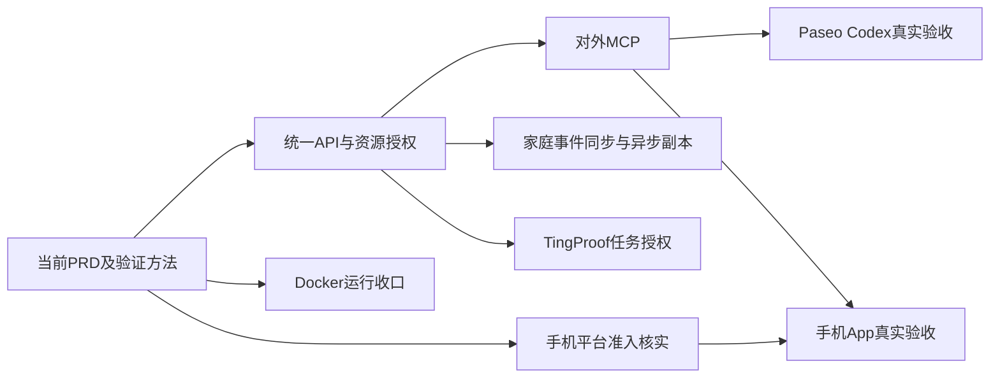

# Praxis 路线图

版本：0.1.153

[English](ROADMAP.en.md)

## 委托管理与空间上下文响应

交付 DM01–DM03：为全部未撤销委托（包括已到期／受限记录）提供居中模态框撤销入口；逐应用管理展示对应空间／应用委托，仅沿用当前操作人既有撤销权限，确认时说明撤销整份委托。空间页按选定用户刷新应用访问、资源权限与操作，拒绝旧响应覆盖，保留完整目录及管理员能力。使用隔离合成 API 验证鉴权／CSRF、即时失权与既有审计事件，真实 Chromium 1440/390 px 对比各账号原生会话视图。打开双语 PRD、通过完整测试与一次对齐的补丁门禁，提交后仅在授权测试蓝绿环境构建／发布受影响的 web/core。报告实际版本与公开回读；独立业务验收仍由指定客户端完成。

## MCP 空间链路与设置清理

交付 MCP01–MCP03：移除过时的 MCP 调用／免责声明／时间 UI；使用直接原生同意下拉框并保留内联创建；验证自有空间删除拒绝复用既有持久错误浮层。依次审计公开指引、同意、令牌指定及真实 SDK 工具参数，包含 SDK 剥离扩展字段时的当前获准空间发现兜底。双语记录源码／浏览器证据，运行完整测试及一次对齐的补丁版本，打开双语 PRD，提交后仅将受影响的 web/core 发布到指定受管测试环境。独立业务验收仍由指定客户端完成。

## 长期 AI-native testing

1. 实现前在平台 PRD 定义 ANT01–ANT10，同步英文与简体中文。
2. 交付三个场景配置、稳定人设、可复现情境抽样、持久控制器、覆盖证据和 Paseo 适配器；首条提示词前应用配置的 full access（OpenCode auto_accept、Codex full-access），保留人工提问，agent 间派单和汇报统一用 Paseo send message；全局强制一个 worker 槽，每次仅含技术复现的 Maintenance 派单须在 Paseo 中人工明确确认。
3. 用合成夹具验证重启、不明派发、缺少/拒绝/重放确认与范围变更、原角色修复复测、暂停和真实覆盖统计，从工作台打开双语 PRD；交付时不创建测试 agent、周期调度或业务记录。
4. 明确启动后，配置隔离业务身份/工作区、独立维护环境，验证公开建号/建团队/同意路径，确定投资市场/期限，核对真实 MCP 能力；通过 Paseo 启动主控与角色并收集实际客户端证据。周期运行、负载验收和生产部署另行安排。

## 首屏语言

在平台所属 HTML 返回入口按已保存偏好渲染，无有效 Cookie 时保持英文，认证显式语言优先。保留英文原文元数据、客户端回退、公开双语 SEO 地址及语言导航。使用隔离夹具在桌面／手机验证阻止脚本时的初始 DOM、刷新／导航和切回英文，断言无语言替换／位移且授权不变。运行完整平台测试和双语需求阅读器，同步递增一次 PATCH，提交后构建受影响的 web/core 镜像并通过已授权受管蓝绿环境发布，回读实际运行版本。

## 公开产品主页设计

定义公开搜索意图、双语正文、真实产品图及在线试用/自托管路径。先交付响应式静态原型和 SEO/交互验收，再改路由。确定官网 origin 后实现可抓取的语言版本与元数据，验证并部署公开页面，保持工作台受保护。公开页面已在既有 canonical origin 部署。本轮优化紧凑吸顶页头、主标题/按钮下方通栏演示及原生结果卡片质感，保留授权入口和双语 SEO 合同。

## 公开自助账号

从公开主页及登录页提供双语注册入口，校验 JSON/表单、同源写入及持久化对端/全局限流。身份创建以原子操作配置一个本人拥有的个人空间，保存不可由用户更改的自动来源删除保护标记；仍与应用／资源授权及管理员角色分离。保留运维已配置的个人空间，不重复创建。用合成夹具验证注册 → 登录 → 授权码/S256 PKCE 同意 → 受保护 MCP 令牌调用、拒绝路径、重启持久化及双语 PRD 阅读器。平台 patch 仅递增一次并同步双语发布记录；源码/浏览器检查并提交后，构建受影响的 web/core 组合，在指定受管蓝绿环境部署。仅回读公开注册及主页文案，不创建线上账号；独立业务角色另行验证自己的结果。

## 个人空间自动配置与 OAuth 指定空间

实现前定义 BSA01–BSA04。公开注册以原子且幂等的操作配置一个带来源标记、本人拥有的个人空间，不重复配置运维已创建的空间，不授予应用／资源权限。删除保护由类型改为自动来源标记，对平台管理员在内的所有调用者生效；其他空间（包括额外个人空间）沿用创建者／管理员的确认及级联删除。在既有 OAuth 同意页增加可访问空间明确选择、个人空间默认值，以及无空间时的内联创建。将指定空间绑定同意／授权码／委托，指定空间的授权码交换及刷新响应增补 `space_id`，保留既有客户端、委托、令牌字段、PKCE、Origin、CSRF 及逐空间／应用／动作边界。验证合成持久化、允许／拒绝与回归，以及真实 Chromium 1440/390 px 选择、创建和回调／令牌流程。运行平台完整套件和同步一次 PATCH 的版本门禁，通过工作台打开双语 PRD；提交验证源码后，构建受影响 web/core 服务对，在已授权测试蓝绿环境发布。公开回读和实际运行版本属于技术证据，独立业务验收另记。

## OAuth 同意页回调跳转与空选择

在既有外部智能体同意页处理已校验的空选择，显示可操作的英文/简体中文提示及重试表单。用隔离合成夹具验证 HTTP 400、无跳转且授权码/委托数量不变，再勾选一项完成既有 303/授权码/S256 PKCE 交换。在已校验的同意页和重试文档中，仅为 CSP `form-action` 添加注册回调 origin，拒绝不安全的 CSP 来源；其他页面维持原有限制。验证真实 Chromium 表单 POST、浏览器自动跨源回调、无 CSP 违规及成功 PKCE 交换，并覆盖空选择失败与重试。保留默认未选中及授权边界。运行平台套件、打开双语 PRD 阅读器，提交后构建受影响的 web/core 组合，在已授权测试蓝绿环境发布。实际运行版本及公开回读与独立业务客户端验收分开记录。

## 管理员用户管理与删除

实现前定义 USR01–USR06。将标题创建按钮及列表内联编辑器替换为「新用户」区块与独立逐用户详情页，保留现有启用／停用、密码和管理员操作、返回列表／历史及普通用户限制。原生管理员可通过既有准确输入确认模态框删除他人；任何调用者均禁止自删。账号拥有非自动空间时清楚列出空间 ID 并拒绝，须先通过既有管理流程处理。在现有策略边界内原子删除账号及会话、委托／凭据／授权码／同意范围、成员关系、权限、入口策略，以及带来源标记的自动个人空间与其授权／启用引用；适配器文件保留供另行授权清理，无关授权不变。刷新全部用户选择器并清除失效选择。用隔离合成夹具验证允许／拒绝、回滚和立即撤权，并在真实 Chromium 1440/390 px 验证创建／详情／确认／上下文切换及双语工作台 PRD。运行完整平台套件和一次 PATCH 对齐的版本门禁；提交已验证源码后，仅构建受影响 web/core 服务对，经已授权测试蓝绿控制器发布。技术证据、部署修订及公开回读与独立业务验收分别报告。

## 统一设置控件行

实现前定义共用字段／操作行及说明、区块间距。全部表单与列表的操作统一对齐主内容区右边缘，控件在左；移除各表单独立的宽度限制。全部管理视图采用同一模式，保留原生控件和静态底部空间。移除下拉触发的页面滚动及过大的焦点滚动留白；对每个下拉框断言鼠标聚焦、键盘展开及关闭前后的滚动差与布局偏移均为零，覆盖视口底部的可见控件，并实际检查原生菜单；仅在不超过 390 px 时纵向排列。使用合成夹具，在 Chromium 1440/390 px 验证八个管理视图、键盘焦点、触控尺寸、原有空间／成员／应用启用／授权提交，以及工作台中英文 PRD 阅读。运行平台完整测试，同步一次 PATCH 与双语发布记录，提交已验证源码，再构建并通过已授权测试环境蓝绿控制器发布现有 web/core 服务对。回读公开设置入口行为和实际运行版本；业务验收归独立客户端。

## 管理确认与委托辨识

实现前定义 ADM01–ADM04。委托状态右对齐，显示带标签的完整等宽委托及空间 ID，安全换行，覆盖相同名称。仅在既有本人／管理员委托列表投影中增加从原始委托规则提取、去重并排序，且与当前有效操作范围区分的只读 `grant.spaceIds` 元数据；保留路由、写操作、授权及全部既有字段含义。管理台每种破坏性内联确认统一改为居中遮罩模态框，保留空间删除准确 ID 输入。用像素断言验证周围几何／滚动位移为零，Tab／Shift+Tab 限定框内、恢复焦点，以及取消／Escape／点击遮罩不发修改请求。空间与智能体委托均使用普通原生「当前用户」下拉框，可按需分页，无搜索，保持选择与身份语义。用隔离合成夹具在 Chromium 1440/390 px 检查全部管理视图及原流程，通过工作台打开双语 PRD。运行完整平台套件和同步一次 PATCH 的版本门禁，提交已验证源码后构建受影响 web/core 服务对，通过已授权测试蓝绿控制器发布。实际运行版本与保持不变的公开回读分别报告，不代替独立业务验收。

## 空间概览与逐应用管理

实现前定义 BSP05–BSP08。空间概览只承载成员与完整已安装应用目录，逐项标明智能体业务能力；「管理」进入只含一个应用的启用状态及成员权限／授权表单的页面。新空间表单保留在空间控件顶部、管理员专属用户上下文行下方。保留既有 ID、标签、确认方式与授权；增补目录能力元数据，为非业务应用提供成员网页入口，不授予智能体动作、不绕过应用自有检查。全部管理视图统一单条分隔线；成功使用独立浏览器 `window.alert` 弹窗，由用户确认后关闭，不插入页面通知或文字行、不改变正文布局和文案、不设置自动消失计时；错误保留到处理、重试或明确刷新，包括成功操作后的跟随读取失败，此时不弹成功提示。用隔离合成 API 及真实 Chromium 1440/390 px 验证管理／返回、启用／停用、添加／移除成员、授权／撤销、成功弹窗确认且不插入页面行、读写错误持续可见与无横向溢出，并通过工作台回读双语 PRD。运行完整平台测试和同步一次 PATCH 的版本门禁，提交已验证源码，再构建受影响 web/core 服务对，通过已授权测试蓝绿环境发布。实际运行版本与公开回读单独报告，不代替独立业务验收。

## 设置中的管理员显示上下文

交付 BUC06：空间所有者说明复用实际登录会话的所有权判断，仅在非所有者管理员显示上下文中将所有者引导改为中性说明。保留应用／权限投影、所有者／成员行为和操作人既有动作。用合成个人／家庭／团队会话在双语 Chromium 1440/390 px 检查稳定刷新几何及工作台双语 PRD；通过完整版本门禁套件，提交后仅通过已授权受管测试蓝绿控制器构建／发布受影响 web/core。技术检查、运行版本及保持不变的公开回读与业务验收分别报告。

实现前定义 BUC01–BUC05。在空间首行为平台管理员复用智能体委托的「当前用户」模式，默认当前登录管理员本人，空间与智能体委托均通过普通原生下拉框提供全部已注册用户，可按需分页，无搜索输入框或搜索交互，跨页保留当前及已选账号。按选定用户的只读模型展示已启用应用和资源权限，管理操作入口则依据当前登录管理员的能力。切换至成员／非成员上下文时保留原本可删除空间的删除入口；管理员本人拥有空间时保留 owner 控件，选择其他 owner 不会借用其权限。保留会话身份、授权、owner 专属 API 规则、准确 ID 确认／级联删除及既有 API／管理流程。修正智能体委托的实际展示用户语义，默认管理员本人，并在刷新、分页和上下文切换中保持标签与数据一致。普通用户无切换器，只保留本人上下文。用隔离合成 API 验证允许／拒绝及真实 Chromium 1440/390 px 流程、原生下拉和无横向溢出。运行完整平台套件及同步一次 PATCH 的版本门禁，通过工作台打开双语 PRD，提交已验证源码后构建受影响 web/core 服务对，在已授权测试蓝绿环境部署。技术证据、实际运行版本及公开回读单独报告，不代替独立业务验收。

## 自助业务空间

实现前定义 BSP01–BSP04。在既有工作台/设置中扩展登录后建空间、owner 从已安装审核目录启用应用、成员管理及明确资源授权。持久化运行时启用策略，保留既有静态空间、个人隔离、操作上限与最小权限。网页、bridge 执行/发现、应用 HTTP 和任务统一当前边界。用合成夹具验证公开界面 → 成员授权 → 授权码/S256 PKCE → 有界 MCP 发现、重启、撤权与提权拒绝，再运行平台套件及双语 PRD 阅读器。提交已验证源码，构建受影响 web/core 组合，在已授权测试蓝绿环境发布；回读入口及匿名 MCP 拒绝。独立业务客户端验收另行记录。

## 创建者发起的空间删除

实现前定义 BSD01–BSD04。在既有「设置 → 空间」概览及文档化本人 API 增加创建者删除和准确 ID 确认，保留平台管理员删除能力；拒绝仅加入成员，对所有调用者保护带来源标记的自动个人空间；其他空间（包括额外由用户创建的个人空间）可按相同的创建者／管理员规则删除。在现有策略锁内原子清除空间的成员关系、资源权限、委托规则／同意范围、应用启用策略及其派生网页入口。保留其他空间／用户／独立授权及适配器自有文件，记录文件留待另行授权运维清理。验证合成允许／拒绝、错误确认、回滚及立即撤权，再以真实 Chromium 1440/390 px 验证警告、取消、成功及选择器／列表刷新。运行扩展授权／布局检查、完整平台套件和同步一次 PATCH 的版本门禁；通过工作台回读双语 PRD，提交已验证源码后构建受影响 web/core 服务对，在已授权测试蓝绿环境部署。实际运行版本及保持不变的公开回读单独报告，不代替独立业务客户端验收。

## 外部客户端验收纠正

保留正常客户端的 shell、文件、联网及 MCP/OAuth 配置工具。验证身份、同意、发现与服务端越权拒绝/撤销，不要求禁用客户端工具。旧受限环境的证据仍按历史记录保留，不作为新 agent 的默认启动要求。

## 加载式集成与 Projects 规划

1. 记录剩余写死点、归属决策及行为／安全等价检查，实现前确定可信本地模块合同。
2. 将既有应用集成语义抽离到所属仓库，路由、授权、MCP、技能、卡片、观测、部署和存储共用 registry；用新增合成应用验证无需修改父仓应用专属代码，包含撤权与停用。
3. 在 Projects 仓库按最新 PRD 显式解决 D1，完成 AC01–AC15／P0，再实现 AC16 恢复为新草稿；保留旧工作视图及记录，使用隔离合成身份和数据。
4. 先发布所属修订并固定公开可获取的提交，验证组合原生 UI／类型 API／MCP、迁移回滚及约定负载，再保留现有数据及单写者部署受影响服务；外部客户端／手机证据另列。

## 应用清单归属与版本审计

1. 实现前先在 PRD 和应用标准定义应用自有清单／示例及三段发行版本合同，区分安装引用、授权与应用展示。
2. 在所属应用仓库发布经审核的声明、图标与示例，修正发行版本冲突，不重编 schema 或无关版本，保留未发布工作。
3. 目录、provider、数据清单和 PRD 元数据改从已安装声明解析，同步启动引导、资源、打包及本地登记，删除重复的中央目录。
4. 验证十四个公开 pin、package／manifest 版本一致、匿名空检出引导、非法输入拒绝及私有覆盖项；检查十三个卡片来源、数据清单、双语 PRD 显式需求修订标签和原生入口／Home 导航，再部署受影响服务并回读版本。

## MCP 优先的 Trace 验收

概览默认展示真实 MCP 调用。用隔离合成数据，经实际 MCP 入口验证已注册工具成功、拒绝、参数及未知工具错误、控制调用、中断，以及应用提交和回读。将工具名、准确传输来源、脱敏调用者关联、调用量及耗时与实际请求对应；委托 HTTP 不计入 MCP 调用量。Polaris 历史保留为补充上下文。将合成写入暂停在应用执行之后，用实际管理 Trace HTTP 接口验证其及时报告进行中的调用，同时不释放业务串行门控。验证双语、窄屏、重启持久化和访问边界后，部署受影响的工作台与 Core 槽。

## 应用接入交付

1. 发布应用自有的只读卡片及数据清单 provider 合同，接入十三个非 runtime 应用及 Polaris 数据清单。
2. 按已设计的卡片 UI 实现，并提供持久、仅本人可读的呈现偏好；用合成记录逐应用验证来源跳转、资源拒绝、刷新及桌面／手机导航。
3. 用按应用目录发现的 provider 汇总替换人工维护的数据位置总表，逐应用显示真实可用状态。
4. 实现 Overview 的业务 Trace 流程视图，使用和体验线索始终展开；验证结构化记录、权限、隐私排除及空状态／历史覆盖。
5. 子仓先发布到 main，主仓固定实际验证的组合，保留可恢复数据后部署受影响服务，并回读线上安装。

## 统一应用发布

十四个内置应用统一使用 `main` 作为默认开发与发行分支。核对各应用正式仓库、固定提交的匿名获取和分支归属，验证干净递归克隆及平台合成测试。源码切换时保留已审核的应用代码、现有记录和运行中的授权边界。

## 产品方向

| 目标 | 验收计划 |
| --- | --- |
| 保护员工的注意力 | 跟踪从获授权的委托、例行执行和自动检查，到员工核验结果的全流程。在已支持的送达路径上，记录员工主动查进度的次数、被打断的次数和恢复上下文的时间。核对异常是否带着证据和问题送达有权处理的人，并记录漏报的阻塞。 |
| 在质量和时效相同的前提下提高交付产能 | 比较委托前后每次合格交付的人工分钟数，分别记录例行处理和需要判断的验证用时。跟踪验收通过、按期交付和返工情况。有客户需求时，观察同一支团队是否实际完成更多付费交付。 |
| 给团队留出反思和改进流程的空间 | 先验证获授权的同事能从已完成的交付回溯原始材料、MCP 业务操作、Polaris 运行和人工决定。再用一批历史案例提出一项改进，在隔离环境验证草案。比较等待时间、返工、员工被打断的次数和验收质量。验证团队能补充情况或暂缓建议，并由获授权的人决定是否发布新流程版本。 |
| 将平台能力复用到下一条流程 | 由独立开发者参照内置应用和应用标准部署不同工作流。评估 Polaris 作为工作流引擎的效果，对照首条流程，记录第二、第三条流程的构建、运行、升级和恢复投入。在受管环境中验证 agent 的授权范围、执行与回读。在付费试点中，验证客户是否为新增流程的持续运行付费。 |

当前的本地登记与受管发布步骤见[应用标准](APP-STANDARD.md)。

## 交付范围

| 交付范围 | 预期结果 |
| --- | --- |
| 平台公开源码 | 贡献者可直接克隆、安装锁定版本的依赖、启动本地工作台并运行合成测试。 |
| 公开阅读器 | Letters 与 Profiles 使用各自独立维护的源码仓和固定提交。运行时为配置的所有者只读挂载原件。 |
| 更多应用 | 逐个核对公开源码、许可证、合成测试、数据合同和固定提交后分发。 |
| 受管部署 | 各安装环境自行配置身份、存储、路由和应用服务，并验证访问、撤权、返回工作台和恢复。 |

### v0.1.111 · 桌面安装图标

为安装图标 URL 加入图案版本，统一登录页和设置页的标志，保留已安装应用的身份。验收匿名读取、PNG 内容、manifest 一致性，以及登录页的图像与 manifest 加载策略。部署后核对线上安装元数据。

### v0.1.110 · 移除工作台 Paseo 门户

删除工具栏入口、嵌入面板和配套资源。验收工作台不再请求 Paseo 网页客户端，桌面和手机上的视图切换、顶部对齐、设置及首页返回均可使用。部署已验证的版本并回读线上工作台。

### v0.1.109 · 底栏切换视图

在现有底栏使用单个小图标切换「应用 / 待关注」，移除左上角切换器及应用视图中的事项预览。两个视图在内容很少或为空时也始终顶部对齐。验收桌面和手机上的图标状态、键盘焦点、卡片保留、空内容及错误状态、语言切换与撤权。在本地自托管安装中部署验证后的结果并回读。

### v0.1.108 · 工作台设置

将工作台的「管理」入口更名为「设置」，在独立及受管工作台中统一从「通用」选择语言。验收时以普通成员身份切换语言、返回首页、刷新并打开对应语言的需求文档。账号与管理员各项设置继续沿用现有授权。

## 容器快速开始

按冻结原仓的合同恢复完整内置栈，包含各应用的原生服务、身份、限定范围的业务操作和持久存储。在私有部署描述文件之外，保留原有栈管理与恢复流程。逐项验证十四个入口、真实合成数据的原生写入与回读、权限、媒体与创作功能、首次初始化重试及重启持久化。

## 既有安装迁移

固定内置应用源码版本，发布目录并说明启动方式。将本地控制仓与 Docker 项目一同迁移，沿用原工作空间和持久化数据。退役旧控制入口前核对服务挂载、读取结果和回滚点。

## 里程碑、交付顺序与验收历史

以下按作出决策时的版本记录 v0.1.0 至 v0.1.107 的需求与交付。历史测试数量、启动命令和部署结果均对应当时版本。现行公开发行版的启动方式、应用权限及 Polaris 只读查看器见[运行说明](RUNNING.md)、[内置应用指南](BUILTINS.md)和[查看器说明](POLARIS-VIEWER.md)。

## 1. 当前目标与交付边界

当前方向为面向外部 agent 的个人、家庭与公司业务平台。Praxis 不运行内部 agent、模型推理或聊天助理；普通用户及其 AI 只修改获准业务数据，平台代码只由平台管理员维护。当前维护 agent 专注代码、文档与合成验证，不再直接操作真实业务记录。**开发与使用分离**是平台原则：同一模型承担两类角色时，也必须分开身份、会话、凭据、环境与审计。

v0.1.14 已交付 PRD、验证方案、路线图及角色说明。当前按**外部 agent、数据、界面**三个实体对齐产品：agent 到数据依赖 MCP 控制通道、OAuth 2.0 用户委托和连接器能力；数据到界面依赖用户体验设计。控制、鉴权、连接与体验是关系能力，不拆成五个并列模块。已有 E8–E14 保留，本轮 F35 优先把用户与授权管理做进网页。维护侧交付代码和隔离合成验证，真实业务记录仍由独立业务身份经受控通路操作，真机检查需要用户参与时提供具体方法。

| 目标 | 验收结果 | 优先级 |
|---|---|---|
| O1 统一业务契约（F26） | 网页/API/MCP 复用同一业务规则与事实源，先 Reminder 闭环，再 TingProof 任务适配 | P0 |
| O2 用户与空间隔离（F27） | 个人/家庭/公司、空间成员和任务外部协作者均有明确资源/动作范围，所有等效入口不能绕过 | P0 |
| O3 外部工具接入（F28） | 可达的受认证 MCP，外部 harness 调用业务工具，无代码/主机能力 | P0 |
| O4 两条独立实证（F30/F31） | 真实 Paseo Codex 经 MCP 操作指定数据；另一个真实手机第三方 agent App 完成连接与业务操作 | P0 |
| O5 协作与恢复（F24/F25/F29） | Docker 统一管理；家庭提交后同步、冲突/重连正确；云/NAS 异步副本独立验收 | P0 |

现状更新（2026-11-12）：v0.1.13 已交付 Compose/存储代码及隔离验收。Docker 现在已安装，`sg docker` 可访问引擎；旧 Paseo Supervisor 仍持旧组，本机原生服务尚未切换。云凭据已有 Git 外私有副本，但实际客户端配置、WebDAV 往返和恢复未验收。统一业务 API、资源权限、家庭同步、MCP 及手机接入仍待实现；不能引用137项历史自动测试宣称这些功能已通过。

## 2. 能力拆分、依赖与产能

| 能力单元 | 交付物 | 硬依赖/边界 |
|---|---|---|
| E7 现行需求基线 | 当前 PRD、VERIFICATION.md、维护/业务执行角色约定及四部分产品定位 | 文档刷新后直接继续既有待办；不写真实业务数据 |
| E8 Docker 本机收口 | 现有 Compose、Paseo 一次启动任务、健康/持久化与回退 | 引擎已可访问；真实数据迁移由受控运维执行通路负责，当前维护 agent 不借部署代写业务记录 |
| E9 API 与授权 | 用户/客户端/空间/资源/动作契约、版本/幂等/审计、Reminder 适配 | 个人数据默认私有、空间管理员无代码权；应用无接口先补 owning app，保持独立运行 |
| E10 远程 MCP | 工具、协议、用户授权、薄厂商适配 | E9；HTTPS 与凭据管理；不运行内部 agent |
| E11 外部 Codex 实证 | Paseo 真实 Codex 业务 agent、隔离门禁、真实工具调用/拒绝证据 | E9/E10、独立业务身份、无维护宿主/源码/直连后端；不以 full-access 子 agent 冒充 |
| E12 手机 App 实证 | 至少一个真机第三方 agent App 绑定账号、操作/读回、拒绝/撤销 | E10、厂商实际准入/手机版本；豆包首选，资格调查可从 E9 前开始 |
| E13 家庭协作与副本触发 | 单服务端事实源、提交后事件、冲突/幂等/重连；变更触发快照与持久重试 | E9/E10；与现有默认每小时备份分别记录；云故障不阻塞家庭业务 |
| E14 TingProof 任务外包 | 指定项目/任务资料与校正提交，生命周期及所有旁路授权 | E9/E10；原账号墙仅应用级，不等于资源权限 |

[排期假设] 以1名维护实现者、可并行的代码子任务、外部业务验收执行者及用户真机参与为参考，分3周能力切片，保留20%验证/联调缓冲；这是规划粒度，不要求等待周末或额外观察期。当前已授权实施，按 PRD → 路线图 → 实现 → 验证 → 本地提交逐项推进，独立应用子仓先提交，不自动 push。先实现 API/授权及应用适配，同步封闭受管模式旧接口旁路，再接 MCP/协作事件；手机准入与真实业务隔离环境独立验证，不能用合成测试替代。

关键路径是 E7 → E9 → E10 → E11/E12，两条外部验收均需通过。手机资格/协议探针提前并行，避免最后才发现消费 App 不能配置工具。Docker 与云条件单独收口，不把引擎可访问、凭据保存、桌面 MCP 可用混为业务或手机通过。

本轮运行修复同时核对既有转发镜像、动态 TOTP 与有限失败尝试；认证失败停止重试并明确记录，证书、existing relay 和无关服务以变更前后摘要核对。

当前代码切片：独立4326业务服务与持久身份授权、应用签名适配、Reminder 原子资源/幂等、TingProof 窄任务接口；随后接真实 MCP 协议与 OAuth、授权事件及持久副本队列。每个应用受管模式先关闭旧匿名旁路；未受管的既有运行实例不因代码提交而宣称获得资源隔离。实际迁移、真实业务执行者与真机联调分别记账。

## 2.1 当前周粒度里程碑与验收

| 里程碑 | 时间/状态 | 交付与完成标准 |
|---|---|---|
| M24 需求与方法基线 | 本轮 v0.1.14/文档完成 | PRD、路线图、验证方法落盘；维护/业务分工和所有新用例未执行状态明确；文档检查后本地提交 |
| M25 Docker 本机收口 | 第1周/统一13项健康运行 | 实际 Paseo run-stack 启动并关闭终端后仍健康；绑定原真源，业务重启持久化通过；完整原生回退未执行 |
| M26 业务 API 与权限 | 第1周/源码及隔离测试通过，Reminder 已受管运行 | 用户/空间/资源/动作、版本/幂等/脱敏审计；受管模式关闭旧接口旁路；TingProof 原完整工作流与受管任务接口分别验收 |
| M27 MCP 服务 | 第1–2周/本机与公网协议可达 | 经认证工具发现/调用、客户端委托与撤销；无原始文件/命令/代码工具，无直连后端绕过 |
| M28 Paseo Codex | 第2周/Reminder 实际闭环通过 | 实际隔离、CRUD/例行执行/统计、跨空间与版本/幂等拒绝、重启持久化、限定清理及同连接撤销401；其他实际用例仍按台账区分 |
| M29 真机第三方 App | 第1周预检、第2–3周联调/依赖 M27与厂商准入 | 实际手机 App（优先豆包）完成账号连接、业务调用/读回、拒绝/撤销；任何桌面结果不替代 |
| M30 家庭同步及副本 | 第2–3周/依赖 M26–M27 | 两成员/两客户端提交后互见、冲突/重连正确、缓存与事件受授权；变更触发云队列及恢复校验独立验收 |
| M31 TingProof 外部任务 | 第2–3周/依赖 M26–M27 | 仅获分配任务可读/提交，其他项目、音频/附件/导出/搜索/下载等旁路拒绝；任务结束后收权 |
| M32 其他应用增量 | P1/后续按需求 | Travel 受控写入、Memo 服务端业务持久化、Knowledge/Slides 按授权内容能力逐项验收，不把浏览器备份或可执行源码当作已共享数据 |
| M33 需求与体验观测（F32） | 已交付，v0.1.18独立提交 | 私有有界观测库、HTTP/MCP/工作台浏览器事件及CLI聚合；隐私sentinel、权限/冲突/系统探测排除、MCP200业务失败、慢阈值与p95检查通过；部署后核验真实脱敏事件 |
| M34 首页状态概览（F33） | 本地已部署，v0.1.19独立提交 | 只读查看名单与session边界、固定同源代理、权限/连接/存储三组、脱敏存储发布器；匿名/普通用户拒绝、混合/未知/过期/会话失效及桌面手机验证 |
| M35 统一登录与源站网关（F34） | 自用环境及公网已切换，v0.1.20独立提交 | 持久入口授权、源站全路径守卫与分享迁移、原端口限制；先保护源站再撤边缘Basic，浏览器单次登录与OAuth独立验收，保留证书/existing relay及健康VPN |
| M36 网页用户与授权管理（F35） | 本周增量/已部署v0.1.21 | 显式平台管理员、用户启停/重置密码、入口权限、委托查看/撤销；现有owner角色配置后无需CLI完成日常管理；隔离HTTP/浏览器、权限保护及实际部署只读验收通过 |
| M37 管理员默认授权及工作台返回（F36） | 本周增量/已部署v0.1.22 | 管理员全部页面入口默认可用，第一方本人业务无需重复委托；默认完成进入桌面，应用上下文保留；普通用户与外部OAuth隔离、降权撤销及真实浏览器验证通过 |
| M38 Reminder原版界面恢复（F37） | 本周增量/已交付v0.1.23 | 原版右侧任务/统计、紧凑条目与徽标、日历配色/尺寸、六视图语义和既有操作恢复；独立原版与受管版同夹具视觉/行为对照、权限与冲突回归通过 |
| M39 单一用户工作台（F38） | 本周增量/已交付v0.1.24 | 移除重复业务空间页面、有效账号个性化过滤桌面、零授权空态和受限全局概览；应用/项目同标签跳转及后退；权限鲜度、直接URL与Reminder视觉回归通过 |
| M40 统一平台手册（F39） | 本周增量/已交付v0.1.25（文档） | 工作台说明和BUSINESS手册合为PLATFORM，README成为快速入口；专题文档对齐现行权限，引用/链接及原检查通过 |
| M41 管理界面状态概览（F40） | 本周增量/已交付v0.1.26 | 概览与体验线索从首页移入管理默认页；仅管理员可进入，不保留独立查看者入口；首页零概览请求、权限边界、失效清空和手机布局验收 |
| M42 多模板UI指南与工作台（F41） | 本周增量/已交付v0.1.27 | 将共同视觉规范与启动台/集合/阅读/编辑模板分开；首页采用启动台，保留权限与现有图标导航；桌面、390px及样式隔离验收 |
| M43 并列分组标题一致（F42） | 本周增量/已交付v0.1.28 | 应用与项目均为二级标题，统一字号/字重/颜色；桌面与390px浏览器、PRD样式隔离及根383/383通过，实际服务已更新 |
| M44 状态概览图表化（F43） | 本周增量/已交付v0.1.29 | 锁定本地Chart.js、固定受保护资源；权限/连接/存储及全部体验聚合改为图表；准确值表格、未知/过期及图表清理/缩放验收 |
| M45 系统导航与应用分离（F44） | 本周增量/已交付v0.1.30 | 平台主页控件、应用侧栏去平台功能、工作台账号菜单；受控私有HTML呈现与分享隔离、听校通用离开保护、六应用/手机/Reminder基准验收 |
| M46 移除通用业务空间UI（F45） | 已交付v0.1.31 | 先PRD/路线图，再删除通用HTML/控制器/样式/日历；专属页面首屏、禁JS刷新、错误态、旧资源404及原Reminder基准验收，更新服务并独立提交 |
| M47 资料归属整理（F46） | 已交付v0.1.32 | 根PRD/路线图→Knowledge文档→清单保全→书库与项目迁移→双模式构建、逐文件核对→受影响服务更新→子仓及主仓独立提交 |
| M48 Paseo运行入口收口（F47） | 已交付v0.1.33 | PRD/路线图→六个Docker管理脚本与注册表→命令路由和引用检查→Paseo只读状态验证→独立提交 |
| M49 统一管理与智能体权限分层（F48） | 已交付v0.1.34 | PRD/路线图→当前权限交集与网页本人模式→移除重复入口、同一管理页按身份分层→安全/浏览器回归→更新受影响服务并独立提交 |
| M50 Travel行程地图（F49） | 已交付v0.1.35 | Travel v0.1.8地图、日期联动和展开；私有凭据只读挂载，61/61与根420/420及真实账号／SDK检查通过，子仓后主仓本地提交 |
| M51 Travel高德Web服务（F50） | 已交付v0.1.36 | Travel0.1.9只读搜索及驾车／步行接口，73/73和根420/420、两个实际账号6项查询及权限边界通过；原UI／MCP／业务数据不变，子仓后主仓提交 |
| M52 Travel地图卡片与路线（F51） | 已交付v0.1.37 | Travel0.1.10悬浮卡片、放大数字与列表道路联动；74/74和根420/420、真实HTTPS桌面／390px触控及道路绘制通过，子仓后主仓提交 |
| M53 Travel类型化MCP与UI保护（F52） | v0.1.38代码门禁已验证；内容已撤回并暂停 | 原攻略完整回退及旧身份撤销→移除整份写入口→单地点类型化白名单／代码格式化→根441/441、Travel108/108及实际1440／390只读通过→14项健康、原数据哈希不变→子仓后主仓提交；后续内容不得绕过新合同 |
| M54 原有行程新版UI（F53） | 第46周，当前实施 | PRD／路线图→冻结原稿终稿投影→既有三标签／日期／卡片→Leaflet海外地图适配→原稿／55图／清单及桌面手机保全检查→部署并子仓后主仓提交；不写攻略、不扩大MCP范围 |

M54仅使用一个现有UI：删除未发布的重复的旧行程界面与额外控件，复用已有路线组件及交互，差异限制在数据和地图服务适配。原始内容存档保全，不把旧功能全部搬进新页面。

M54同时落实全局原则：先将PRD中的共用界面约束写入操作技能和视觉指南，再核验Travel两份数据确实调用同一渲染／交互／预算／准备组件；此后所有同类功能按该门禁实施，不按地区或记录复制页面系统。不同应用保持独立，不开展无关全站重写。

M54验收：Travel118/118、Praxis441/441，无跳过；AMap与真实Leaflet／OSM桌面手机通过，原五页七宽度回归通过。正式HTTPS1440／390两地检查与14项服务健康通过；原始HTML／55图及回退攻略不变，没有维护者业务写入。全局原则已写入操作技能与视觉指南。

| 里程碑 | 顺序 | 验收范围 |
|---|---|---|
| M55 管理MCP清单（F54） | M54验证提交后，逐需求交付 | 同一管理页增加管理员专属栏目，运行时注册表生成工具／认证／配置／实际调用状态；先PRD再路线图，合成权限与无样本测试、桌面／手机及HTTPS只读核验后独立版本提交 |
| M56 公共用户引导MCP（F55） | M55后交付，公共模块可提前独立实现 | 固定只读介绍／连接／桌面保存指南，独立公共端点；匿名初始化／发现／调用通过，业务工具不可见、受保护MCP仍401；限量／来源／Host／生命周期边界检查，实际HTTPS验证后独立提交 |
| M57 按资源委托的旅行规划 | 在统一界面与对象级合同通过后实施 | 隔离执行者逐对象核实、登记来源并回读。限制写入字段，拒绝整份记录替换；未知和未来可售状态保留未知。 |
| M58 工作台主屏幕（F57） | 第46周当前增量；旅行复核已完成 | PRD→路线图→启动台视觉指南→一套响应式图标／底部系统栏→权限与键盘回归→桌面／平板／手机／短屏／放大检查→仅更新工作台服务、正式HTTPS只读验证→单一PATCH本地提交 |

| M59 共享项目应用与跨小组协作（F58） | 当前第一版；单一共享应用 | PRD→路线图→独立Projects子模块合同→通用项目UI／事务存储与类型化MCP→工作台／权限／Docker／备份登记→两项目合成验证→独立业务agent录入并回读首个项目→子仓、主仓本地提交 |

| M60 双通道公网访问（F59） | v0.1.45 的传输容灾里程碑 | 先用隔离配置验证备用传输，再检查边缘切换、源站身份、MCP 拒绝、授权读取和断线恢复。切换时保留证书、现有路由与回退材料。 |

| M61 独立项目桌面入口（F60） | 当前用户增量 | PRD→路线图→Projects受管上下文合同→本人授权摘要生成桌面逐项目图标→同一项目页面固定上下文→多项目／资源隔离／撤销与手机验收→子仓、主仓提交 |

M61完成记录：根483/483、子应用21/21；三份数据共享同一界面与资源、每个独立桌面入口直达其六视图，受管选择器移除。三项目合成／真实公网、单项目授权合成与两项目授权实际账号、跨项目403、撤销／到期前台复核、迟到响应及手机检查通过。新增项目仅经独立MCP写入，原记录哈希保持；代码／业务身份分离，私有记录不提交。

| M62 项目资料栏目名称（F61） | 当前小增量 | PRD→路线图→两处文案统一为资料→既有检查／公网确认→更新Projects与文档镜像→子仓及主仓提交 |

| M63 Knowledge业务知识库（F62） | 已交付v0.1.48；单一共享应用 | PRD→路线图→库／集合／来源／条目与修订→权限MCP及受控项目快照→同一阅读界面与旧书库保全→Docker／备份→多库隔离／来源／历史／中文检索→独立写入及只读agent实证→子仓、主仓提交 |

| M64 Knowledge书库风格统一（F63） | 已交付v0.1.49 | PRD→路线图→原文／资源基线→统一阅读壳与紧凑侧栏→目录／搜索／公式／图表／旧路径／前缀→跨书籍与320–1440px、200%字号→部署→子仓及主仓提交 |

| M65 Knowledge链接与参考页统一（F64） | 已交付v0.1.50 | PRD→路线图→链接／源文件清单→按源解析链接＋9份HTML统一投影→旧地址跳转→构建后链接核查及正文保全→默认／前缀／镜像／HTTPS／手机验证→子仓及主仓提交 |

| M66 根项目资料目录归位（F65） | 已交付v0.1.51 | PRD→路线图→30文件与引用清单→Projects子仓源资料归档及范式归属→哈希／权限／相对链接／镜像隔离→测试与服务状态→移除根目录→子仓及主仓提交 |

| M67 Paseo单一启动命令（F66） | 已交付v0.1.52 | PRD→路线图→删除卸载脚本及五项多余Paseo入口→更新维护说明和命令测试→实际Paseo列表与15项健康检查→版本及提交 |

| M68 Knowledge内容直达（F67） | 已交付v0.1.53 | PRD→路线图→首页平铺条目与书名／侧栏直达→权限与空态／深链接／搜索／章节回归→默认及前缀／手机浏览器→部署→子仓及主仓提交 |

| M69 PRD集合阅读界面（F68） | 已交付v0.1.55 | PRD→路线图→直接文档侧栏／集合与阅读壳／折叠目录→内容和权限回归／手机键盘与大字号→部署→独立提交，之后推进Slides UI |

| M70 Slides界面风格（F69） | 已交付v0.1.56 | Slides唯一PRD／§5.1排期→引擎中的门户／查看控件／工作区→合成与前缀／画布身份及手机检查→镜像／公开资产更新→HTTPS→引擎、Slides文档与主仓提交 |

M70保留deck、主题、内容锁与生成媒体身份，预留20%处理空侧栏、公开player导入和窄屏控件；不新增框架或修改真实文稿。

M69复用原PRD白名单与消毒渲染，预留20%处理长标题、宽表格和手机首屏；不新增页面或修改真实业务数据。

M68只优化既有Knowledge导航，保留数据、授权、来源与版本；预留20%处理书籍目录权限、路径前缀及窄屏内容优先，不增加新页面或写入真实业务记录。

M67复用现有Docker Compose统一编排，不合并私有控制文件或改变业务挂载；以配置加载和健康检查验收，无需为删减入口重建全部服务。

M66只整理既有离线源材料，预留20%核验截图忽略规则、ZIP与文档相对链接；不迁移真实业务记录，不重生成产物或新建服务。

M65预留20%缓冲处理锚点、HTML相对资源和跳转前缀；本轮只统一展示与修复链接，不让维护者写业务数据或重写资料。

M64保留20%缓冲处理长目录、旧侧栏偏好、平台导航及前缀搜索；容器构建明确生产模式，实际镜像检查搜索容器并用公网验证搜索，只调整书库呈现，不修改业务内容或授权。

M63按完整链路交付，维护者仅改代码与配置；真实收录／修订／项目引用由隔离业务身份完成。保留约20%缓冲处理旧书库资源权限、路径前缀、源码镜像保全、中文检索、CAS／幂等和原应用回归。先覆盖文本与授权项目快照，附件解析、自动跨库推广与高级检索后续按实际需要安排。

M61先完成新两项目受限MCP录入，同时并行实现桌面入口与应用上下文；两者共享同一项目模型，不改真实数据来适配界面。工作台使用既有业务API，不新增页面或全局权限；预留约20%用于无权限、上游失败、过期、后退和迟到响应的验收。

M60 历史验收记录：当时的两套配置通过 64/64 项检查，受限传输的断线恢复用时 16 秒。切换后的登录与健康检查返回 200，匿名 MCP 返回 401，授权账号可读取项目与知识库。此次验收覆盖运维人员显式切换；自动判断双通道健康仍是未完成项。

M60 的原计划为传输账号限制、系统服务环境、边缘配置校验和长连接预留约 20% 时间。先确认受保护源站可达，再切换上游；核对原路由、证书和回退配置。单条连接自动重连与两条通道之间的自动切换分别验收。

M59完成记录：两个合成项目共用 UI 及全部资源边界通过；独立业务身份经受限接口建立记录并读回核对，维护身份无写入。核对桌面、手机、平板、放大字号及知识引用。

M59按同一项目纵向打通“知识引用→科研结论→工程交付→市场反馈”，支持侧记录获准工作项；科研／工程／市场／支持共用列表及详情。先完成结构化模型与UI，再由独立业务身份录入，禁止维护者直接写业务数据。预留约20%用于资源权限、跨组依赖、CAS／幂等、手机布局与部署联调；不为每个项目创建仓库／服务，不扩张完整ERP。本机、真实MCP、公网及实体手机结果分别报告；边缘认证未恢复不阻断本机实现，也不新增隧道或公开旁路。

M58 核验：行程记录和权限归 Travel，入口布局的更新只读核对，不写业务数据。

M58已验收：Praxis465/465无跳过，六种视口及200%字体、长短账号／菜单／键盘和原权限／收权／迟到响应／退出回归通过。实际HTTPS两种角色的8／1入口、平板手机布局、本人管理与受限PRD行为通过，首页无业务正文或概览请求；14项服务健康。三份旅行计划未重复写入，工作台前端已更新；本轮为v0.1.43单独本地提交。

M55已部署：根完整测试与管理员相关28项检查通过，原管理回归和桌面／手机、收权／迟到响应通过。实际HTTPS管理员18业务／2未启用指南工具显示正确，普通用户无请求且403、匿名401，无真实业务写入。

M56已部署：根458/458无跳过；实际HTTPS匿名官方SDK初始化／发现／2指南工具及4平台说明通过，业务工具拒绝且原MCP401。管理员清单启用状态与桌面／手机、普通用户拒绝通过；没有匿名业务数据或实际写入，实体手机客户端仍另验。

M57依次交付：F56／Travel合同→对象级地点／单日／预算操作与只读旧计划投影→合成字段白名单、并发幂等与三路线共用UI检查→部署代码独立提交→重新建立只含这各条路线的业务身份及隔离门禁→实际API查询、MCP逐对象更新与回读→关闭执行者并撤销临时委托。保留约20%接口联调缓冲；提供方缺失不通过改UI或虚构事实兜底，未完成项明确报告。

M57预算验收同时检查不完整分类仅显示“已列预算”，无条目显示`—`；不以已有小计冒充完整费用，不增加解释区块。

M57运行门禁还需核验统一stack登记校验与三路线一致：显式允许既有三个ID的非空唯一子集，其他ID／重复／跨空间拒绝，随后验证实际14项服务健康。

M57 验收：隔离客户端在各自委托范围内写入行程，按资源和修订读回；地点、来源与报价均可追溯，未知信息保持未知。检查其他行程及源码没有发生越权修改。

当前迭代同步处理作者新增的卡片反馈：紧凑高度、正方形图片、桌面选中卡片居中；移除地图标题及常驻说明，展开／收起改为地图右上角悬浮图标。验证点击／键盘／无障碍名称、手机滑动、编号／道路、日期与署名无遮挡，以及真实故障反馈；按PRD后路线图再代码验证，纳入当前未完成版本。

实际攻略保存同时检查长模型输出：模型响应采用有界等待，避免完整攻略参数尚未生成完就反复断流；MCP短期断言、查询／提交时限、撤销和隔离仍独立执行。

最新优先级覆盖M53旧执行顺序：停止实际攻略写入→PRD／路线图明确类型化展示合同→撤掉整份JSON写入口、实现对象／字段白名单与固定格式化→合成拒绝及实际只读UI回归→部署并提交→再更新内容。原有行程UI、三份真实旅行规划、管理内MCP、匿名引导MCP、全应用反馈及新定位保留后续，不能在UI修复前穿插业务写入。

原始UI保全同时检查合法旧格式：空白、千分位、起价与费用已包含必须按固定类型表示；以公开原始seed覆盖所有已知数值，避免合格数据退化为缺失占位，再完成提交。

本轮执行顺序固定为F32→验证/提交→F33→验证/提交，不等待观察期。两项各按PRD→Roadmap→代码推进，常规测试直接运行。保持20%缓冲处理多进程SQLite锁、投影鲜度与登录状态；观测写失败不影响业务，状态不可得就显示未知。现有公网认证故障不扩展为本轮另一次网络改造，使用合成登录及实际只读验证分别记录；不为展示状态放宽匿名权限或改真实业务数据。

M29 保留豆包首选及其邀请制前提；已核实 Claude 远程连接器可供真实手机 App 联调。公网入口已恢复，用户可在手机连接 `/mcp`、本人登录并选择有限范围，完成操作/读回及撤销；当前不宣称真机通过。

F25 本轮实际结果：坚果云专属合成命名空间的加密同步、完整检查与空目录恢复通过，含文件哈希及 SQLite WAL 提交恢复；首轮生产副本已由唯一工作器在后台执行，完成状态不与合成验收混报。

详细 case、执行身份、证据与清理要求统一见 [VERIFICATION.md](VERIFICATION.md)。M24 是历史文档交付；当前继续 M25–M31 的既有待办，状态按代码、合成测试、实际运行及外部验收分别记录，不得因文档提交或版本号递增改为完成。连接覆盖以完整任务可用为标准；安全拒绝不能以成功数抵消；数据复用与美观呈现沿用既有应用/通用 UI 规范，不以增加启动图标代替业务接通。

v0.1.16 代码交付：M26/M27 的业务服务、权限/OAuth和 MCP 已实现，M30 的授权事件/断线重读/持久副本队列与动态覆盖、M31 的窄任务接口已完成隔离合成验证。工作台业务视图与授权登录、两成员同步、受限校正及草稿差异经真实 Chromium 检查；业务 Compose 与固定端口的临时 Docker 链路、独立业务执行环境的网络防火墙亦已隔离验证。上述结果不将 M28/M29、D01/B01 标记完成；需要实际运行证据和用户真机参与。坚果云认证已通过，新路径初始化兼容问题待修；实际云端复制及恢复尚未通过。

当前基础设施收口：先登记并验证原路径精确绑定的 Docker 运行方案，确认替代服务可用后停止仅有的旧监听者；统一入口聚合业务项目与其余应用/同步器，不新建长期终端。并行修复坚果云明确的祖先缺失初始化，用独立合成 workspace 完成真实加密复制、check 和空目录恢复后，再按原配置启用正式副本。独立 Paseo 业务 agent 在有效隔离门禁通过后，经同一 MCP 操作与清理专属验收空间；真机用户步骤只在可达入口就绪后提供。

## 3. 历史周粒度里程碑与验收（保留来源）

| 阶段 | 时间 | 交付物 | 成功指标与护栏 |
|---|---|---|---|
| M0 产品基线 | 第 1 周，先执行 | `docs/PRD.md`→`docs/ROADMAP.md` | 两文件落盘、v0.1.0 范围可评审；不创建 `docs/prd/` 替代文件 |
| M1 可读真源 | 第 1 周 | 集合目录与源读取 | 当前七份允许 PRD 可读；版本以正文为准；缺失单项不阻塞其余项 |
| M2 工作台入口 | 第 1 周 | “PRD集合”大图标与本地阅读页 | 两分组可见、正文可读；原 Reminder 与知识库入口不回退 |
| M3 v0.1.0 交付 | 第 1 周 | 自动验证与浏览器证据 | 原文一致、刷新可见、越界拒绝、危险 Markdown 不执行；第三方仓库零改动 |
| M4 首页与 Slides 入口调整 | 本次补充 | 首页标题去重、Slides 大图标、运行服务检查 | 先更新 PRD，再同步本路线图，然后改页面；桌面/手机无重复标题，其他文档标题保留，点击 Slides 新标签打开 4666；已有服务复用，不重复启动 |
| M5 Praxis operator skill | First requirement | General English skill, optional metadata, root discovery pointer | Validate structure and synthetic data-only/code-only/mixed scenarios; explicit readback, PRD→roadmap→code→verify→local commit, service restart when needed, subrepo then gitlink, privacy and authorization boundaries |
| M6 Travel independence | Next requirement after the operator skill, in a separate commit | Standalone Travel service on port 4323, workbench launcher and legacy entry compatibility | Compare the reference HTML and static asset bytes, run independent app tests, verify the legacy entry, then check that the parent gitlink matches the child commit. |
| M7 Praxis shell | Current requirement after Travel | Lightweight Node desktop on 4321; app registry; existing safe PRD reader | Root npm test and browser checks pass; app/project groups and existing PRD URLs work; no Astro runtime for Praxis |
| M8 Knowledge extraction | Current requirement after shell | Independent Knowledge on 4324; Notes, Library, project references; legacy route compatibility | Content/assets/Markdown redirects preserved; independent child build/start checks pass; private checklist is not public; child commit then parent gitlink |
| M13 限时旅行分享（F15） | v0.1.4，先交付 | 私有默认、指定计划令牌、7 天默认到期、撤销与逐请求授权 | 有效链接免密码；过期/撤销/越权/写请求拒绝；作者与既有部署不回退；独立提交 |
| M14 多行程目录（F16） | 独立行程复用渲染器 | 按计划比较路线、日期和费用，单独分享 | 检查手机阅读、资产完整、过期和相邻资源拒绝 |
| M16 通用 UI 语言与 Travel（F18） | v0.1.7 | 技能内通用 UI 规范；Reminder 黄金留白与 160px 侧栏条目；Travel 无全局头尾；原有行程历史源保全 | 规范可发现；桌面/手机/键盘/缩放及实际分享 URL 通过；路线/照片/地图/清单保留；先子仓后主仓提交 |
| M15 TingProof 专属账号（F17） | v0.1.6，权限基础后交付 | 独立协作账号、应用级范围与受限工作流 | 合成听校读写成功；其他应用/PRD/工作台拒绝；作者原账号与私有数据不变；独立提交 |
| M12 主机名兼容修复（F14） | 本次 v0.1.3 | TingProof 完整/短主机名、Knowledge 短主机名允许项；其余应用逐项检查 | 真实 Host 页面/资源可用，受修改的 Vite 服务拒绝无关主机；根与应用测试、实际主机名浏览器验收通过；重载后子仓、主仓提交 |
| M11 仓库清理与入口精简（F13） | 本次 v0.1.2 | 移除遗留 books/travels/空 packages；VPN 子模块与单一实现；PRD 仅留页眉入口 | 六个应用、两个项目与七份 PRD 可用；旧浏览器路径兼容；测试、规范 VPN 构建与既有远程入口健康检查通过；子仓先提交 |
| M10 版本纪律修复（F12） | 本次修复 | PATCH 递增命令、package/lock/文档同步与测试前校验 | 本次 v0.1.1；验证 0.1.9→0.1.10、历史保全、错误预检与漏增拒绝；公网阅读版本一致 |
| M9 Protected cellular access — F11 | Inspect the protected origin and rehearse using synthetic credentials | Require authentication for pages, APIs, media and connection upgrades | Verify public TLS, authorized navigation and rollback |

M0 完成后即可实施，不设置额外用户观察等待期。源变更与安全探针使用临时合成文件，不修改第三方真实 PRD 或私人运行数据。交付记录区分已验证和未验证结果，不提前宣称完成。

每个需求按“PRD → ROADMAP → 实现 → 验证 → commit”闭环；验证通过后立即单独本地提交，不跨需求积压。涉及子模块先提交子仓，再提交主仓引用；排除私有数据和无关改动，不自动 push。完成标准同时包含验证结果与可核对的提交号。

## 4. 风险、缓冲与预案

### 4.1 当前增量风险

| 风险 | 影响 | 对策与判定 |
|---|---|---|
| 维护与业务角色混用 | 表面 MCP 成功却实际由管理员直接写库 | 按 F30 分离，真实写入/清理由业务 agent 经 MCP；维护角色只看脱敏证据 |
| 应用级账号误当资源权限 | 家庭/外包用户读到其他人的资料 | 每个入口做资源授权，负向样本与版本/摘要证明拒绝无副作用 |
| Paseo 默认宿主权限过大 | 业务 agent 仍可走文件/shell/直连旁路 | 有效隔离门禁未通过就不记权限验收成功，不靠 prompt 或 profile 名称 |
| 手机 App 无准入/无自定义工具 | 桌面通过却手机无法操作 | 提前核实，记录真实平台约束，保留至少一个实际手机第三方 App 的硬验收 |
| 协作事件丢失或云限流 | 客户端不同步或将云失败误报保存失败 | 提交后事件、游标补拉、版本/幂等；云队列独立状态与持久重试 |
| 私人正文/凭据进入模型或证据 | 授权范围与资料外发不一致 | 工具最小返回、客户端委托、脱敏审计/伪名及受控保存，不提交原始秘密 |

### 4.2 历史风险与预案

| 风险 | 概率/影响 | 缓解与触发预案 |
|---|---|---|
| 子模块未初始化或源缺失 | 中/中 | 显示该项不可用，其他项目可读；不自动联网初始化或替换为旧副本 |
| 复制文档导致版本分叉 | 高/高 | 只保存项目元数据，读取原文件；发现副本维护即回到源读取方案 |
| 将文件名当作现行版本 | 高/中 | 优先正文声明/版本表；不确定显示“见原文”，不猜测 |
| 读取越界或脚本执行 | 中/高 | 固定文档 ID、路径白名单与真实路径检查；安全渲染；失败先关闭对应读取而非放宽范围 |
| 愿景扩散为通用系统重写 | 中/高 | 当前仅交付已授权的壳与应用提取；工具先复用 CLI/API 与适配，证据不足不重写 |
| F11 managed credentials unavailable | Activation depends on the installation owner | Stage with synthetic credentials; the operator supplies installation secrets outside Git and verifies the actual origin separately |
| F11 public bypass or HTTPS-origin failure | High | Inventory every app/page/API/asset/media/upgrade and alternate listener; keep one protected public entry and explicit origin mapping; reject deployment if unauthorized content or private-host redirects remain |
| F11 disturbs existing nginx/SSL/existing relay | High | Capture baseline and back up old nginx config outside Git before stopping only Polaris nginx; preserve existing relay/config/certificates; stop the new relay and restore old nginx if acceptance fails |

20% 缓冲优先用于安全、长文渲染与本地读取适配。若工作量超出，简化装饰样式，不削减白名单、原文一致性或缺失处理，也不增加在线编辑、搜索和团队功能。

## 5. 当前边界与历史规划

当前明确排除 Praxis 内部 agent/聊天模型、业务用户代码编辑、任意命令/文件工具、多机活动数据库文件合并和首版离线编辑。F26–F31 已确认为待实施目标，不再按早期 n=1 把家庭/公司权限全部延后。以下旧规划保留历史来源，不覆盖当前执行者分离及文档阶段限制。

### 历史 F07：通用操作技能

After saving the PRD and then this roadmap, implement only the operator skill, optional generated skill metadata, and a tiny root discovery pointer. Validate the skill without modifying real private data. Historical workflows covered code/data together; current F30 separates maintenance from external business execution. Cover scoped business API/MCP readback by business agents, authorized code/app/platform/adapter changes by maintainers, and synthetic test verification; service restart and running-result checks when necessary; one-requirement local commits, subrepository before parent gitlink; and private-runtime-data exclusion. Do not repeat approval for authorized routine work or infer permission for external messages, publishing, push, or remote-resource creation.

The current requirement does not implement the discussed shell or move any content. Existing UI language remains unchanged. `profiles/` and `letters/` stay untouched.

### Travel extraction — implement after the skill commit

Preserve the native Travel renderer, stable route and relative assets. Serve the app independently, then verify workbench entry, direct route and compatibility redirect.

### Approved refactor — current delivery

| Stage | Direction | Gate before implementation |
|---|---|---|
| Thin Praxis shell | Static HTML/CSS/JS desktop with a Node server at 4321; manifest for apps and project references | Own dependencies and safe PRD renderer; preserve /prds/ URLs; test per-request source refresh and fixed allowlist |
| Knowledge app | Move the existing reader into its independent repository; separate Notes, Library and project references | Preserve source files, relative links and legacy redirects, start the app without the platform and pin its public revision |
| Travel app — F08 | Move the renderer to an independent pinned repository | Check private source integrity separately; verify native page, assets and return navigation |
| Deferred areas | `profiles/` and `letters/` remain as-is | Revisit only under a later explicit requirement |

### F11 protected cellular deployment — current delivery

1. Capture a private rollback point and inventory the existing routes. Select the protected origin through installation configuration.
2. Stage the gateway with synthetic identity fixtures. Exercise anonymous denial, authorized navigation, app APIs, media, assets and required upgrades.
3. Verify certificate, route ownership, return navigation and the lack of direct public access to backend services before moving traffic.
4. Restore the previous routing if the candidate cannot serve the complete protected path. Record credential-dependent or untested parts separately.

| 阶段 | 方向 | 进入下一步的依据 |
|---|---|---|
| 个人 v1 | 逐个工具接入，形成可验证的个人任务执行与结果读取闭环 | 真实高频场景、授权范围、现有 CLI/API 能力与失败证据；另行 PRD |
| 团队 v2 | 在真实团队协作需求上发展数据化与协作 | 出现真实团队用户和共享需求后再定义；本次不建设账号、权限或云同步 |

“AI手机”保持交互和控制平台愿景；本路线图不安排物理手机、系统刷机、无人值守 agent runtime 或聊天 UI 的本次交付，不作虚构竞品结论。

## 历史增量：F24 Docker 与 F25 全局存储（v0.1.13）

按 pm-master → pm-prd-writer → pm-roadmap-planner 接力；根 PRD 先更新，再执行本节。估算为两个连续周的维护容量（1 名作者与执行代理），20% 留给恢复、浏览器数据和真实云端联调；自动实施连续推进，不人为等待周结束。服务数据挂载依赖同一存储配置，本次作为一个全局优化需求递增一次 PATCH 至 v0.1.13；Memo 独立子仓先提交，主仓随后提交集成，不推送。

| 里程碑 | 周/依赖 | 交付物 | 验收与护栏 |
|---|---|---|---|
| M22.1 统一服务 | 第 1 周；F24 PRD、源码盘点 | Dockerfile、Compose、数据挂载、日志/健康检查、统一 CLI/Paseo 任务 | 十一原端口及公开前缀保持；构建不带私人数据/密钥；应用依旧独立 |
| M22.2 Docker 验证与切换 | 第 1 周；可用引擎 | 独立 Docker 构建/合成运行、数据导入校验、切换/回退手册 | 引擎不可用时不关当前服务；实际切换和准备就绪分别记录；Slides 渲染另验 |
| M23.1 一致快照与本地恢复 | 第 1–2 周；F25 契约；可与 Docker 配置并行 | 应用注册、SQLite/JSON 导出、哈希清单、本地加密仓库、状态与 CLI | 带 WAL、中文路径、损坏、writer/父链冲突、失败重试与空目录恢复检查 |
| M23.2 多副本与迁移 | 第 2 周；M23.1 | 坚果云适配、第二仓复制、目标校验、迁移与 writer 交接、定时协调器 | 新目标试恢复后再切；旧源保留；限制内请求，禁止自动 prune；无需公网中继搬数据 |
| M23.3 客户端与换机闭环 | 第 2 周；Memo 合同及来源 | Memo 完整备份/恢复；精确源码保全；媒体/浏览器遗漏清单、恢复演练 | 照片可恢复、计时不自动运行；TingProof 原音频与浏览器句柄不虚报已备份 |
| M23.4 实际激活 | 外部前提到位后，无额外观察期 | 本机 Docker 切换、真实坚果云往返、恢复密钥独立保存 | 凭据和引擎未到位时明确待办；合成与本地结果不冒充云端完成 |

关键路径：数据契约 → 一致快照 → 本地恢复 → 第二仓复制/校验 → 新目标默认切换；Docker 镜像与 Memo 导入导出在契约明确后并行。Docker 服务切换在数据路径与恢复校验之后进行，旧原生服务保留到切换前，避免端口冲突或用户中断。

| 风险 | 概率/影响 | 预案/负责人 |
|---|---|---|
| v0.1.13 曾缺引擎，当前已解除 | 引擎可访问/切换未验 | `sg docker` 已验证，旧 Supervisor 组需刷新；实际迁移/运行验证仍独立完成，不擅移私人数据 |
| 凭据已保存，WebDAV配置/真实验证未完成 | 外部联调/高 | 不记录秘密值；低频小包、上限失败关闭、真实往返/试恢复；未验证不切默认、不 prune |
| 多台离线 writer 分叉 | 中/高 | 初版单活、显式交接；检测父链差异后保留两份，拒绝自动合并 |
| SQLite/WAL 或浏览器数据漏备 | 高/高 | Online Backup、按应用覆盖清单、Memo 完整导出；不以容器卷声称客户端数据已覆盖 |
| 换机缺源码/解密密钥 | 中/高 | 保全本地未推送提交与源版本；密钥单独私有转移和恢复演练，原存储保留 |

## 6. 变更记录与交接

| 版本 | 日期 | 变更 |
|---|---|---|
| v0.1.0 | 2026-11-11 | 主项目基线：PRD 文档、集合入口、五文件只读原文与安全验收；个人/团队方向后续细化 |
| v0.1.0 | 2026-11-11 | 同步首页标题去重与 Slides 启动入口，使用主仓现有 run-slides 管理独立服务 |
| v0.1.0 | 2026-11-11 | Adopt Praxis identity; implement a reusable code/data operator skill; deliver shell, Knowledge and the existing Travel app as separate requirements; leave profiles and letters untouched |
| v0.1.0 | 2026-11-11 | Add F11/M9: authorized protected HTTPS relay on the existing VM/domain, VPN credential-placement dependency, complete authentication coverage, unchanged SSL/existing relay, cellular verification, and nginx rollback |
| v0.1.1 | 2026-11-11 | 修复版本冻结，建立逐需求 PATCH 递增与版本一致性校验 |
| v0.1.2 | 2026-11-11 | 清理遗留目录，统一 VPN 维护来源，PRD 集合仅保留页眉入口 |
| v0.1.3 | 2026-11-11 | 修复 TingProof 与 Knowledge 主机名允许项并检查全部应用入口 |
| v0.1.4 | 2026-11-11 | 增加指定旅行计划的限时可撤销分享，普通入口继续私有 |
| v0.1.5 | 2026-11-11 | 新增多条行程多份行程及 Travel 目录 |
| v0.1.6 | 2026-11-11 | 增加 TingProof 专属协作账号及跨应用访问隔离 |
| v0.1.7 | 2026-11-12 | 加入通用原生应用 UI 规范并统一 Travel 两栏外观 |
| v0.1.8 | 2026-11-12 | Travel 路线分类、卡片与指定路线每日行程时间线 |
| v0.1.9 | 2026-11-12 | Travel 标题层级与预算管理，并按 pm-master 重整 PRD |
| v0.1.10 | 2026-11-12 | Travel 标准地点图标、连续紧凑时间线及开放和预算日期 |
| v0.1.11 | 2026-11-12 | 全局图片私有缓存、条件响应与更新校验 |
| v0.1.12 | 2026-11-12 | Travel 地点搜索、出行准备与 Memo 时刻卡入口 |
| v0.1.13 | 2026-11-12 | Docker 统一服务与可恢复多存储 |
| v0.1.14 | 2026-11-12 | 明确开发使用分离、外部业务API权限MCP及双客户端验证规范 |
| v0.1.15 | 2026-11-12 | 刷新连接、安全控制、数据沉淀与美观呈现定位并启动既有待办 |
| v0.1.16 | 2026-11-12 | 实现受控业务API、持久授权及外部MCP服务 |
| v0.1.17 | 2026-11-12 | 收口Docker实际运行与云端初始化恢复验证 |
| v0.1.18 | 2026-11-12 | 增加脱敏需求线索与体验观测日志 |
| v0.1.19 | 2026-11-12 | 工作台增加受保护的权限连接与业务存储概览 |
| v0.1.20 | 2026-11-13 | 统一Praxis登录并将公网中继收敛为转发 |
| v0.1.21 | 2026-11-13 | 三实体架构与网页用户授权管理 |
| v0.1.22 | 2026-11-13 | 管理员默认授权并恢复登录授权后的桌面工作台 |
| v0.1.23 | 2026-11-13 | 恢复受管Reminder原版右侧布局与既有交互 |
| v0.1.24 | 2026-11-13 | 统一按用户展示的工作台并改为当前标签页导航 |
| v0.1.25 | 2026-11-13 | 合并工作台与业务服务文档为统一平台手册 |
| v0.1.26 | 2026-11-13 | 将状态概览与体验线索移入管理界面，仅管理员可见 |
| v0.1.27 | 2026-11-13 | 扩展按用途选择的UI模板并更新工作台启动台样式 |
| v0.1.28 | 2026-11-13 | 统一工作台应用与项目的并列二级标题样式 |
| v0.1.29 | 2026-11-13 | 使用本地Chart.js将管理状态概览与体验线索改为图表 |
| v0.1.30 | 2026-11-13 | 将主页导航与账号功能收归Praxis系统层，保持应用独立 |
| v0.1.31 | 2026-11-13 | 删除通用业务空间界面，直接提供应用专属首屏 |
| v0.1.32 | 2026-11-13 | 将学习资料归入Knowledge并将项目参考资料归入项目 |
| v0.1.33 | 2026-11-13 | 将Paseo入口统一为Docker栈管理并清理过时启动脚本 |
| v0.1.34 | 2026-11-14 | 统一按角色展示的管理页并清理重复授权入口 |
| v0.1.35 | 2026-11-14 | Travel行程地图、日期联动及高德私有运行配置 |
| v0.1.36 | 2026-11-14 | Travel高德Web服务Key、地点搜索与驾车步行查询 |
| v0.1.37 | 2026-11-14 | Travel地图悬浮卡片、访问编号和列表路线联动 |
| v0.1.38 | 2026-11-14 | Travel受限MCP、私有攻略事实源与独立业务执行 |
| v0.1.39 | 2026-11-14 | 不同行程共用同一界面；全局明确结构化数据与服务适配原则 |
| v0.1.40 | 2026-11-14 | 管理界面增加管理员专属MCP状态与能力清单 |
| v0.1.41 | 2026-11-14 | 提供无需认证的公共MCP使用与主屏幕引导 |
| v0.1.42 | 2026-11-14 | 以受限对象操作更新各份旅行计划并复用统一界面 |
| v0.1.43 | 2026-11-14 | 工作台采用桌面平板手机共用的主屏幕与底部系统栏 |
| v0.1.44 | 2026-11-15 | 共享Projects应用与跨小组项目协作第一版 |
| v0.1.45 | 2026-11-15 | 保留VPN并增加可切换的反向SSH公网通道 |
| v0.1.46 | 2026-11-15 | 桌面逐项目入口与隔离的项目上下文 |
| v0.1.47 | 2026-11-15 | 项目资料栏目名称简化 |
| v0.1.48 | 2026-11-15 | Knowledge可追溯业务知识库与受控项目引用 |
| v0.1.49 | 2026-11-15 | 统一Knowledge书库与知识库阅读风格 |
| v0.1.50 | 2026-11-15 | 修复Knowledge内部链接并统一旧HTML参考页 |
| v0.1.51 | 2026-11-15 | 将根项目源资料归入Projects应用并移除目录 |
| v0.1.52 | 2026-11-15 | 精简Paseo为单一Docker启动入口并删除卸载脚本 |
| v0.1.53 | 2026-11-15 | Knowledge首页平铺内容并提供书籍和条目直达阅读 |
| v0.1.54 | 2026-11-15 | 补充AI Agent Handbook设计参考及既有需求关联 |
| v0.1.55 | 2026-11-15 | 统一PRD集合的导航与阅读界面 |
| v0.1.56 | 2026-11-15 | 统一Slides文稿列表与播放和视频工作区界面 |
| v0.1.57 | 2026-11-15 | 为PRD集合和正文补齐统一系统导航 |
| v0.1.58 | 2026-11-15 | 落实按影响范围验证并分离重型集成测试 |
| v0.1.59 | 2026-11-15 | 通过MCP握手声明授权能力及不可执行边界 |
| v0.1.60 | 2026-11-15 | 增加MCP只读能力刷新入口 |
| v0.1.61 | 2026-11-15 | 设计受控Slides制作MCP完整闭环 |
| v0.1.62 | 2026-11-15 | 实现Slides受控制作MCP与文稿交付 |
| v0.1.63 | 2026-11-15 | 合并Lattice并重做原生模板制作MCP |
| v0.1.64 | 2026-11-15 | 修复旧业务稿按原生模板重做：受控独占编辑保留历史并恢复原生查看 |
| v0.1.65 | 2026-11-16 | 新增Finance财务应用：mock收支、月预算与储蓄目标预测，数据和控制分离 |
| v0.1.66 | 2026-11-16 | Knowledge单篇阅读隔离，目录仅包含当前文档 |
| v0.1.67 | 2026-11-16 | Knowledge文档MCP与受控版本编辑 |
| v0.1.68 | 2026-11-16 | Knowledge精简阅读目录并显示真实文档版本 |
| v0.1.69 | 2026-11-16 | MCP工具配套skill与Knowledge正文增删改查 |
| v0.1.70 | 2026-11-16 | Knowledge采用section章编层级并显示完整章目录 |
| v0.1.71 | 2026-11-16 | Praxis核心蓝绿发布、健康门禁与回滚 |
| v0.1.72 | 2026-11-16 | 外部内容助手的有界新增授权 |
| v0.1.73 | 2026-11-16 | Knowledge关系图纵向分组与可读性修复 |
| v0.1.74 | 2026-11-16 | 固定系统主页入口，消除滚动与渲染闪烁 |
| v0.1.75 | 2026-11-16 | Knowledge参考页展示标题统一 |
| v0.1.76 | 2026-11-16 | Knowledge静态参考页接入受控内容MCP |
| v0.1.77 | 2026-11-17 | Praxis桌面安装入口，移除Memo独立安装引导 |
| v0.1.78 | 2026-11-17 | Knowledge当前section目录自动展开与更新 |
| v0.1.79 | 2026-11-17 | Knowledge章内新增section与受控目录归属 |
| v0.1.80 | 2026-11-17 | Memo新增维权与租房指南及受权MCP，内容与本机凭证分离 |
| v0.1.81 | 2026-11-17 | Reminder独立与托管界面移除编辑，保留完成和旗标 |
| v0.1.82 | 2026-11-17 | Reminder移除完成圆圈避免误触，状态由授权agent维护 |
| v0.1.83 | 2026-11-18 | Polaris现有仓库迁入third_party并登记独立数据位置 |
| v0.1.84 | 2026-11-18 | 管理页增加全部应用数据位置清单，仅管理员可读 |
| v0.1.85 | 2026-11-18 | 统一应用工作数据目录并支持每应用路径配置 |
| v0.1.86 | 2026-11-18 | 数据管理使用工作区简称显示长路径 |
| v0.1.87 | 2026-11-18 | 路径复制控件使用标准手型指针 |
| v0.1.88 | 2026-11-18 | 新增Intelligence情报展示应用与四类材料阅读 |
| v0.1.89 | 2026-11-18 | 多类学术会议论文收录及文库统计概览 |
| v0.1.90 | 2026-11-18 | 学术资料客户端按需采集会议论文，通过受限 MCP 发布统计 |
| v0.1.91 | 2026-11-18 | 工作台新增管理员专用的 Polaris 原生门户入口 |
| v0.1.92 | 2026-11-18 | Knowledge 接收按年采集的会议统计并保全其他年份 |
| v0.1.93 | 2026-11-18 | Polaris 的用户管理统一归入 Praxis，工作流沿用既有运行空间 |
| v0.1.94 | 2026-11-18 | Polaris 数据归属统一到 Praxis 工作区 |
| v0.1.95 | 2026-11-18 | Knowledge 分类统计、原件入库与证据检索 |
| v0.1.96 | 2026-11-18 | Knowledge 入库目录自动更新与跨页阅读定位 |
| v0.1.97 | 2026-11-19 | 统一工作台项目入口并一次呈现授权项目列表 |
| v0.1.98 | 2026-11-19 | 将平台 UI 规范扩展为统一 UI/UX 设计指南 |
| v0.1.99 | 2026-11-19 | 审计平台与应用 UI/UX 并修复导航、反馈和恢复问题 |
| v0.1.100 | 2026-11-19 | 新增应用先登记空白首发状态，Matrix Reader 随 Docker 蓝绿网页槽发布 |
| v0.1.101 | 2026-11-19 | Matrix Reader 纳入工作台应用目录并补充首发点击验收 |
| v0.1.102 | 2026-11-19 | 修复 Matrix Reader 入口的 TLS 握手错误并接入工作台标准 HTTPS 路径 |
| v0.1.103 | 2026-11-19 | Matrix Reader 房间选择支持全选和取消全选 |
| v0.1.104 | 2026-11-19 | International workbench, Calendar, attention cards, local apps and public project documentation / 双语工作台、日历、关注卡片、本地应用与公开项目文档 |
| v0.1.105 | 2026-11-19 | 公开 MCP 引导与操作技能支持双语，应用目录复用双语清单 |
| v0.1.106 | 2026-11-19 | 补充 agent-native 应用与 harness、已有应用连接器的竞品分析 |
| v0.1.107 | 2026-11-19 | 新增 Letters 和 Profiles 所有者阅读器，公开应用代码与私有资料分离 |
| v0.1.113 | 2026-11-19 | 平台后端服务及命令更名为 core，并兼容既有安装 |
| v0.1.114 | 2026-11-19 | 实现应用自有卡片、动态数据清单、个人卡片偏好及概览业务 Trace，使用和体验线索始终展开 |
| v0.1.115 | 2026-11-19 | 卡片发现与个人偏好遵守私有阅读器所有者授权 |
| v0.1.116 | 2026-11-19 | 概览 Trace 优先展示真实 MCP 调用、结果与耗时 |
| v0.1.117 | 2026-11-20 | 业务调用进行中仍可及时读取 MCP Trace 状态 |
| v0.1.118 | 2026-11-20 | 应用清单归属所属仓库，统一三段发行版本 |
| v0.1.119 | 2026-11-20 | 显式读取应用自有需求修订，与发行版分开显示 |
| v0.1.120 | 2026-11-20 | 加载应用自有集成合同并实现 Projects 规划 |
| v0.1.125 | 2026-11-20 | Remove per-app language toggles; apps follow the workbench language preference |
| v0.1.126 | 2026-11-20 | Serve the public product homepage at the canonical origin and retire the About Praxis pages |
| v0.1.127 | 2026-11-20 | Default the workbench to the card view and return to the public homepage after sign-out |
| v0.1.128 | 2026-11-20 | Make the For you card deck the workbench home without a view switch |
| v0.1.129 | 2026-11-20 | Refine the public homepage: sticky header, autoplaying hero demo, authorize-ask-review order and a card design preview |
| v0.1.130 | 2026-11-20 | 恢复公开主页通栏演示，优化导航、间距与结果卡片层级 |
| v0.1.131 | 2026-11-20 | 为首页资源加入内容版本，避免部署后新旧缓存混用导致布局错乱 |
| v0.1.132 | 2026-11-20 | 主页卡片聚焦注意力管理，精简说明并加入文档和贡献导航 |
| v0.1.133 | 2026-11-20 | 主页归属区恢复左侧标题、右侧短文的左右布局 |
| v0.1.134 | 2026-11-20 | 主页页脚重复宣传语改为 55AA Security Lab 版权署名 |
| v0.1.135 | 2026-11-20 | 保留卡片文字选区，仅主触点滑动触发翻页 |
| v0.1.136 | 2026-11-20 | 卡片区随页面视口固定，翻页控件保持原位 |
| v0.1.137 | 2026-11-20 | 合入持久 AI-native 测试场景，明确跨分支合并须更新版本 |
| v0.1.138 | 2026-11-21 | 新增公开自助账号注册及基础限流保护 |
| v0.1.139 | 2026-11-21 | 支持自助空间、owner 控制应用启用及一致授权边界 |
| v0.1.140 | 2026-11-21 | OAuth 同意页 CSP 放行已校验回调来源，空选择显示明确提示并支持重试 |
| v0.1.141 | 2026-11-21 | 统一各管理视图的设置控件行、说明间距及原生下拉展开空间 |
| v0.1.142 | 2026-11-21 | 原生设置下拉框聚焦、展开与关闭时保持页面和布局稳定 |
| v0.1.143 | 2026-11-21 | 拆分空间概览与逐应用管理，完整应用目录、有界网页启用、单条分隔线及浏览器成功弹窗 |
| v0.1.144 | 2026-11-21 | 增加创建者明确确认的原子空间删除，保护个人空间并立即撤回空间权限 |
| v0.1.145 | 2026-11-21 | 为空间增加管理员显示上下文切换并修正智能体委托当前用户语义 |
| v0.1.146 | 2026-11-21 | 自动配置受保护个人空间，OAuth 明确指定空间，管理员显示上下文支持全部用户。 |
| v0.1.147 | 2026-11-21 | 管理台显示委托与空间 ID、对齐状态，统一模态确认及普通用户下拉框。 |
| v0.1.148 | 2026-11-21 | 空间切换显示用户时保留登录会话的管理能力 |
| v0.1.149 | 2026-11-21 | 分开新用户区块与账号详情页，增加管理员明确确认的原子账号删除 |
| v0.1.150 | 2026-11-21 | 在首屏绘制前按已保存语言渲染平台页面 |
| v0.1.151 | 2026-11-21 | 审计 MCP 空间发现，精简同意页及设置错误展示。 |
| v0.1.152 | 2026-11-21 | 补齐设置中的委托管理，并刷新空间用户上下文权限。 |
| v0.1.153 | 2026-11-21 | 空间管理员显示上下文的所有者提示按实际登录会话判断 |

交接：按 PRD 明确的七文件清单实施；先读原文能力，再联调图标与阅读页，最后验证安全和一致性。本次操作技能实现仅改主仓技能和发现入口；PRD 集合不得读取私人运行数据或在界面展示调试实现信息。当前角色以 F30 为准：维护 agent 只交付代码/文档，外部业务执行者通过获准 API/MCP 操作数据；两者不能互代。私有运行数据不提交。实现代码注释与内部错误英文，UI 与产品文档中文。

### Local services and repository boundaries

The thin Node launcher replaces the combined site runtime. Knowledge owns the reader and Travel owns itinerary presentation. Register services using their native startup contracts, distinguish project references from app entries, and verify direct access, stable redirects and app-to-workbench return paths.

Praxis keeps its original PRD collection, adds explicit source entries for new app PRDs, and redirects legacy document routes to the same paths at the Knowledge origin. Check the destination before switching services. Keep original Markdown, assets, anchors, math, Mermaid, and historical redirects. Move the ignored legacy checklist to an unserved, ignored local archive; do not copy it into Knowledge public assets or any commit. Existing Reminder owns live task data.

Delivery sequence is skill → Travel → Praxis shell → Knowledge extraction and compatibility, followed by the separately authorized F11 protected relay. Each requirement has its own verified local commit; independent child repositories commit before the parent gitlink. Public deployment is authorized only within F11's existing VM/domain and preservation constraints. No push, new application business features, or changes to profiles/letters. Root documents are the platform contract; each extracted app supplies its own PRD, roadmap, runtime, and tests.

F11 verification: validate anonymous denial, authorized app and asset loading, public TLS, upstream isolation and restoration of prior routes. Track the edge checks separately from app unit and browser tests.

F12 执行顺序：PRD 定义版本纪律 → 本路线图同步 → 实现递增与校验 → 本次递增为 v0.1.1 → 执行测试及公网只读校验 → 单独本地提交。后续每个 Praxis 需求或修复在同一流程中仅递增一次 PATCH；第三方应用与例行业务数据不联动。历史发布记录保持原样，版本命令不自动 commit/tag/push。

F13–F14：确认每个入口和网络组件的唯一维护来源，清理重复目录。用已配置的 Host 验证应用页面、脚本及只读接口，拒绝额外主机名。既有数据和当前工作台链接应保持可访问。

F15–F17 顺序：根 PRD → 本路线图 → 限时分享基础与权限矩阵 → v0.1.4 提交 → 完成三地权威资料、Travel 子仓与实际分享页面 → v0.1.5 提交 → TingProof 专属账号与合成工作流 → v0.1.6 提交。第三目的地已确认为指定路线；不再重复确认权限。旅行日期暂按 2026 年 12 月下旬连续七天编排，未来具体班次、票价与天气需预订时核实，不进行购买。

F18 顺序：根 PRD → 本路线图 → 技能通用 UI 参考 → Travel 本仓 PRD/路线图及外观改造 → 单元/HTTP/桌面手机/键盘及分享前缀验证 → v0.1.7 本地提交。Reminder 按作者最新确认作为布局、留白、英文名/中文名及图标/名称/数量条目的黄金示例，Travel 跟随其 160px 侧栏与居中 shell，并实测英文/中文品牌块及首条目起点，排除继承行高造成的偏移；不导入其代码作为运行依赖，其他应用不在本次重做范围。原有行程历史源与照片先做保全，新生成的公开 HTML 验证内容/脚本和交互；不改季节性计划数据或分享授权。

F19 / M17：Travel 路线卡片与指定路线时间线，按根 PRD → Travel PRD → 本路线图与 Travel 路线图 → 分类卡片及独立路线数据 → 指定路线总览/逐日胶囊/地点时间线 → 单元、浏览器、手机及分享范围验证 → Praxis v0.1.8，子仓先提交、主仓后提交。数据真实性不阻塞本轮界面验收，使用演示数据，不接新 API，界面不加演示标识；后续数据接入另排需求。保留黄金侧栏几何、旧路线与原权限。

F19 验收结果：Travel 20/20、Praxis 83/83 通过；指定路线总览和逐日时间线在桌面/手机可用；六应用路径回归与三份实际旅行分享检查通过，普通入口的访问保护保持。

F20 / M18：先由 pm-master 路由重整 Travel v0.1.4 PRD（需求体检、澄清结果、五章规范及可执行验收），再同步 Travel 路线图；随后实现标题次序、双标签与景点/交通/住宿预算列表、金额与状态校验，验证总额、手机、历史/键盘和分享隔离，最后子仓先提交、Praxis v0.1.9 后提交。沿用本周增量交付并预留约 20% 校验修复缓冲；未来 API 不作为当前依赖，不发起真实预订。

F20 验收：Travel 28/28、Praxis 83/83；标题层级、预算求和/状态、桌面手机/键盘/历史及实际分享检查通过。Travel 完整中文 PRD、路线图和 package 均为 v0.1.4，运行中的集合已读取正确版本。

F21 / M19：现行 Travel PRD → 本路线图及 Travel 路线图 → 官方地点 SVG、本地许可与时间字段 → 连通紧凑时间线、开放时间、预算日期 → 图标/几何/日期、手机和分享回归 → Travel v0.1.5 子仓先提交、Praxis v0.1.10 后提交。本次不接 API；保留 20% 校验修复缓冲，不调整网关或账号。

F21 验收记录：Travel 33/33、Praxis 83/83；四类官方本地图标、逐日连通虚线、开放时间、紧凑间距及预算日期的桌面/手机和分享检查通过。Travel 当前文档与 package 为 v0.1.5，主仓当前版本 v0.1.10。

F22 / M20：根 PRD → 本路线图 → 全局缓存规范及各图片拥有者的 PRD/路线图 → 浏览器缓存、条件响应和图片更新 → 分享网关重验证 → 合成 HTTP/浏览器及运行路径验证 → 必要服务重启/原边缘重载 → 子仓先提交、主仓后提交。当前为一个全局需求，Praxis 递增至 v0.1.11，预留约 20% 用于缓存/授权及范围请求回归。

| 阶段 | 交付 | 验收 |
|---|---|---|
| M20.1 目标及规范 | 统一私有缓存、验证器、资源分类及技能指引；现有六应用图片入口清单 | 区分静态、可变、分享和本地照片；不扩大为全部响应缓存。 |
| M20.2 服务实现 | Praxis/静态适配器、Travel、实际图片服务与必要开发入口 | 200/HEAD/304、更新失效、条件优先级、错误与音视频回归。 |
| M20.3 分享保护 | 仅成功图片允许私有重验证缓存 | 有效分享可 304；失效或撤销先拒绝，HTML/失败仍不存储。 |
| M20.4 运行交付 | 应用检查、浏览器暖缓存和必要服务更新 | 同图重复访问减少传输，文件更新可刷新；既有账户、VPN、existing relay 与证书不变，检查后逐仓提交。 |

主要风险是过长缓存掩盖图片更新，以及分享缓存绕过撤销。普通未版本化图片采用一小时有效期并提供验证器，刷新/到期可得新内容；可变和分享图片每次先校验。保持现有失败关闭策略；不引入新 CDN、查询令牌、上传系统或全站离线缓存。

F22 完成记录：M20.1–M20.4 已验证。根 85、Travel 37、TingProof 421（既有 6 项外部夹具跳过）、Lattice 11 项相关检查及双跳网关 14 项检查通过；六应用浏览器回归、暖缓存、更新失效和实际分享图片 304/零正文通过。服务器已按需重启，边缘和 relay 经校验后仅重载；VPN、existing relay、证书和账户未改。后续应用沿用技能中的图片缓存约定。

F23 / M21：Travel 现行 PRD及 Memo 已有路由评估 → 路线图 → 地点搜索与准备数据/第三标签 → 只导航的 Memo 联动及移除概览参考 → 搜索编码、实际 Memo 卡片、分享隔离与手机回归 → Travel v0.1.7、Praxis v0.1.12 本地提交。无云同步、无跨应用存储读取；保留约 20% 校验修复缓冲。

F23 验收：Travel 46/46、Praxis 85/85；搜索弹窗、准备第三标签、五个现有 Memo 深链的两种入口及无自动写入、桌面/手机/分享检查通过。Memo 保持原版本和数据；Travel v0.1.7 与主仓 v0.1.12 版本识别正确。

F24/F25 v0.1.13 历史交付记录（当前事实见第1节）：M22.1 完成；M22.2 的隔离构建/运行验收完成，本机切换等待引擎。M23.1/M23.2 的本地与第二仓库、复制/试恢复/迁移/冲突检查完成；M23.3 已交付 Memo v0.5.3 完整导入导出、源码保全与覆盖清单，实际浏览器数据和原音频仍须显式导出/登记。M23.4 尚待可用引擎、实际坚果云凭据及真实云端验收，不把模拟或本地验证计为云端完成。

根测试137/137、Memo Node34/34及浏览器6/6通过；现有工作台及六应用公开前缀浏览器回归通过。真实本地720文件加密备份已check并试恢复。Docker 十一应用、后台同步器、只读冷WAL及优雅停机清理锁均经过隔离实测；原服务及边缘机既有容器不变。主仓 v0.1.13 与 Memo 子仓分别本地提交，私有数据、配置和密钥未入 Git。

## F35 / M36 当前实施计划

按PRD → 本路线图 → 实现 → 验证/部署 → 本地提交推进，作为一个需求只递增一次PATCH。第一阶段交付显式平台角色与受保护管理API，覆盖用户、入口权限和委托；第二阶段并行完成160px侧栏的管理界面与首页角色入口，复用现有OAuth授权，不新增内部agent或五模块设置台；第三阶段运行完整测试与真实合成浏览器，配置已有owner控制角色并更新受影响容器，公网只读确认管理员可进入、普通账号拒绝。保留20%缓冲处理并发降权、最后管理员保护、旧session/令牌撤销和手机布局。

每阶段验收分别是：API正反例与跨源/CSRF/业务Bearer隔离通过；网页能完成建号、入口授予及撤销且失效后清空；完整回归、实际服务健康和源数据归属不变。管理员不是所有业务数据的隐式所有者；存储、连接器及MCP已有状态如实保留，未接入的能力不因本轮架构整理宣称完成。不变更健康中继/VPN/证书，不执行真实业务CRUD，不以桌面测试替代原有手机端待办。

M36验收：完整根测试343/343，无跳过；真实合成浏览器管理闭环、最后管理员竞争、旧凭据失效、旧响应隔离及390px检查通过。实际公网owner可从首页进入管理三页，原听校范围账号被拒；跨源/缺CSRF/Bearer及退出后访问拒绝。14项服务健康，既有owner密码、存储配置和事实源映射保持，存储工作器未重启，无真实业务CRUD；本轮不新增内部agent或手机准入承诺。

F36/M37执行顺序：PRD → 本路线图 → 管理员动态默认入口/第一方本人权限与安全跳转 → 入口权限说明及应用返回上下文 → PATCH递增一次 → 完整测试与合成真实浏览器 → 受影响Docker服务更新、公网页面及身份元数据验收 → 独立本地提交。保留20%缓冲用于角色实时撤销、旧空/过期入口记录、授权登录链路和移动端。默认登录/授权回到原桌面，独立业务模式和已注册外部OAuth回调分别保持；平台管理角色不隐式扩大他人业务资源，不新增外部agent静默授权，不改真实业务记录或存储真源。

M37验收：根357/357，无跳过；合成真实浏览器验证默认八图标桌面、管理员无重复授权、Reminder六视图/周日历、普通用户返回上下文、外部OAuth确认与管理页初始加载竞态。公网直接登录→桌面、六应用默认入口、只读默认权限说明、手机宽度和退出后拒绝通过。14项服务健康，受限账号及既有身份隔离保持；Reminder、存储发布器与存储工作器未重启，未改真实业务记录或源存储配置。

F37/M38执行：PRD → 本路线图 → 受管Reminder专用呈现与必要动作元数据 → 原版/受管版同内容桌面和390px对照 → 受控操作、单条范围、冲突、撤销及完整测试 → PATCH一次 → 只更新受影响服务并核验静态资源/入口 → 独立本地提交。保留20%缓冲用于原版布局精度、统计/日历和权限失效。独立Reminder原界面作为黄金基准，保持独立运行；不动业务记录、不解封旧API、不重做TingProof或通用业务界面。后续认证、API或MCP改造必须复验该视觉基准，不能只验证六个导航名称存在。

M38验收：根366/366，无跳过。原版与受管版实际浏览器同内容几何、工具栏/条目/徽标/日历配色对照，六视图、统计、390px及深色模式通过；受控编辑/旗标/完成/恢复、冲突草稿、混合资源权限和撤销清空通过，原业务及工作台浏览器回归通过。原Reminder独立应用与业务数据保持；后续接入变更必须沿用该对照，不能用导航条数代替界面验收。

F38/M39执行：PRD → 本路线图 → 原生身份桌面外壳/入口过滤及分离的有效期、旧通用入口跳转 → 工作台按权限刷新/空态/概览能力及同标签链接 → 完整测试、隔离HTTP/浏览器和Reminder基准 → PATCH一次 → 受影响Docker服务更新、实际只读入口核验 → 独立提交。保留20%缓冲用于旧workbench开关、入口到期与身份到期区分、SSE/WS及时收权、旧响应竞态和普通用户界面。保留现有只读查看者与应用/业务资源权限，不删除后台空间或私有数据，不改独立应用或外部OAuth授权边界。

M39验收：根379/379、无跳过；隔离浏览器管理员八入口/受限用户一入口/空桌面、同标签应用与项目点击和后退、延迟注册表跨授权期限、动态概览能力及只读查看者、退出清空和390px通过。入口到期关闭应用流而非伪造身份退出，旧通用入口跳转、越权应用/PRD/历史路径拒绝通过；管理员管理页及Reminder原版视觉基准回归通过。保持后台空间、独立应用、私有数据和存储职责。

F39/M40：PRD → 路线图 → 合并平台总手册及精简README → 引用与专题规则核对 → PATCH一次、链接/版本和原自动检查 → 本地提交。技术后端和应用数据边界保持；不做服务合并、配置迁移或业务操作，不把文档整理扩大为专题重写。

F40/M41：PRD → 本路线图 → 仅管理员的管理页面与概览接口 → 首页移除概览、复用原脱敏展示及刷新机制 → PATCH一次、完整自动检查与合成浏览器权限/失效/窄屏验收 → 更新受影响服务、实际只读核验 → 独立本地提交。预留20%缓冲处理旧查看名单不再授权、旧异步响应和会话过期；不重启原存储任务，不改变真实业务记录或其他应用界面。

M41验收：根383/383无跳过；管理概览、原三项管理功能、管理员与受限账号、过期/撤权/迟到响应及390px浏览器检查通过。实际14项服务健康，首页不发起概览请求，管理默认概览可读；原Reminder及存储任务保持运行，未读写真实业务正文。

F41/M42：PRD → 本路线图 → 技能指南区分共同视觉规范与按用途选择的布局模板 → 首页采用启动台并更新旧视觉样式 → PATCH一次、技能校验/完整检查与合成浏览器布局/权限/导航验收 → 更新受影响服务并核验实际首页 → 独立本地提交。预留20%缓冲处理窄屏、样式隔离与授权变化；不强制所有页面两栏，不修改其他应用、PRD阅读页、管理功能或真实业务数据。

M42验收：技能校验、根383/383与桌面/390px浏览器通过；启动台无侧栏、原管理和文档权限/同标签导航保持、PRD阅读样式隔离。已更新受影响服务并实际验证首页，14项服务健康，原Reminder和存储任务未重启，未操作业务记录。

F43/M44：PRD → 本路线图 → 选定Chart.js并锁定本地依赖/精确资源路径 → 图表适配器与概览/体验表格并行实现 → PATCH一次、数据映射/资源权限及真实合成浏览器验证 → 完整测试、更新受影响服务、实际只读核验 → 独立本地提交。预留20%缓冲处理库加载失败、窄屏表格与图表尺寸、未知/过期误绘及销毁竞态；不新增观测采集、真实业务写入或历史趋势推断。

M44验收：根383/383通过，Chart.js实际绘制、完整表格与零/未知、整数数量轴、缩放/销毁/撤权、库失败回退和CSP浏览器验证通过；实际管理页图表与角色隔离可用，14项服务健康，存储配置与后台任务保持。

F44/M45：PRD → 本路线图 → 平台导航组件/账号菜单与精确HTML呈现并行 → 听校PRD/路线图及独立通用离开提示 → PATCH一次、解析/CSP/压缩/权限检查 → 六应用/分享/深链/账号及原Reminder视觉浏览器验收 → 更新受影响服务、实际只读核验 → 子仓与主仓依次本地提交。预留20%缓冲处理遮挡、上游HTML与CSP、转换中收权、未保存编辑和账号切换；不引入iframe、不改真实业务数据或原存储职责。

M45验收：根395/395及导航/账号/授权/业务/Reminder视觉浏览器检查通过；满屏手机控件仍可见可点击，打印排除及样式/滚动恢复通过。听校离开保护438项通过、6项既有夹具跳过，lint/构建通过并独立提交。实际六私有静态入口与角色隔离、主页及账号菜单可用；14项服务健康，原Reminder与存储任务未重启，未执行真实业务CRUD。

M40验收：统一平台手册、README导航和旧引用清理完成，原技术主题与分层边界保留；30个本地链接/锚点、版本及空白检查通过，根379/379无跳过。本次只有文档和版本元数据，未触发服务调整、数据操作或新的业务验收。

## 历史交接：v0.1.14

先有根 PRD，再同步本路线图与 VERIFICATION；本轮仅做文档及角色说明。后续维护实现者交付统一 API、权限、MCP 和部署代码，不能亲自造/改真实业务记录来完成验收。独立 Paseo Codex 业务 agent 和实际手机第三方 App 是两个必需执行主体。所有新 case 当前未执行；本轮文档检查与历史自动测试只证明文档/原代码回归，不计作新功能通过。

M24 文档检查记录：2026-11-12，现有代码回归137/137通过（无跳过）、操作技能结构及版本/本地链接/空白检查通过。开发与使用分离已同步至 PRD、验证方法、AGENTS 和操作说明；仅文档基线完成，M25–M32 与 VERIFICATION 的新业务/客户端用例仍未执行。

F32 / M33 验收：根测试268/268通过，无跳过；真实Chromium隐私与采集故障隔离检查通过。已更新工作台、公开前端与业务核心，13项服务健康；实际首页加载已产生脱敏HTTP/浏览器记录，CLI聚合可读。未改业务记录，存储后台任务未重启。

F33 / M34 验收：根测试294/294通过，无跳过，含实际隔离Docker发布器检查。已部署14项服务且均健康；实际只读汇总确认六应用服务可达，Reminder为当前统一业务控制接入，JSON/SQLite/目录来源计数来自现有配置，本地副本成功、坚果云处理中、成功覆盖未知分别呈现。匿名401、显式查看者200、退出后401及日聚合通过；原存储工作器启动时间未变，业务记录未改。原生首页桌面/手机匿名保护及八入口通过；公网认证链路既有故障仍在，真实手机登录不计完成。

F33隔离浏览器验收通过：真实合成身份登录、混合/过期状态、一天/七天聚合、403及退出/过期清空、旧响应不回填、503不影响八入口；390px手机、768px平板及桌面检查无横向溢出。截图仅含合成元数据，实际手机公网登录仍待既有认证链路恢复。

F34 / M35 执行顺序：根PRD → 本路线图及传输组件规格 → 身份入口授权/源站路由及能力分享 → 隔离HTTP/浏览器/流式协议和Docker检查 → 先部署源站保护 → 只读验证匿名/获准/跨应用/分享范围 → 校验并切换边缘纯转发 → 复核HTTPS与OAuth/MCP边界 → vpns子仓先提交、主仓后提交。保留20%缓冲用于前缀、WebSocket、图片缓存和原端口兼容；源站授权不可用时关闭访问。原听校账号只迁移已有应用级权限，不将其称为项目级隔离。无真实业务写入，无豆包准入或VPN自动恢复的额外交付。

F34 / M35 验收：根测试326/326、另有传输组件集成检查，无跳过；另有隔离真实AuthStore浏览器登录/退出/过期与390px布局验证。实际公网一个Praxis登录表单、八入口、三状态组及退出后401通过；受限听校账号只可进入听校；MCP真实Bearer初始化与两项只读工具发现200，撤销后401（未调用业务工具）。14项服务健康，10个原始端口对非回环关闭。边缘edge已无用户/分享凭据挂载，旧分享服务已停；VPN与relay容器身份/启动时间、existing relay和证书未变。实际豆包手机接入、任务级听校隔离和VPN自动恢复仍按原待办处理。

F45/M46验收：根401/401无跳过；专属页面静态响应、禁用/延迟脚本冷刷新、390px、原Reminder视觉与交互、听校离开保护和权限回归通过。实际公网页面关闭JavaScript仍直接显示Reminder六卡界面，旧通用资源404；14项服务健康，Reminder与存储后台任务未重启，未读写真实业务记录。

F46/M47：先记录每份资料的摘要、权限及相对路径，再按归属迁入知识库或项目的私有资料目录。核对所有原件、读者入口、下载及交叉引用，最后移除临时根目录。

F47/M48：以现有Docker栈CLI为唯一服务管理实现，移除旧原生常驻脚本，补齐状态、停止及三组有界日志入口。先做合成命令验证，再让实际Paseo加载配置并执行状态任务；预留20%缓冲处理旧进程组权限和注册表引用。不给配置检查附加真实停机试验，不触碰无关Cyrus改动、业务数据或存储配置。

F47/M48验收：根404/404无跳过，外层exec退出行为补充3/3通过；六个任务的两种Docker权限路径、命令参数及失败码验证通过。实际Paseo只列六个一次性任务，stack-status报告14项健康并自动退出0。公网工作台及知识库PRD分别识别v0.1.33/v0.1.2，原八入口与Reminder专属首屏可用；存储配置、原Reminder及存储任务保持，未操作真实业务记录。

F48/M49：先明确管理员→账号→agent的当前有效权限，再修复网页本人模式及OAuth空交集，同时删除账号菜单的重复授权入口。所有有效用户共用已有管理页面：管理员保留全局和用户管理，普通用户只读查看本人应用/能力并管理本人智能体委托。补齐本人API和原生页面权限，保持管理员API、概览及图表资源的严格边界；普通用户不请求这些资源。验证owner、Travel与零应用账号的同页管理/刷新/撤销、跨用户拒绝、角色变化与旧凭据收窄后更新受影响服务，独立提交。保留20%缓冲；不改真实业务记录，不把界面检查当成真机或厂商连接。

页面预算遵循PRD：登录、工作台、管理、PRD集合、应用及项目。新需求优先复用既有页面与组件，只有作者明确提出时增加独立页面或导航。本轮独立授权页已撤销，管理员与普通用户统一使用原管理页，与原修复共用v0.1.34和一次提交。

F48/M49验收：根417/417无跳过、技能校验及完整角色化浏览器检查通过。管理员四项管理/图表、普通与零应用账号本人权限/委托、跨用户/CSRF/身份拒绝、升降权清理、原生本人操作、OAuth/旧凭据收窄、撤销及原Reminder视觉均通过；未新增独立页面。实际owner与doubao-test均进入并刷新同一管理页，分别显示完整管理与本人内容；普通页面无管理员数据或图表请求。14项服务健康，原Reminder、存储任务及配置保持，未读写真实业务记录。

F49/M50验收：Travel 与平台定向测试通过。用固定的合成位置覆盖地图展开、日期联动、详情定位、预算返回缓存和不可定位时的文字视图。受保护的提供方配置只挂载给 Travel；分享页面与过期、撤销边界单独验证。

F50/M51验收：Travel73/73、根420/420无跳过，新增12项单元／HTTP边界检查及真实隔离接口3项通过。正式HTTPS管理员及Travel账号各完成搜索／驾车／步行，6项均200；匿名401、分享404、客户端Key注入400，浏览器配置及原控制器保持。测试Web服务Key仅存既有Git外600配置并单文件只读挂载，无新UI／MCP及业务记录写入。首次公开请求出现一次临时502、后续诊断及完整复测恢复，未据此虚构持久故障原因或长期可用性承诺。

F51/M52验收：Travel74/74、根420/420，应用自有浏览器和实际HTTPS高德1440px／390px检查通过。悬浮照片卡片、放大编号、真实触摸、预算返回及3条道路实线正常；未定位／失败虚线、旧响应、并发缓存和分享保护通过。修复平台导航移动内容区域后的日期行高度与重复布局，署名无遮挡；本项没有业务数据写入，MCP内容能力继续按下一需求推进。

F62/M63验收：隔离合成写入者在获准文库内建立来源、条目修订和项目引用，另一个只读身份经 MCP 核对来源与版本。检查撤权、已有书库资源隔离、窄屏布局及在线备份的工作根路径。

F63/M64验收：根497/497、Knowledge23/23，无跳过；默认、前缀和实际Docker镜像产物的浏览器检查全部通过。书库与业务Knowledge同为160px侧栏，品牌首入口间距56.890625px一致；三类书籍及章节、中文Pagefind／键盘、公式／Mermaid／PDF、320–1440px与200%字号均通过。实际HTTPS三阅读页及搜索结果／PDF200，平台导航唯一，无脚本或资源错误；原文与资产哈希不变，无业务写入。修正容器开发模式导致搜索缺失，两次Astro构建均明确生产模式；只更新阅读与工作台相关服务，15项服务健康。

F64/M65验收：比较原文摘要，参考页沿用同一阅读界面，表格、Mermaid、SVG 和稳定地址继续可用。检查默认路径、带前缀路径、搜索及下载；记录已知缺失附件，阻止引入新的断链。

F65/M66验收：项目材料迁移前后逐文件比对，项目内离线资源可解析，知识库原有链接继续定位相同资料。

F66/M67验收：卸载脚本已删除且未执行；实际Paseo仅列`run-stack`，命令保持原样，七个应用引用有效。两种Docker权限路径与失败退出码验证通过，根497/497无跳过，统一状态检查15项服务健康。现有Compose分组、登记真源与业务数据不变；未为菜单整理触发全栈重建。

F67/M68验收：根497/497、Knowledge43/43，无跳过。首页直接展示获授权条目与每个获准的书名，一次点击阅读；书籍侧栏移除分类外层，保留章节展开、搜索与原路径。受限／仅书籍／空内容、来源／历史、迟到响应／撤销、实际镜像默认／前缀及HTTPS、320–1440px／200%字号均通过；原正文及源文件哈希不变。只更新阅读与工作台相关服务，15项健康，无业务记录写入。

设计参考补充：[AI Agent Handbook](https://github.com/aliyun/ai-agent-handbook)，参考关系见[PRD 5.3](PRD.md#53-设计参考资料)。用于F26／F27／F28／F30／F31／F32等既有工作的架构、治理与运行评审，当前排期不变。

F68/M69验收：497/497测试无跳过；8文档合成集合／阅读、空文档／缺失／不安全HTML、折叠目录及锚点、键盘／返回、320–1440px与200%字号通过，宽表格只在自身滚动。桌面侧栏160px、首入口偏移56.890625px；完整个人工作台／PRD-only用户／无权403／撤销与到期合成浏览器检查通过。正式HTTPS目录、正文和单标签导航验证通过，相关服务更新，无业务写入。

F69/M70验收：引擎Runtime417、Portal5、scoped工作区5、Presentation浏览器5及应用边界38项通过，主仓497/497无跳过。当时的专用浏览器测试验证了默认及真实公开前缀构建、两份／空数据、四入口、播放／备注隔离／完整预览、键盘、320–1440px与200%字号；画布逻辑尺寸／字体／底色及源文件保持，无ResizeObserver错误。正式HTTPS入口、查看和单文稿视频验证通过；仅重建公开runtime资产，文稿及其他状态文件哈希不变，无业务写入。完成周期陈旧的存储工作器单独重启后，15项容器健康恢复；容器健康不等同远端同步重新验收。

F68导航补漏：先PRD→路线图，再将受管PRD集合／正文接入既有Praxis系统导航，移除受管页面的重复侧栏入口；独立模式保留返回链接。验证统一控件唯一、同标签返回、键盘、手机／滚动避让及PRD权限，更新工作台服务后独立提交，不修改业务记录。

执行效率修正：先PRD→路线图，再将按影响范围验证、非关键检查不阻塞交付和稳定后一次构建写入AGENTS／操作技能；增加PRD、导航快速测试入口，将真实备份／Docker集成放在显式完整测试入口。仅运行受影响的快速检查确认配置，避免为流程修正再跑整套回归。内容更新由独立Paseo Codex经MCP执行，维护agent只处理代码、文档与配置。

MCP接入协商修正：先PRD→路线图，再在受保护服务的`initialize.instructions`下发当前授权工具与执行边界，复用`tools/list`的同一筛选结果；不修改外部agent启动方式。验收握手与实际发现一致、只读授权不含写能力、没有Slides工具时拒绝调用且无数据副作用；只运行相关协议／授权检查并更新业务服务。

MCP能力刷新入口：先PRD→路线图，再增加只读`praxis_refresh_capabilities`，复用握手与授权发现合同，并同步管理清单和受限代理白名单源码。验收返回最新约束、版本与工具schema，授权过滤／撤销／未知字段拒绝、业务记录及事件无变化；部署后仅向独立content agent发送提示，不修改其缓存、配置或执行重载，实际是否发现／调用另据回复记录。合同刷新明确区别于客户端传输重连，不新增平台页面或业务能力。

## F70／M71：Slides制作MCP（P0已实施）

详细合同与唯一Slides进度跟踪见[Slides PRD §9／M16](../third_party/lattice/docs/Slides-Platform_PRD.md)。目标是外部受限agent完成创建、编辑画布、看图修订、导出和回读；当前已实现A／B／C的P0代码与合成端到端，部署和独立业务制作分别核验；D及大文件／远程素材仍未开放。

| 切片 | 交付物与依赖 | 验收出口 |
|---|---|---|
| A 安全文稿合同 | 结构化文稿／编辑schema、可信Lattice编译、私有事实源；复用grid与主题 | 两份合成文稿同一渲染器；排版可编辑，任意代码／HTML不可写 |
| B 受控制作 | A后接入Slides动作权限、事务／幂等／CAS、素材、讲稿、历史／恢复／归档及MCP发现 | 跨稿隔离、冻结、撤销、失败零写和核心编辑通过 |
| C 视觉与文件交付 | 持久作业适配可与B并行，集成依赖B；预览／检查、PNG／HTML／PDF／PPTX、受控产物 | 独立业务agent制作8页稿、看图修复、按同一revision导出真实文件并回读；稿件和notes权限不泄漏 |
| D 音视频与观众 | C后接入现有配音／BGM、MP4／字幕／章节和观众评审 | 对每种格式／提供方实际验收后才开放能力，不阻塞C独立交付 |

先暴露最高风险“安全数据能否完整复用原渲染”；不凭空承诺人数或日期。实施估算保留约20%缓冲用于格式保真、字体、任务恢复／取消及授权旁路。默认不做PPTX导入、公网发布、自由源码写入或新增平台页面。出现问题停用未达标能力，不以整页截图冒充可编辑PPTX；不重复既有引擎或创建文稿专属仓库。

设计交付验证仅检查文档与PRD阅读，后续实现每切片选择相应数据／协议／像素／产物检查；不为本轮设计运行渲染、全量回归或Docker重建。真实文稿与清理由独立业务agent经MCP完成；通知content agent只发prompt，不处理其缓存、配置、启动或重载。

2026-11-15开始实施：先通模型／应用业务服务和可信Lattice渲染，再集成权限／MCP、真实预览／交付和持久作业；用合成文稿跑相关检查，部署后向独立content agent发送原8页brief。记录实际保存版本、真实预览与访问入口；若外部客户端未发现工具，不处理其缓存或启动，只据实记录阻塞并发prompt。

2026-11-15验收记录：P0的20项工具已部署，16项产品服务健康。定向授权／MCP／HTTP／作业与真实Chromium检查通过；修复原生栅格跨列语法、只读容器浏览器目录及PDF打印分页，保留真实溢出检测，PDF页数不符即失败。独立受限Codex通过MCP制作并回读8页revision 3；可信校验核对PNG、PDF／PPTX各8页、讲稿隔离和HTTPS认证下载。C的客户端看图验收未完成，D及大文件／远程素材未开放；不将合成检查、产物校验或Paseo附件显示冒充模型视觉或实体手机验收。

## F71／M72：合并Lattice并重做原生MCP

作者已明确授权实施，模板不变是硬边界。F70自定义简化版式被否定，不延续其交付结论；详细范围见合并后的Lattice PRD第十章。

| 顺序 | 交付 | 验收／依赖 |
|---|---|---|
| 1 单仓与保全 | 双方Git历史、模板哈希与旧运行目录保全；唯一`third_party/lattice`及应用／引擎工作区；路径与部署登记更新 | 旧gitlink／活动源码路径移除、数据摘要保持、模板／主题／布局零变化 |
| 2 原生制作 | 正式模板／slot／guidance发现、原scaffold及受校验字段／结构／原语／时间线编辑 | 依赖1；与原生模板同内容DOM／像素一致，不再使用自定义四版式 |
| 3 完整适配 | 既有验证／预算／锁／溯源、音频、双后端视频／字幕／章节和观众MCP；复用事务／作业／权限 | 可与2并行；逐项覆盖真实原生操作，依赖不足准确返回，不删功能／不冒充完成 |
| 4 发布与闭环 | 合成模板对照、受限MCP与原生界面验证、相关Docker服务更新、逐项能力登记及本地提交 | 依赖2／3；模板哈希、权限、原生门禁和实际产物全部通过后才声明相应项完成 |

保留约20%缓冲处理旧挂载、媒体依赖、原生HTML槽位安全及CLI副作用；不重写模板、不增加独立页面、不代写真实文稿。按同一需求递增一次PATCH；先合并子仓提交，再提交主仓gitlink和集成。外部agent缓存／启动由客户端控制，不为验收修改它们。

F71／M72实施记录：单一Lattice工作区及双方历史合并、旧路径清理、源文件与状态物理保全已完成；31份模板／主题／skill保护文件哈希不变。32项原生MCP接口和类型化上传／下载已接入，补齐原生图表／图示／形状的库级扩展；默认模板原生13页HTML／CSS／像素完全一致，8页模板PDF、可编辑PPTX、原生质量门禁、媒体及评审状态连续性分项通过。主仓集成86/86、应用后端16/16、上传4/4、模型挂载22/22及相关原生检查通过，不累加重叠用例冒称全量回归。只读生产容器验证真实Piper中文配音及8页PDF；实际业务正文保持，外部客户端发现／视觉审美与未配置提供方仍单独验收。

F71修复顺序：显式模板重建合同→独占事务／权限及旧历史合成检查→部署→独立MCP内容agent在原资源上重做→原生查看、逐页画面及导出。失败不得通过直接修改真实存储或重启客户端缓存绕过。

实际画面发现的槽位嵌套栅格／正文标记适配问题属于同轮v0.1.64修复；先以合成浏览器定位并修复，再重新生成业务预览和交付，模板不改。

## F72／M73：Finance mock交互第一版

先Finance PRD→路线图→数据／API合同，再并行数据层与UI，随后接Praxis工作台、受保护应用入口与Docker。验收覆盖收入／支出／预算／转账、预测零写与极端情形、真实浏览器登记→预算→预测→刷新，以及390px手机。按独立应用子仓先提交、主仓一次PATCH提交；不接真实财务数据或扩展既有应用。

## F73／M74：Knowledge单篇阅读隔离

先Knowledge PRD与路线图，再调整静态及业务阅读组件；通过目录锚点、单篇隔离、首页返回和手机定向检查后，更新Knowledge相关服务及平台文档产物，子仓先提交、主仓一次PATCH提交。无业务内容修改。

## F74／M75：Knowledge文档MCP

应用PRD及路线图先行，补齐文档数据层／原阅读器投影和MCP，定向验证后更新相关Docker服务，再通知独立content agent完成指定精确替换并回读，以只读证据确认原URL生效；先子仓、后主仓提交本需求。不改外部客户端启动或缓存，不由维护者写真实内容。

## F75／M76：Knowledge目录精简与文档版本

按应用PRD／路线图先行，数据目录删除与阅读组件修复并行；定向检查后更新相关服务，核对指定文档正文／侧栏／版本后子仓先于主仓提交本需求。

## F76／M77：MCP配套skill与Knowledge正文增删改查

应用PRD／路线图先行，正文接口与全局skill关联并行实现；发现／授权／匹配／版本定向测试通过后更新相关服务，核对独立content agent指定插入及原URL显示，再提交应用和主仓。本轮不重做现有应用界面，也不替外部agent管理启动或工具缓存。

## F77／M78：Knowledge层级与容器阅读

应用PRD与路线图先行，通用层级结构／章编导航与概览退出并行实施，定向验证混合入口、跨section导航和正文投影保全后更新相关服务；只读核验指定章及原版本，再提交两仓。无正文业务写入。

## F78／M79：Praxis核心蓝绿发布

PRD→路线图→固定双入口转发与候选核心活动控制→私有发布状态／不可变镜像／健康及回滚控制器→统一Compose和单命令启动接线→合成协议及Docker发布闭环→线上初次接管→只读切换／回滚核验→提交。预留缓冲处理Host／Cookie、SSE、首次端口接管及Compose数组覆盖；原业务应用／作业和存储继续单活，本轮不扩成跨机器发布平台或Kubernetes。

已完成：核心双入口接管及蓝→绿→蓝→绿实测，284次连续入口请求零失败，原会话与业务版本保持；绿版活动、蓝版待命，原17项服务健康。定向协议、共享存储与发布恢复测试通过。运维命令与边界见[Docker运行手册](DOCKER.md)。

## F79／M80：有界内容新增

先补Reminder目标ID预授权及MCP合同，定向验证创建／越权／冲突／幂等与回读，更新受影响的核心和Reminder。为独立业务客户端授予最小范围，由其新增用户指定的待办与知识笔记；两个应用回读核验后，应用先于主仓提交，不提交私有数据、不修改既有客户端缓存。

## F80／M81：Knowledge关系图布局

按应用PRD／路线图修复共用Mermaid分组渲染，定向核验指定页面四张图的三列纵向节点与连线保全、普通图及手机显示，发布Knowledge并只读核验后提交两仓；不修改图中业务内容。

已发布Knowledge0.1.12；关系图、手机及主题切换线上验收通过，正文版本保持，14项定向测试通过。

## F81／M82：系统主页入口固定

PRD先确认固定左下角合同，删除全页避让／body改写，更新对应浏览器检查；验证滚动、图表加载、正文更新、窄屏、访问状态及原生链接后，经蓝绿发布更新共用导航，线上核验并提交。只改平台导航，不改应用业务数据。

已完成：22项导航定向测试、6项固定位置浏览器场景及PRD目录／阅读、实际托管编辑器的未保存离开保护通过。Knowledge／Reminder桌面与手机在持续内容更新、图表加载和滚动中入口位置不变，body样式保持；共用导航经蓝绿发布，无业务数据写入。

## F82／M83：参考页标题统一

按应用PRD／路线图调整指定参考页的展示元数据，定向核对阅读页／侧栏与原URL，发布Knowledge后提交；不改原稿或业务数据。

已发布Knowledge0.1.13并完成源码／线上标题与侧栏核验，原URL、原稿及其他参考页标题保持，11项定向测试通过。

## F83／M84：参考页受控编辑

先更新应用PRD／路线图，扩展现有文档目录与去重、验证通用版本投影；发布受影响服务后，由独立业务身份经MCP完成指定内容编辑并回读。模型代理仅同步用户已选模型，不扩大工具或数据权限，不以代码改写业务内容。

已发布：Knowledge16项、主仓MCP／技能12项定向测试通过；独立业务身份完成内容保存与回读，原URL关系图渲染、目录、版本及手机布局均通过核验。原稿与业务历史保留，私有正文不提交Git。

## F84／M85：桌面入口归Praxis

先确认Praxis与Memo的安装归属合同，再为工作台补manifest、品牌图标与已有页面内的保存引导，移除Memo独立安装声明及引导。定向验证安装资源、原生提示／手工指引／关闭七天／standalone隐藏、Memo保留能力与认证边界；一次相关浏览器交互检查通过后发布受影响镜像，线上核对并分别提交子仓与主仓。不新建离线业务缓存，不涉及业务数据修改。

源码验收：主仓46项相关测试与Memo34项定向测试通过；Chromium安装检查零问题，manifest与图标有效，浏览器验证手机引导、关闭后刷新、点击触发安装及Memo移除入口。系统级添加仍由用户在设备上确认。

已发布Praxis0.1.77与Memo0.5.4：线上安装检查零问题，未登录可取品牌安装资源、业务接口仍受保护；手机引导、账户菜单和Memo原入口正常，Memo不再声明独立安装。未修改真实业务记录。

## F85／M86：Knowledge目录自动展开

PRD与全局阅读规范→现有section目录容器／点击交互及当前正文投影→定向合成测试与一次阅读交互核验→发布Knowledge及平台版本／文档→原URL目录自动显示与正文版本核对→提交两仓。不新建目录页面，不修改业务内容。

已发布Praxis0.1.78／Knowledge0.1.15：14项定向测试与实际构建后的目录交互通过，线上验证新增标题、默认展开、同章导航、手机收合与原文版本保持；全局阅读指南已加入自动展开规则。

## F86／M87：Knowledge章内section新增

先确认章与入口section的区别，复用既有MCP签名和权限为新增作者section及父章归属补齐合同；通用目录／阅读路由通过合成验证后发布。真实内容由独立业务身份经MCP保存为同章并列section，入口正文只保留引用；回读验证来源、历史、正文保全和自动目录后提交。

已发布Praxis0.1.79／Knowledge0.1.16，54项后端、MCP、阅读与浏览器定向检查通过。独立内容身份完成真实章内section保存与入口引用纠正；维护会话只读核验并列目录、各页标题／版本、正文保全与手机阅读，不写业务记录。

## F87／M88：Memo 维权与租房

PRD／应用路线图→独立指南存储与接口→同一模板的栏目／租房阅读入口→统一授权、MCP／技能与私有存储接线→定向测试与一次相关交互→发布→独立内容身份完成迁移、回读与来源替换→提交子仓及主仓。目标指南保存确认前不删除来源；无新增权限页面或内容编辑页面。

代码已发布Praxis0.1.80／Memo0.5.5：应用46项、主仓权限／存储／运行绑定定向检查通过，手机托管入口可读取对应主题。真实迁移使用独立Paseo内容身份与仅限源库、维权／租房主题的MCP授权，维护会话不写正文。

## F88／M89：Reminder移除编辑

PRD→路线图→独立／托管界面与既有浏览器检查同步调整→定向合成交互→发布Reminder与平台→分别提交两仓。保持布局与剩余操作，验证未保留隐藏编辑表单或失效事件。

验收：21项视图、入口与权限定向测试及独立／托管两入口合成交互通过；旗标、完成、资源授权、修订与幂等传输保持，无编辑表单或草稿提示，未写真实业务内容。

## F89／M90：Reminder移除圆圈

PRD→路线图→同步移除两入口的完成控件及事件→定向合成交互→发布与检查→子仓后主仓分别提交。保持外部完成结果展示和旗标，避免正文／整行成为新的误触入口。

源码验收：9项视图定向测试与两入口合成交互通过，页面错误为0；完成／恢复继续由外部受控接口执行，UI不再触发完成写入。

## F90／M91：Polaris代码迁移与Docker接管

历史里程碑涉及独立仓库、工作区绑定与管理员入口。现行版本通过只读文件展示观察记录。安装检查单包括工作区一致、角色拒绝、只读挂载、发布入口和 Home 返回；查看器故障不影响私有原始记录。[只读查看器](POLARIS-VIEWER.md)

## F91／M92：管理页数据位置清单

PRD→路线图→宿主元数据清单及严格白名单合同→管理员只读接口→管理页表格模块→启动流程自动刷新与私有只读挂载→定向权限／清单／界面检查→发布→记录线上核验并提交。保留状态概览现有脱敏合同，数据管理不读取内容或改变数据真源。

已实现数据管理表格、管理员只读接口与宿主清单生成；46项权限、清单、挂载、生命周期和渲染定向检查通过，合成浏览器验证窄屏、权限降级与迟到响应不泄漏数据。已发布v0.1.84，线上核对现有管理页展示10个应用及平台条目、Reminder两个空间和Finance实际卷位置，手机无横向溢出；19项服务健康。

## F92／M93：统一存储与每应用可配置

1. 固定产品范围与配置合同：默认工作区应用根、单应用覆盖、密钥分离、单writer。
2. 建立统一路径解析并接线所有服务／CLI／Docker／备份／清单；Finance转显式目录挂载，Knowledge／Travel补齐运行数据路径，Polaris支持历史引用重定位。
3. Memo增加受控服务端记录／照片存储与已有本机数据导入，保留现有界面和导出恢复。
4. 在停止writer后逐应用迁移、校验、切换与恢复服务；保留失败恢复来源，不制造双写。
5. 验证自定义目录、现有数据与历史、容器重建、清单及备份源一致，明确用户设备导入验收项，完成发布与各仓本地提交。

应用数据由各自数据层负责，主仓只统一位置和运行控制。迁移实施前先完成合成验证和可恢复方案；私有数据与实际凭据不进入PRD、测试或提交。

已交付v0.1.85：统一目录解析、应用覆盖、受控迁移、外置Knowledge／Travel内容、Memo服务端记录与照片、Finance显式挂载、Polaris路径校验，以及停写后的蓝绿双槽重建。14项实际来源同盘迁移并通过身份核对；19项受管服务恢复健康，管理页显示新位置且窄屏无横向溢出。主仓npm test为624通过、0失败、2个可选检查跳过；各子仓定向检查通过。Memo旧设备导入需用户打开设备后回读，Polaris活动多数据库树仍明确列作自动备份遗漏，不把服务健康当作云端备份验收。

## F93／M94：数据位置简称

PRD→路线图→清单声明当前工作区根→管理页按目录边界显示`$WORKSPACE`并保留完整路径查看／复制→定向渲染与一次交互检查→发布与提交。验证工作区外目录不误缩写、容器路径保持、复制结果为原始绝对路径。

已发布v0.1.86：公共前缀显示为`$WORKSPACE`，悬停保留完整位置，点击复制原始绝对路径；17项定向检查与浏览器交互通过，线上管理页及窄屏核验通过。

F93界面修正：路径悬停改用标准手型指针，保留完整路径提示与点击复制；按单项样式交互检查后发布。

## F94／M95：情报展示预览

PRD与独立应用路线图→并行实现类型化只读数据层和共享三视图／四类阅读→应用级可配置目录及预览区分→工作台、原生授权、导航和Docker接线→定向数据／路由／权限与一次浏览器交互→发布→独立子仓后主仓提交。保留现有研究资料；真实内容导入、采集、团队资源级写权限与MCP另排，不把展示任务扩成工作流系统。

已交付v0.1.88：Intelligence独立子模块与只读展示服务上线；3个预览情报集覆盖4类材料、对象关联／对比和变化时间线。主仓634项通过、0失败、2项可选检查跳过；应用14项检查及桌面／窄屏交互通过。实际HTTPS工作台同tab进入、四类数据合同与共享导航核验通过，20项受管服务健康。保持显式预览，原研究材料只保留在文档，未冒充真实采集或完成MCP写入。

### 会议论文统计

来源必须可追溯。每次只更新授权文库、指定会议和年份；核对其他年份统计保留，覆盖不足或缓存缺失可见。使用合成会议数据测试重复采集、断点、跨年更新和按权限读回。

## F95／M96：Polaris 工作台入口

Praxis 负责管理员身份和工作区归属。读者可从工作台进入、刷新观察记录深链并返回主页；匿名与普通用户直接访问均受网关限制。现行独立查看器读取同一工作区的私有只读文件。

## 知识概览与资料问答

同步 Knowledge 的资源级 MCP、授权发现和业务 skill，保留阅读入口，发布后通过专用内容助手执行真实资料操作。

沿用原件读取接口提供分页目录，让既有原件无需重新入库即可从侧栏定位章节与文件。

## 统一工作台项目入口

工作台并行加载应用与已授权项目，合并项目的首屏展示、空态和错误反馈。两个旧入口经专用内容助手迁入 Projects 并回读后，再撤下静态入口。

## 平台 UI/UX 设计指南

在现有 UI 规范中补入任务流程、导航语义、状态反馈、恢复与无障碍交互；平台手册和维护技能共同引用这份指南。后续界面变更按所改流程选取一条代表性交互验收。

## UI/UX 审计与修复

逐应用登记可复现的问题、修复及检查结果。平台先处理登录恢复、会话反馈和管理操作，再随各应用的定向交互检查发布受影响的界面；真实业务数据不作为验证夹具。

### 新增应用首发

先补齐运维手册中的首发记录，再构建、验收和切换。面向工作台用户的应用同版登记入口和权限，并用全新浏览器会话的获准账号实际点击。Matrix Reader 由 Docker 蓝绿网页槽在工作台 HTTPS 来源的受保护路径提供空白设置页面和所需构建资源。

### International release / 国际化发布

1. Establish English-first bilingual documentation, locale selection and the managed Home return check.
2. Add Calendar, actionable attention cards and the opt-in independent Paseo panel.
3. Document and exercise local app development; publish open-source collaboration and indexing assets in the repository. Record language coverage and outstanding human review.

1. 建立英文优先的双语文档、语言切换和受管应用返回验收。
2. 接入日历、可打开来源事项的关注卡片和可选的独立 Paseo 面板。
3. 交付并验证本地应用开发方式，准备开源协作和搜索索引文件，记录翻译覆盖面及待人工审校项。

### 公开应用与私有资料

接入 Letters 和 Profiles；只在运行时挂载私有资料源。验收权限、文件边界、空态、双语及工作台往返。缺少上游的应用在组织下建立公开仓库，排除历史业务数据。

## 0.1.121 · Storage 启动元数据

区分备份元数据验证与 Core 签名密钥验证。证明协调器不打开明确缺席的服务密钥，而 Core 仍拒绝相同运行配置。只读验证实际挂载配置、不启动任务，随后正常停止/重建受影响 worker，核对绑定、身份与持久待处理队列不变；保留失败切换/回滚诊断及真实副本状态。

## 0.1.122 · 稳定的数据预览与复制反馈

在 Settings 数据中统一小手/聚焦/触屏预览及固定位置复制反馈；保留原始剪贴板内容，避免布局位移，并验证长内容、键盘/手动恢复以及相同刷新时的 DOM/焦点/滚动。完成合成桌面/手机场景及双语 PRD 检查后，仅部署受影响的工作台/Core 镜像。

## 结构化数据库切换

1. 实现前定义各应用的数据库/附件/浏览器边界及保真迁移验收。
2. 在所属仓实现存储和显式转换/导出，以合成数据验证一致、并发、回滚与授权。
3. 发布应用 main，更新应用自有部署/供数/恢复描述及平台通用集成。
4. 备份并停止受影响写者，保真转换到新存储并比对/恢复，随后部署、回读身份/入口/数据覆盖，保留原件。
